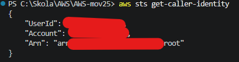
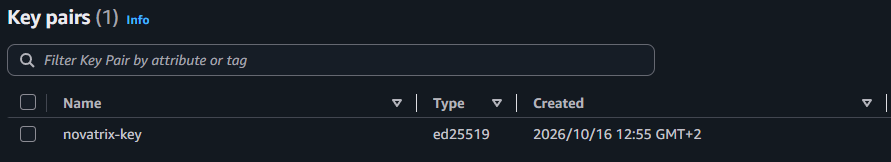
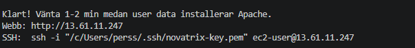
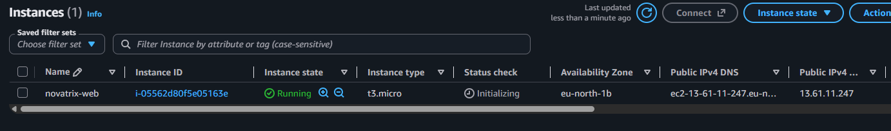
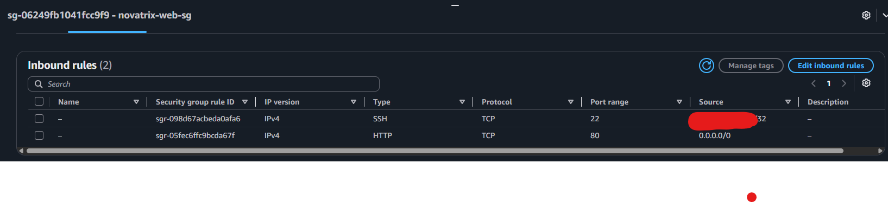
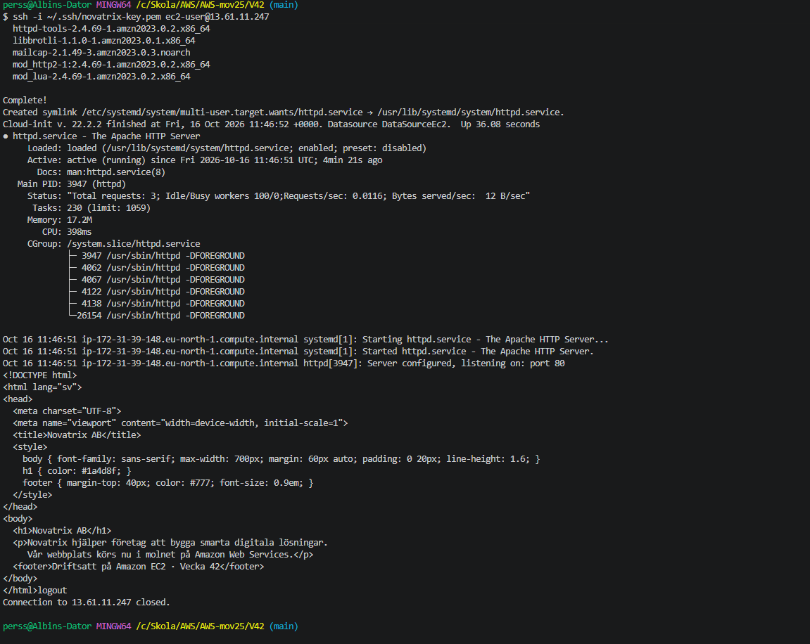
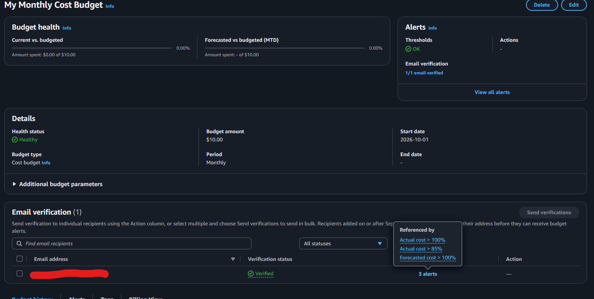
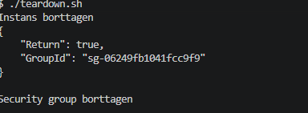

# V42 – Compute och kom igång (EC2)

**Kurs:** Amazon Web Services · **Vecka:** 42 · **Uppgift:** 1 av 8 · **Företag:** Novatrix AB

## Syfte

Novatrix AB ska flytta sin webbplats till AWS. I den här uppgiften provisioneras en virtuell
server med Amazon EC2 och en enkel webbserver driftsätts på den. Hela miljön (security group,
instans, webbserver och webbsida) sätts upp **från kod** med AWS CLI och ett user data-skript,
så att den kan återskapas från det här repot med ett enda kommando.

## Översikt

| Val | Värde | Motivering |
|-----|-------|------------|
| Region | `eu-north-1` (Stockholm) | Närmast Novatrix användare, låg latens |
| AMI | Amazon Linux 2023 | Enligt uppgiften, hämtas alltid i senaste version via SSM |
| Instanstyp | `t3.micro` | Ingår i free tier, räcker för en statisk webbsida |
| Webbserver | Apache (`httpd`) | Finns i Amazon Linux standardrepo |
| Nyckelpar | `novatrix-key` (ED25519) | Skapat manuellt så att den privata nyckeln aldrig hamnar i repot |
| Security group | `novatrix-web-sg` | SSH endast från min IP, HTTP från alla |

**Flöde:**

1. `provision.sh` körs lokalt i Git Bash och skapar security group och instans via AWS CLI.
2. Instansen kör `user-data.sh` vid första uppstarten: installerar Apache och hämtar `index.html` från GitHub.
3. Sidan nås på `http://<publik-IP>`.
4. `teardown.sh` tar bort instans och security group.

## Filer

| Fil | Beskrivning |
|-----|-------------|
| `index.html` | Novatrix webbsida |
| `user-data.sh` | Körs vid instansens start: installerar Apache och hämtar sidan |
| `provision.sh` | Skapar security group och EC2-instans |
| `teardown.sh` | Tar bort instans och security group |

---

## Delmoment 1 – Kursrepo på GitHub

Ett publikt repo skapades på GitHub och klonades lokalt. Repot innehåller en README i roten med
namn, kurs och veckoöversikt, samt en mapp per vecka.

En `.gitignore` förhindrar att privata nycklar checkas in, och en `.gitattributes` tvingar
Linux-radslut (LF) på skripten så att de fungerar även när de redigeras i Windows.

```
# .gitignore
*.pem
*.key
.aws/
.env
```

```
# .gitattributes
*.sh text eol=lf
```

**Verifiering:** Repot öppnades i ett inkognitofönster och syntes utan inloggning.


## Förberedelse – AWS CLI och nyckelpar

AWS CLI v2 installerades och inloggning gjordes med `aws login`, som använder samma
inloggning som konsolen och ger tillfälliga uppgifter. Inga långlivade access keys behövs.

```bash
winget install -e --id Amazon.AWSCLI
aws login
aws sts get-caller-identity
```



Nyckelparet `novatrix-key` (ED25519, `.pem`) skapades i EC2-konsolen i regionen
eu-north-1. Den privata nyckeln flyttades till `~/.ssh` utanför repot och låstes så att
bara min användare kan läsa den:

```powershell
mkdir $env:USERPROFILE\.ssh -Force
Move-Item $env:USERPROFILE\Downloads\novatrix-key.pem $env:USERPROFILE\.ssh\
icacls $env:USERPROFILE\.ssh\novatrix-key.pem /inheritance:r
icacls $env:USERPROFILE\.ssh\novatrix-key.pem /grant:r "$($env:USERNAME):(R)"
```

**Verifiering:**

```bash
aws ec2 describe-key-pairs --region eu-north-1 --key-names novatrix-key
```



## Delmoment 2 – Provisionera EC2-instansen

Instansen skapas med `provision.sh`. Skriptet kontrollerar först att nyckelparet finns, avbryter
om instansen redan körs, skapar (eller återanvänder) security groupen och startar sedan instansen
med `user-data.sh`. Senaste Amazon Linux 2023-AMI:n slås upp via en SSM-parameter, så att
skriptet inte är beroende av ett hårdkodat AMI-ID.

```bash
#!/bin/bash
# Skapar Novatrix webbmiljö: security group + EC2-instans med Apache och webbsida.
# Förutsätter: AWS CLI inloggat (aws login) och nyckelparet novatrix-key skapat i konsolen.
set -euo pipefail
cd "$(dirname "$0")"

REGION=eu-north-1
INSTANCE_TYPE=t3.micro
KEY_NAME=novatrix-key
KEY_PATH="$HOME/.ssh/$KEY_NAME.pem"
SG_NAME=novatrix-web-sg
TAG_NAME=novatrix-web
AMI=resolve:ssm:/aws/service/ami-amazon-linux-latest/al2023-ami-kernel-default-x86_64
MY_IP="$(curl -s https://checkip.amazonaws.com)/32"

# 1. Kontrollera nyckelparet (i AWS och lokalt)
aws ec2 describe-key-pairs --region $REGION --key-names $KEY_NAME > /dev/null \
  || { echo "Nyckelparet $KEY_NAME saknas i $REGION"; exit 1; }
[ -f "$KEY_PATH" ] || { echo "Hittar inte den privata nyckeln $KEY_PATH"; exit 1; }

# 2. Avbryt om instansen redan körs
EXISTING=$(aws ec2 describe-instances --region $REGION \
  --filters Name=tag:Name,Values=$TAG_NAME Name=instance-state-name,Values=pending,running \
  --query 'Reservations[].Instances[].InstanceId' --output text)
if [ -n "$EXISTING" ]; then
  echo "Instansen $TAG_NAME körs redan ($EXISTING). Kör ./teardown.sh först."
  exit 1
fi

# 3. Security group: återanvänd om den finns, annars skapa
SG_ID=$(aws ec2 describe-security-groups --region $REGION \
  --filters Name=group-name,Values=$SG_NAME \
  --query 'SecurityGroups[0].GroupId' --output text)

if [ "$SG_ID" = "None" ]; then
  VPC_ID=$(aws ec2 describe-vpcs --region $REGION --filters Name=isDefault,Values=true \
    --query 'Vpcs[0].VpcId' --output text)
  SG_ID=$(aws ec2 create-security-group --region $REGION --group-name $SG_NAME \
    --description "Novatrix web: SSH fran min IP, HTTP fran alla" \
    --vpc-id $VPC_ID --query GroupId --output text)
  aws ec2 authorize-security-group-ingress --region $REGION --group-id $SG_ID \
    --protocol tcp --port 22 --cidr $MY_IP > /dev/null
  aws ec2 authorize-security-group-ingress --region $REGION --group-id $SG_ID \
    --protocol tcp --port 80 --cidr 0.0.0.0/0 > /dev/null
  echo "Skapade security group $SG_ID (SSH från $MY_IP, HTTP från alla)"
else
  echo "Återanvänder security group $SG_ID"
fi

# 4. Starta instansen med user data
INSTANCE_ID=$(aws ec2 run-instances --region $REGION \
  --image-id $AMI \
  --instance-type $INSTANCE_TYPE \
  --key-name $KEY_NAME \
  --security-group-ids $SG_ID \
  --user-data file://user-data.sh \
  --tag-specifications "ResourceType=instance,Tags=[{Key=Name,Value=$TAG_NAME}]" \
  --query 'Instances[0].InstanceId' --output text)

echo "Startar $INSTANCE_ID ..."
aws ec2 wait instance-running --region $REGION --instance-ids $INSTANCE_ID

# 5. Skriv ut publik IP
IP=$(aws ec2 describe-instances --region $REGION --instance-ids $INSTANCE_ID \
  --query 'Reservations[0].Instances[0].PublicIpAddress' --output text)

echo ""
echo "Klart! Vänta 1-2 min medan user data installerar Apache."
echo "Webb: http://$IP"
echo "SSH:  ssh -i \"$KEY_PATH\" ec2-user@$IP"
```

Körning:

```bash
cd V42
./provision.sh
```



**Verifiering:** I EC2-konsolen har instansen `novatrix-web` status *Running*, typ *t3.micro*
och *2/2 status checks passed*.



### Security group

| Typ | Port | Källa | Motivering |
|-----|------|-------|------------|
| SSH | 22 | Min IP (`/32`) | Endast jag kan logga in, minskar attackytan |
| HTTP | 80 | `0.0.0.0/0` | Webbsidan ska vara publikt nåbar |

Min IP hämtas automatiskt när skriptet körs och sparas aldrig i repot.



## Delmoment 3 – Konfigurera värdmiljön

Webbservern installeras automatiskt av `user-data.sh`, som EC2 kör som root vid instansens
första uppstart. Ingen manuell installation behövs.

```bash
#!/bin/bash
# User data: installerar Apache och hämtar Novatrix webbsida från GitHub.
# Körs som root vid instansens första uppstart.
# Logg: /var/log/cloud-init-output.log

dnf update -y
dnf install -y httpd
systemctl enable --now httpd

curl -fsSL -o /var/www/html/index.html \
  https://raw.githubusercontent.com/02albper-frog/AWS-mov25/main/V42/index.html
```

`systemctl enable --now` både startar Apache direkt och ser till att tjänsten startar
automatiskt om servern startas om.

## Delmoment 4 – Driftsätt applikationen

Webbsidan `index.html` ligger i repot och hämtas av user data-skriptet till Apaches webbrot
`/var/www/html/`. Sidan har därmed en enda källa: ändras den i repot och pushas, får nästa
instans den nya versionen.

```html
<!DOCTYPE html>
<html lang="sv">
<head>
  <meta charset="UTF-8">
  <meta name="viewport" content="width=device-width, initial-scale=1">
  <title>Novatrix AB</title>
  <style>
    body { font-family: sans-serif; max-width: 700px; margin: 60px auto; padding: 0 20px; line-height: 1.6; }
    h1 { color: #1a4d8f; }
    footer { margin-top: 40px; color: #777; font-size: 0.9em; }
  </style>
</head>
<body>
  <h1>Novatrix AB</h1>
  <p>Novatrix hjälper företag att bygga smarta digitala lösningar.
     Vår webbplats körs nu i molnet på Amazon Web Services.</p>
  <footer>Driftsatt på Amazon EC2 · Vecka 42</footer>
</body>
</html>
```

## Delmoment 5 – Verifiera

**Från min dator:** `curl` mot instansens publika IP returnerar HTML-koden, vilket visar att
sidan är nåbar utifrån och inte bara inne på servern.

```bash
curl http://<publik-IP>
```


**På servern:** Via SSH kontrollerades att user data kördes klart, att Apache är aktivt och
att sidan ligger på plats.

```bash
ssh -i ~/.ssh/novatrix-key.pem ec2-user@<publik-IP>
sudo tail -n 20 /var/log/cloud-init-output.log
systemctl status httpd
cat /var/www/html/index.html
```

| Utskrift | Visar att |
|----------|-----------|
| `Cloud-init ... finished` | User data-skriptet kördes klart |
| `Loaded: ... enabled` | Apache startar automatiskt vid omstart |
| `Active: active (running)` | Webbservern körs |
| `listening on: port 80` | Apache tar emot HTTP-trafik |
| HTML-koden | Sidan hämtades från GitHub och ligger på servern |




## Delmoment 6 – Kostnadskontroll

En månadsbudget skapades i AWS Budgets med e-postlarm på både faktisk och prognostiserad kostnad.

| Inställning | Värde |
|-------------|-------|
| Namn | My Monthly Cost Budget |
| Budgettyp | Cost budget, månadsvis |
| Belopp | 10,00 USD |
| Startdatum | 2026-10-01 |
| Larm 1 | Faktisk kostnad (Actual) > 85 % |
| Larm 2 | Faktisk kostnad (Actual) > 100 % |
| Larm 3 | Prognostiserad kostnad (Forecasted) > 100 % |
| Mottagare | Min e-post (verifierad) |

Larmen kompletterar varandra:

- **Actual > 85 %** ger en tidig varning innan budgeten är förbrukad.
- **Actual > 100 %** larmar när budgeten faktiskt har överskridits.
- **Forecasted > 100 %** larmar i förväg om kostnaden ser ut att överskrida budgeten innan
  månaden är slut, så att man hinner agera innan pengarna är förbrukade.

**Verifiering:** Budgetens status är *Healthy*, alla larm står som *OK* och e-postmottagaren
är *Verified*, vilket betyder att larmen kommer fram. Hittills har 0,00 USD förbrukats,
eftersom resurserna ryms inom free tier och tas bort efter användning.



## Städning

Resurserna tas bort med `teardown.sh` när de inte används. Nyckelparet behålls eftersom det
inte kostar något och behövs vid nästa körning.

```bash
#!/bin/bash
# Tar bort Novatrix-instansen och security group. Nyckelparet behålls.
set -euo pipefail

REGION=eu-north-1
SG_NAME=novatrix-web-sg
TAG_NAME=novatrix-web

IDS=$(aws ec2 describe-instances --region $REGION \
  --filters Name=tag:Name,Values=$TAG_NAME \
            Name=instance-state-name,Values=pending,running,stopping,stopped \
  --query 'Reservations[].Instances[].InstanceId' --output text)

if [ -n "$IDS" ]; then
  aws ec2 terminate-instances --region $REGION --instance-ids $IDS > /dev/null
  echo "Terminerar $IDS ..."
  aws ec2 wait instance-terminated --region $REGION --instance-ids $IDS
  echo "Instans borttagen"
else
  echo "Ingen instans att ta bort"
fi

aws ec2 delete-security-group --region $REGION --group-name $SG_NAME 2> /dev/null \
  && echo "Security group borttagen" \
  || echo "Ingen security group att ta bort"
```



**Verifiering:** Instansen har status *Terminated*, volymen är raderad och security groupen
är borttagen. Endast nyckelparet finns kvar.


---

## Återskapa miljön (VG)

Hela miljön kan återskapas från repot.

**Förutsättningar:**

- AWS CLI v2 installerat och inloggat med `aws login` (region `eu-north-1`)
- Nyckelpar `novatrix-key` skapat i EC2-konsolen, privat nyckel i `~/.ssh/novatrix-key.pem`
- Git Bash (Windows) eller terminal (Mac/Linux)

**Steg:**

```bash
git clone https://github.com/02albper-frog/AWS-mov25.git
cd AWS-mov25/V42
chmod +x provision.sh teardown.sh
./provision.sh      # skapar security group, instans, webbserver och sida
./teardown.sh       # tar bort instans och security group
```

## Reflektion

- **Säkerhet:** SSH är begränsat till en enda IP-adress. Den privata nyckeln ligger i `~/.ssh`
  utanför repot, och `.gitignore` ger ett extra skydd mot att nycklar checkas in av misstag.
  Inloggningen till AWS sker med tillfälliga uppgifter via `aws login` i stället för
  långlivade access keys. I den här uppgiften används root-kontot; i en riktig miljö hos
  Novatrix bör arbetet i stället göras med en IAM-användare eller roll som bara har de
  behörigheter som behövs (least privilege).
- **Kostnad:** `t3.micro` ingår i free tier. Budgeten med tre larm (85 % och 100 % av
  faktisk kostnad samt 100 % av prognos) ger förvarning i flera steg, och `teardown.sh` gör
  det enkelt att ta bort allt när miljön inte används.
- **Automatisering:** Eftersom allt skapas från kod blir miljön likadan varje gång. Det är
  ett första steg mot Infrastructure as Code, som byggs vidare på i v46 med ett riktigt
  IaC-verktyg.