# V43 – IAM och identitet

**Kurs:** Amazon Web Services · **Vecka:** 43 · **Uppgift:** 2 av 8 · **Företag:** Novatrix AB

## Syfte

Novatrix behöver styra vem och vad som får göra vad i AWS, både människor och tjänster.
I den här uppgiften sätts IAM upp enligt **least privilege**: varje identitet får precis den
åtkomst den behöver, inte mer. Lösningen bygger vidare på webbservern från v42, men i stället
för att hämta webbsidan från GitHub hämtar servern den nu från en S3-bucket med hjälp av en
IAM-roll. Hela uppsättningen skapas från kod med AWS CLI och kan återskapas från repot.

## Översikt

Lösningen är en kedja där varje länk bara har den behörighet som krävs för just sitt steg:

```
Utvecklare ──laddar upp──▶ S3: web/ ──läses av──▶ EC2 (via roll) ──skriver──▶ S3: logs/ ──läses av──▶ Drift
```

| Identitet | Typ | Får | Får inte |
|-----------|-----|-----|----------|
| `novatrix-utveckling` (`anna-dev`) | Grupp + användare | Läsa, skriva och radera i `web/` | Röra EC2, läsa loggar, ändra bucketen |
| `novatrix-drift` (`erik-drift`) | Grupp + användare | Hantera EC2 i Stockholm, lämna över webbrollen till EC2, läsa `logs/` | Ändra webbsidan, använda andra regioner, lämna över andra roller |
| `novatrix-web-ec2-role` | Roll för EC2 | Läsa `web/`, skriva till `logs/` | Ändra eller radera webbsidan, läsa loggar, lista buckets |
| `novatrix-admin` (`albin-admin`) | Grupp + användare | Admin kontot | – (används i stället för root) |

## Filer

| Fil | Beskrivning |
|-----|-------------|
| [`config.sh`](config.sh) | Gemensamma namn och inställningar för alla skript |
| [`policies/`](policies/) | De fyra policydokumenten i JSON |
| [`setup-iam.sh`](setup-iam.sh) | Skapar bucket, policies, grupper, användare och roll |
| [`verify-iam.sh`](verify-iam.sh) | Testar behörigheterna med IAM Policy Simulator |
| [`provision.sh`](provision.sh) | Startar webbservern med rollen |
| [`user-data.sh`](user-data.sh) | Hämtar sidan från S3 och skriver installationsloggen till S3 |
| [`teardown.sh`](teardown.sh) | Tar bort instans och security group |
| [`teardown-iam.sh`](teardown-iam.sh) | Tar bort IAM-resurser och bucket |
| [`index.html`](index.html) | Novatrix webbsida |

---

## Delmoment 1 – Repo

Mappen `V43` skapades i kursrepot och README:n i roten uppdaterades med veckans uppgift.
Alla namn (bucket, roll, grupper, användare och policies) samlades i `config.sh`, så att de
bara finns på ett ställe. Policyerna innehåller platshållare (`__BUCKET__`, `__REGION__` och
`__ACCOUNT_ID__`) som fylls i när skriptet körs, så att konto-ID:t aldrig hamnar i repot.

## Förberedelse – sluta använda root

Innan miljön sattes upp skapades en administratörsanvändare i konsolen, så att root-kontot
inte längre används för vardagsarbete. AWS rekommenderar att root bara används för de få
uppgifter som kräver det.

- Gruppen `novatrix-admin` fick den AWS-hanterade policyn `AdministratorAccess`.
- Användaren `albin-admin` lades i gruppen, fick konsolinloggning och **MFA**.
- IAM-användare fick tillgång till fakturering (*IAM user and role access to Billing
  information*), så att budgeten kan ses utan root.

Behörigheten kopplades till gruppen och inte direkt till användaren. Om fler administratörer
behövs läggs de bara till i gruppen.

**Verifiering:** CLI loggades in på nytt med `aws login`, och `Arn` slutar nu på
`:user/albin-admin` i stället för `:root`.


## Delmoment 2 – Användare och grupper

Två grupper skapades som representerar Novatrix roller, med en testanvändare i varje.
Behörigheterna kopplas till grupperna, aldrig till användarna. En ny utvecklare får rätt
åtkomst genom att läggas i gruppen, och åtkomsten försvinner när hen tas bort ur gruppen.

| Grupp | Användare | Policy |
|-------|-----------|--------|
| `novatrix-utveckling` | `anna-dev` | `novatrix-utveckling-policy` |
| `novatrix-drift` | `erik-drift` | `novatrix-drift-policy` |

Testanvändarna har **inga inloggningsuppgifter**, varken lösenord eller access keys. De behövs
inte för att verifiera behörigheterna, eftersom testerna görs med IAM Policy Simulator. Varje
inloggningsuppgift som inte finns är en uppgift som inte kan läcka. I en riktig miljö skulle
användarna få konsolinloggning med krav på MFA.

```bash
cd V43
./setup-iam.sh
```

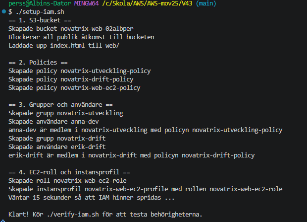

I IAM-konsolen syns de tre användarna. Kolumnen *Groups* visar att alla är medlemmar i en
grupp, som de får sina behörigheter från. Testanvändarna `anna-dev` och `erik-drift` har
ingen aktivitet och ingen MFA, eftersom de saknar lösenord och access keys och därför inte
kan logga in. De används bara för att testa policyerna i simulatorn.

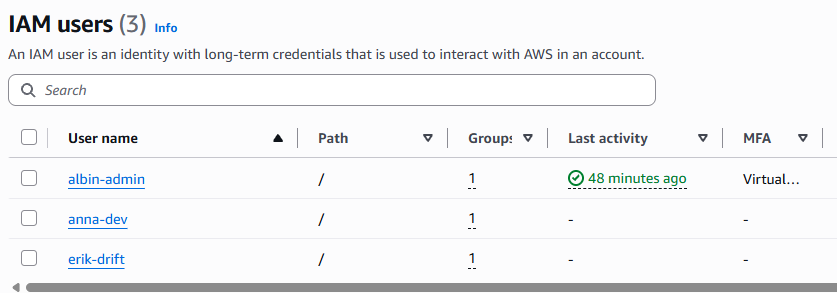

## Delmoment 3 – Policies enligt least privilege

Alla policies är **customer managed**. De kan återanvändas, versionshanteras och syns
tydligt i konsolen, till skillnad från inline-policies som är inbakade i en enskild identitet.

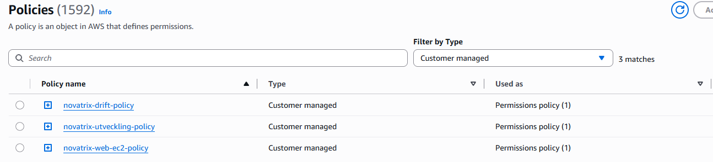

### Utveckling

Utvecklare ska kunna publicera webbsidan och inget annat.

```json
{
  "Version": "2012-10-17",
  "Statement": [
    {
      "Sid": "ListaEndastWebbmappen",
      "Effect": "Allow",
      "Action": "s3:ListBucket",
      "Resource": "arn:aws:s3:::__BUCKET__",
      "Condition": {
        "StringLike": { "s3:prefix": ["web/", "web/*"] }
      }
    },
    {
      "Sid": "HanteraWebbinnehall",
      "Effect": "Allow",
      "Action": ["s3:GetObject", "s3:PutObject", "s3:DeleteObject"],
      "Resource": "arn:aws:s3:::__BUCKET__/web/*"
    }
  ]
}
```

| Val | Motivering |
|-----|------------|
| Endast prefixet `web/` | Utvecklare ska inte kunna läsa driftloggar eller lägga filer på andra ställen |
| `ListBucket` med villkor på `s3:prefix` | Det går att se innehållet i `web/` men inte resten av bucketen |
| Ingen EC2- eller IAM-behörighet | Utvecklare publicerar innehåll; att starta servrar är driftens ansvar |

### Drift

Drift ska kunna starta och riva webbservern och läsa dess loggar.

```json
{
  "Version": "2012-10-17",
  "Statement": [
    {
      "Sid": "EC2LasEndastStockholm",
      "Effect": "Allow",
      "Action": "ec2:Describe*",
      "Resource": "*",
      "Condition": {
        "StringEquals": { "aws:RequestedRegion": "__REGION__" }
      }
    },
    {
      "Sid": "EC2ProvisioneraEndastStockholm",
      "Effect": "Allow",
      "Action": [
        "ec2:RunInstances",
        "ec2:CreateSecurityGroup",
        "ec2:AuthorizeSecurityGroupIngress",
        "ec2:DeleteSecurityGroup"
      ],
      "Resource": "*",
      "Condition": {
        "StringEquals": { "aws:RequestedRegion": "__REGION__" }
      }
    },
    {
      "Sid": "EC2TaggaEndastVidStart",
      "Effect": "Allow",
      "Action": "ec2:CreateTags",
      "Resource": "*",
      "Condition": {
        "StringEquals": { "ec2:CreateAction": "RunInstances" }
      }
    },
    {
      "Sid": "EC2HanteraEndastNovatrixServern",
      "Effect": "Allow",
      "Action": ["ec2:StartInstances", "ec2:StopInstances", "ec2:TerminateInstances"],
      "Resource": "*",
      "Condition": {
        "StringEquals": { "ec2:ResourceTag/Name": "novatrix-web" }
      }
    },
    {
      "Sid": "HamtaSenasteAmazonLinux",
      "Effect": "Allow",
      "Action": "ssm:GetParameters",
      "Resource": "arn:aws:ssm:__REGION__::parameter/aws/service/ami-amazon-linux-latest/*"
    },
    {
      "Sid": "LamnaOverEndastWebbrollenTillEC2",
      "Effect": "Allow",
      "Action": "iam:PassRole",
      "Resource": "arn:aws:iam::__ACCOUNT_ID__:role/novatrix-web-ec2-role",
      "Condition": {
        "StringEquals": { "iam:PassedToService": "ec2.amazonaws.com" }
      }
    },
    {
      "Sid": "LasWebbservernsInstansprofil",
      "Effect": "Allow",
      "Action": "iam:GetInstanceProfile",
      "Resource": "arn:aws:iam::__ACCOUNT_ID__:instance-profile/novatrix-web-ec2-profile"
    },
    {
      "Sid": "ListaEndastLoggmappen",
      "Effect": "Allow",
      "Action": "s3:ListBucket",
      "Resource": "arn:aws:s3:::__BUCKET__",
      "Condition": {
        "StringLike": { "s3:prefix": ["logs/", "logs/*"] }
      }
    },
    {
      "Sid": "LasLoggar",
      "Effect": "Allow",
      "Action": "s3:GetObject",
      "Resource": "arn:aws:s3:::__BUCKET__/logs/*"
    }
  ]
}
```

| Val | Motivering |
|-----|------------|
| `aws:RequestedRegion` = eu-north-1 | Novatrix kör i Stockholm. Servrar i andra regioner kan inte startas av misstag och glömmas bort |
| Tagg-villkor på stop/terminate | Drift kan bara stänga av webbservern, inte andra instanser i kontot |
| `CreateTags` bara vid `RunInstances` | Taggar kan sättas när instansen skapas men inte ändras i efterhand, så tagg-villkoret ovan går inte att kringgå |
| `iam:PassRole` på exakt en roll, bara till EC2 | Se nedan |
| `ssm:GetParameters` på AMI-parametrarna | Behövs för att hämta senaste Amazon Linux, och inget annat i SSM |
| Läsa `logs/` men inte skriva i `web/` | Drift felsöker servern men ändrar inte innehållet |

**Varför `iam:PassRole` är viktigast:** när någon startar en EC2-instans med en roll "lämnar
de över" rollen till instansen. Utan begränsning skulle drift kunna starta en instans med en
roll som har mer behörighet än de själva har, till exempel `AdministratorAccess`, och sedan
logga in på instansen och använda den. Det kallas **privilege escalation**. Genom att bara
tillåta exakt webbrollen, och bara till tjänsten EC2, är den vägen stängd.

## Delmoment 4 – Behörigheter mellan tjänster

Webbservern (EC2) behöver nå S3 för att hämta webbsidan och spara sin installationslogg.
Det löses med en **IAM-roll** i stället för access keys på servern. Rollen ger servern
tillfälliga uppgifter som roteras automatiskt, och det finns inga nycklar som kan läcka
eller glömmas på disken.

En roll består av två delar.

**Trust policy – vem får använda rollen?** Bara tjänsten EC2.

```json
{
  "Version": "2012-10-17",
  "Statement": [
    {
      "Sid": "EndastEC2FarAnvandaRollen",
      "Effect": "Allow",
      "Principal": { "Service": "ec2.amazonaws.com" },
      "Action": "sts:AssumeRole"
    }
  ]
}
```

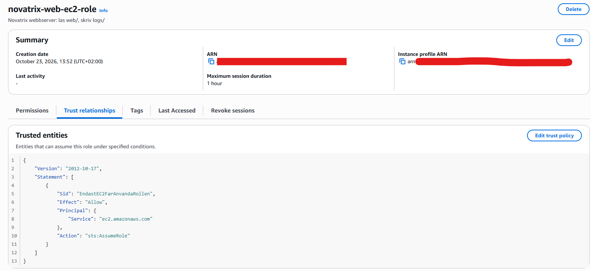

**Behörighetspolicy – vad får rollen göra?** Läsa `web/` och skriva till `logs/`.

```json
{
  "Version": "2012-10-17",
  "Statement": [
    {
      "Sid": "LasWebbsidan",
      "Effect": "Allow",
      "Action": "s3:GetObject",
      "Resource": "arn:aws:s3:::__BUCKET__/web/*"
    },
    {
      "Sid": "SkrivLoggar",
      "Effect": "Allow",
      "Action": "s3:PutObject",
      "Resource": "arn:aws:s3:::__BUCKET__/logs/*"
    }
  ]
}
```

| Val | Motivering |
|-----|------------|
| Bara `GetObject` på `web/` | Servern ska visa sidan, inte ändra den. Om servern blir hackad kan angriparen inte byta ut webbsidan |
| Bara `PutObject` på `logs/` | Servern kan lämna loggar men inte läsa eller radera dem, så en angripare kan inte sopa igen spåren |
| Ingen `ListBucket` | Servern vet vilken fil den ska hämta och behöver inte kunna se vad som finns i bucketen |

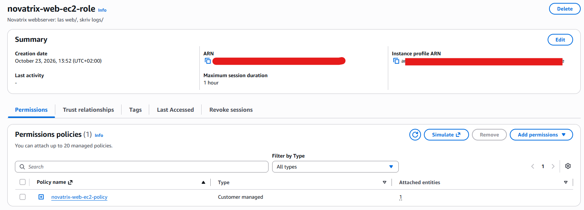

Rollen kopplas till instansen via en **instansprofil** (`novatrix-web-ec2-profile`).
`provision.sh` startar instansen med `--iam-instance-profile`, och `user-data.sh` använder
sedan rollen för att hämta sidan:

```bash
# Läs webbsidan från S3 (rollen tillåter s3:GetObject på web/*)
aws s3 cp "s3://$BUCKET/web/index.html" /var/www/html/index.html

# Skriv installationsloggen till S3 (rollen tillåter s3:PutObject på logs/*)
INSTANCE_ID=$(ec2-metadata --instance-id | cut -d' ' -f2)
aws s3 cp /var/log/cloud-init-output.log "s3://$BUCKET/logs/$INSTANCE_ID-cloud-init.log"
```

### S3-bucketen

Bucketen blockerar **all publik åtkomst**. Webbservern når innehållet enbart genom sin roll,
inte för att filerna är öppna för internet.

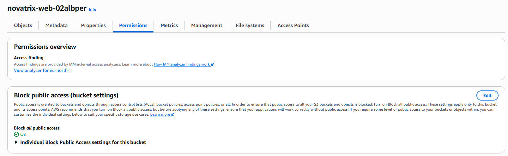

Filen `web/index.html` har inga publika behörigheter: varken *Everyone* eller
*Authenticated users* har någon åtkomst. Inställningen *bucket owner enforced* betyder att
ACL:er är avstängda och att åtkomsten styrs helt av IAM-policies.

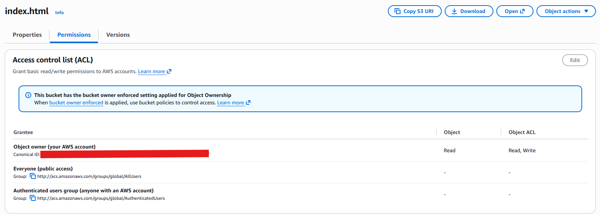

## Delmoment 5 – Verifiera

Behörigheterna verifierades på tre sätt: med policy-simulatorn, med riktiga anrop från
servern och genom att kontrollera att loggkedjan fungerar.

### 1. IAM Policy Simulator

`verify-iam.sh` testar varje identitet mot ett antal åtgärder med
`aws iam simulate-principal-policy` och jämför med förväntat resultat. Testerna visar både att
rätt saker är **tillåtna** och att fel saker **nekas**. Det senare är minst lika viktigt för
least privilege.

```bash
./verify-iam.sh
```

| Identitet | Tillåtet | Nekat |
|-----------|----------|-------|
| `anna-dev` | Skriva, läsa och lista i `web/` | Lista eller läsa `logs/`, radera bucketen, starta EC2, lämna över roller |
| `erik-drift` | Starta EC2 i Stockholm, terminera webbservern, lämna över webbrollen till EC2, läsa `logs/` | Starta EC2 i us-east-1, terminera andra instanser, lämna över andra roller, skriva i `web/` |
| `novatrix-web-ec2-role` | Läsa `web/`, skriva till `logs/` | Skriva i eller radera från `web/`, läsa `logs/`, lista bucketen eller alla buckets |

Alla 23 tester gav förväntat resultat.

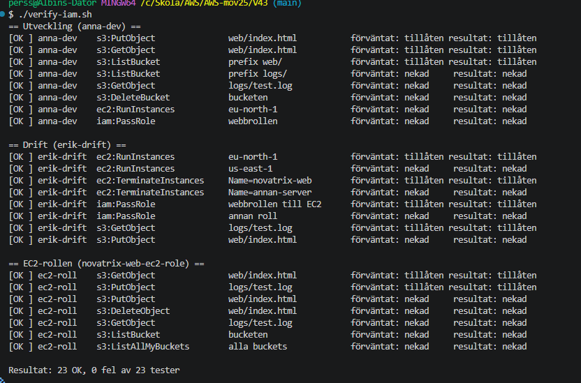

### 2. Riktiga anrop från servern

Webbservern startades med rollen:

```bash
./provision.sh
```

Sidan hämtades från S3 med rollen och visas på instansens publika IP. Sidfoten bekräftar
att det är versionen från bucketen:

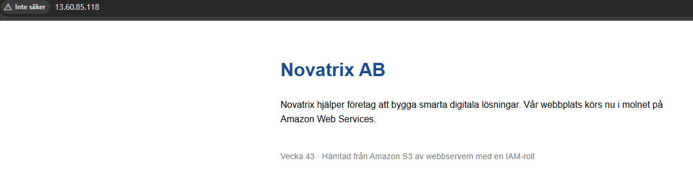

Via SSH testades rollen direkt från servern. Konto-ID:t maskerades i utskriften med `sed`.

```bash
aws sts get-caller-identity
aws s3 cp s3://$B/web/index.html - | head -n 5
echo test | aws s3 cp - s3://$B/web/hack.html
echo test | aws s3 cp - s3://$B/logs/test.log
aws s3 ls
aws s3 rm s3://$B/web/index.html
```

| Test | Resultat | Visar att |
|------|----------|-----------|
| `get-caller-identity` | `assumed-role/novatrix-web-ec2-role/i-...` | Servern har rollens identitet, utan lagrade nycklar |
| Läsa `web/index.html` | Fungerar | Rollen får läsa webbsidan |
| Skriva `web/hack.html` | AccessDenied | Rollen kan inte ändra webbsidan |
| Skriva `logs/test.log` | Fungerar | Rollen får skriva loggar |
| `aws s3 ls` | AccessDenied | Rollen kan inte se vilka buckets som finns |
| Radera `web/index.html` | AccessDenied | Rollen kan inte radera något |

Felmeddelandena säger *"because no identity-based policy allows ..."*. Det betyder att
åtgärden inte är förbjuden av någon regel, utan nekas för att ingen policy tillåter den. Det
kallas **implicit deny** och är grunden i least privilege: allt som inte uttryckligen är
tillåtet är förbjudet.

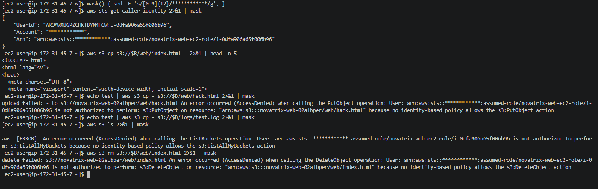

### 3. Loggkedjan

Från administratörens dator syns både loggen som servern skrev vid uppstarten och testfilen
från SSH-testet. Det visar att hela kedjan fungerar: utvecklare → `web/` → EC2 → `logs/` → drift.

```bash
aws s3 ls s3://novatrix-web-02albper/logs/
```

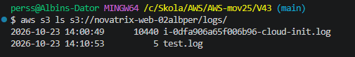

## Städning

Resurserna togs bort i två steg. Först instansen, eftersom rollen inte kan tas bort medan en
instans använder den, och sedan IAM-resurserna och bucketen.

```bash
./teardown.sh
./teardown-iam.sh
```

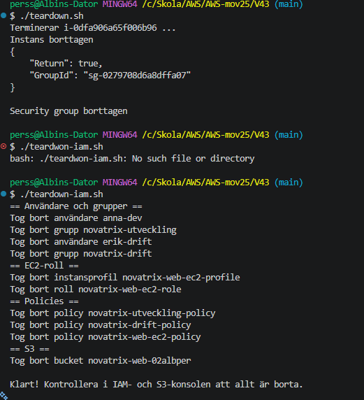

**Verifiering:** Efter städningen finns bara `albin-admin` och gruppen `novatrix-admin`
kvar. Inga instanser körs, inga egna policies finns och inga buckets finns kvar.

```bash
aws ec2 describe-instances --region eu-north-1 \
  --filters Name=instance-state-name,Values=pending,running,stopping,stopped \
  --query 'Reservations[].Instances[].InstanceId' --output text
aws iam list-users --query 'Users[].UserName' --output text
aws iam list-groups --query 'Groups[].GroupName' --output text
aws iam list-policies --scope Local --query 'Policies[].PolicyName' --output text
aws s3 ls
```

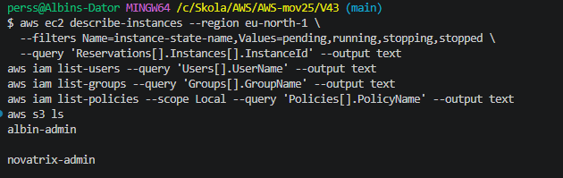

Kvar finns bara det som inte skapades av skripten: `albin-admin`, gruppen `novatrix-admin`,
nyckelparet `novatrix-key` och budgeten. AWS egna service-linked roles
(`AWSServiceRoleFor...`) lämnades orörda.

---

## Återskapa lösningen (VG)

Hela uppsättningen kan återskapas från repot.

**Förutsättningar:**

- AWS CLI v2 inloggat med `aws login` som en användare med administratörsbehörighet
- Nyckelparet `novatrix-key` i eu-north-1, med den privata nyckeln i `~/.ssh/novatrix-key.pem`
- Ett eget, globalt unikt bucketnamn i `config.sh`
- Git Bash (Windows) eller terminal (Mac/Linux)

**Steg:**

```bash
git clone https://github.com/02albper-frog/AWS-mov25.git
cd AWS-mov25/V43
./setup-iam.sh      # bucket, policies, grupper, användare och roll
./verify-iam.sh     # 23 tester av behörigheterna
./provision.sh      # webbservern med rollen
./teardown.sh       # tar bort instans och security group
./teardown-iam.sh   # tar bort IAM-resurser och bucket
```

Skripten kontrollerar om resurserna redan finns och kan därför köras flera gånger utan fel.
Alla skript sätter `MSYS_NO_PATHCONV=1`, så att Git Bash på Windows inte tolkar argument
som sökvägar.

## Designmotivering (VG)

Lösningen består av flera samverkande identiteter, där varje steg i kedjan bara får det
den behöver:

1. **Utvecklare** kan skriva i `web/` men inte röra servern. De kan inte påverka driften.
2. **Drift** kan starta servern med exakt en roll, men kan inte ändra webbsidan. De kan inte
   heller ge servern mer behörighet än webbrollen har.
3. **Webbservern** kan läsa sidan och skriva loggar men inte ändra något. Om servern skulle
   bli hackad kan angriparen varken byta ut sidan eller radera loggarna.
4. **Drift** kan läsa loggarna för att felsöka, men utvecklarna kan inte.

Bucketen är uppdelad i två prefix, `web/` och `logs/`, med olika ägare. Det gör att samma
bucket kan användas av flera roller utan att de kommer åt varandras data. Ingen identitet har
`s3:*`, `ec2:*` eller `iam:*`, och alla resurser är så snävt angivna som möjligt.

## Reflektion

- **Begränsningar:** Några EC2-åtgärder har `"Resource": "*"`, men de är begränsade till
  regionen med `aws:RequestedRegion`. `RunInstances` behöver åtkomst till flera resurstyper
  (AMI, subnät, volym, nätverkskort), och att peka ut alla var för sig skulle göra policyn
  svårläst för en liten vinst. Drift kan också ta bort vilken security group som helst i
  regionen. En möjlig förbättring är att tagga security groupen och lägga till ett
  tagg-villkor, på samma sätt som för instansen.
- **Nästa steg:** I en riktig miljö skulle användarna få konsolinloggning med MFA som krav i
  policyn (`aws:MultiFactorAuthPresent`). Man kan också använda *permissions boundaries* för
  att sätta ett tak för vad en grupp någonsin kan få, även om någon råkar lägga till en för
  bred policy.
- **Lärdom:** Att verifiera vad som *nekas* är lika viktigt som att verifiera vad som
  fungerar. Ett skript som `verify-iam.sh` gör det möjligt att upptäcka direkt om en
  ändring i en policy råkar öppna för mer än det var tänkt.