# V44 – Nätverk och säkerhet

**Kurs:** Amazon Web Services · **Vecka:** 44 · **Uppgift:** 3 av 8 · **Företag:** Novatrix AB

## Syfte

Novatrix lösning behöver ett säkert nätverk. I den här uppgiften flyttas webbservern från
standard-VPC:t till ett eget VPC som byggs **helt som kod** med AWS CLI. Nätverket är
segmenterat i flera subnät och skyddas av flera lager enligt **defense in depth**: route
tables, NACL:er, security groups, en bastion för administrativ åtkomst och begränsad
utgående trafik. Privata subnät förbereds för databasen som kommer i v45.

Lösningen bygger vidare på webbservern från v42 och IAM-modellen från v43, som båda ingår i
den här mappen så att hela miljön kan byggas upp från ett ställe.

## Nätverksskiss

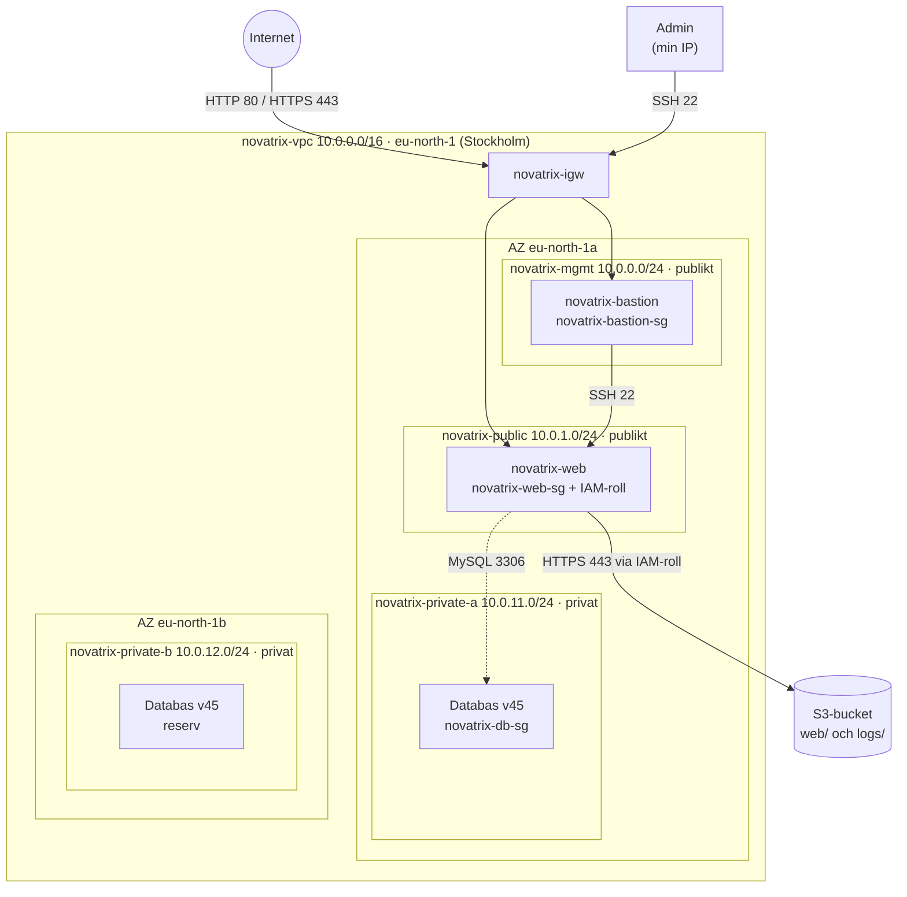

| Resurs | Namn | Detaljer |
|--------|------|----------|
| VPC | `novatrix-vpc` | 10.0.0.0/16 i eu-north-1 |
| Internet gateway | `novatrix-igw` | Kopplad till VPC:t |
| Publikt subnät | `novatrix-public` | 10.0.1.0/24, eu-north-1a, webbservern `novatrix-web` |
| Publikt subnät | `novatrix-mgmt` | 10.0.0.0/24, eu-north-1a, bastion `novatrix-bastion` |
| Privat subnät | `novatrix-private-a` | 10.0.11.0/24, eu-north-1a, tomt och väntar på databasen |
| Privat subnät | `novatrix-private-b` | 10.0.12.0/24, eu-north-1b, tomt och väntar på databasen |
| Route table | `novatrix-public-rt` | `0.0.0.0/0 → novatrix-igw` för `novatrix-mgmt` och `novatrix-public` |
| Route table | `novatrix-private-rt` | Endast `local` för `novatrix-private-a/-b` |
| NACL:er | `novatrix-public-nacl`, `novatrix-mgmt-nacl`, `novatrix-private-nacl` | En per typ av subnät |
| Security groups | `novatrix-web-sg`, `novatrix-bastion-sg`, `novatrix-db-sg` | En per typ av server |

## Filer

| Fil | Beskrivning |
|-----|-------------|
| [`config.sh`](config.sh) | Alla namn, CIDR-block och hjälpfunktioner på ett ställe |
| [`network.sh`](network.sh) | Bygger VPC, subnät, routing, NACL:er och security groups |
| [`provision.sh`](provision.sh) | Startar bastion och webbserver i VPC:t |
| [`user-data-web.sh`](user-data-web.sh) | Installerar Apache med HTTP/HTTPS och hämtar sidan från S3 |
| [`verify-network.sh`](verify-network.sh) | Testar vilken trafik som släpps igenom och vilken som blockeras |
| [`teardown.sh`](teardown.sh) | Tar bort servrarna |
| [`teardown-network.sh`](teardown-network.sh) | Tar bort nätverket i rätt ordning |
| [`setup-iam.sh`](setup-iam.sh) / [`verify-iam.sh`](verify-iam.sh) / [`teardown-iam.sh`](teardown-iam.sh) | IAM och S3 från v43 |
| [`policies/`](policies/) | IAM-policydokumenten (driftpolicyn uppdaterad för v44) |
| [`index.html`](index.html) | Novatrix webbsida |

---

## Delmoment 1 – Repo

Mappen `V44` skapades i kursrepot och README:n i roten uppdaterades. Alla filer från v43
kopierades in, så att IAM, nätverk och servrar kan byggas upp från samma mapp. Alla namn
samlades i `config.sh` och följer kursens namnstandard, som används resten av kursen.

### Förberedelse – IAM från v43

IAM-resurserna och bucketen från v43 byggdes upp igen. En ändring gjordes i driftpolicyn:
drift får inte längre skapa security groups eller VPC:er, eftersom nätverket nu ägs av
administratören och byggs som kod. Drift får i stället hantera både webbservern och bastion.

```json
{
  "Sid": "EC2HanteraEndastNovatrixServrar",
  "Effect": "Allow",
  "Action": ["ec2:StartInstances", "ec2:StopInstances", "ec2:TerminateInstances"],
  "Resource": "*",
  "Condition": {
    "StringEquals": { "ec2:ResourceTag/Name": ["novatrix-web", "novatrix-bastion"] }
  }
}
```

```bash
./setup-iam.sh
./verify-iam.sh
```

Alla 26 tester gav förväntat resultat, inklusive de nya testerna som visar att drift nekas
`ec2:CreateSecurityGroup` och `ec2:CreateVpc`.

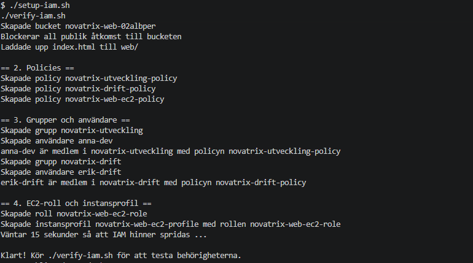

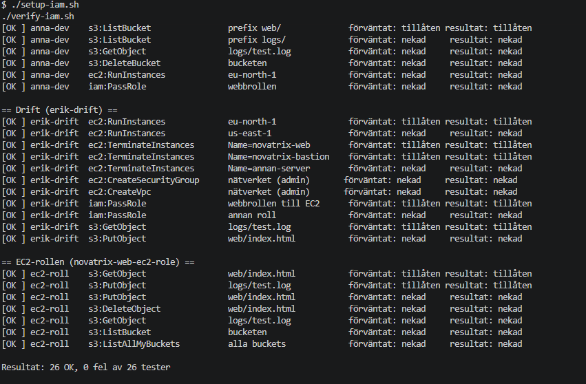

## Delmoment 2 – Bygg VPC:t

Hela nätverket byggs av `network.sh`. Namn och adresser hämtas från `config.sh`:

```bash
VPC_NAME=novatrix-vpc
VPC_CIDR=10.0.0.0/16

MGMT_SUBNET=novatrix-mgmt;        MGMT_CIDR=10.0.0.0/24    # bastion (publikt)
WEB_SUBNET_A=novatrix-public;     WEB_CIDR_A=10.0.1.0/24   # webbserver (publikt)
DB_SUBNET_A=novatrix-private-a;   DB_CIDR_A=10.0.11.0/24   # databas (privat)
DB_SUBNET_B=novatrix-private-b;   DB_CIDR_B=10.0.12.0/24   # databas (privat, andra AZ)
```

```bash
./network.sh
```

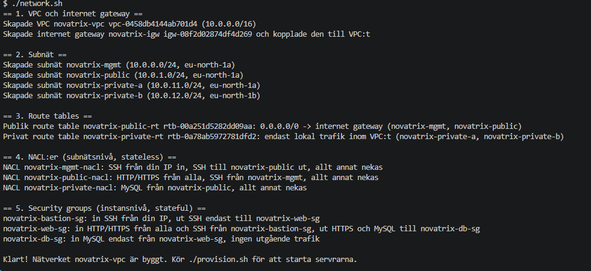

Skriptet bygger nätverket i fem steg.

**1. VPC och internet gateway.** VPC:t är ett isolerat nätverk med adressrymden
10.0.0.0/16. Internet gateway `novatrix-igw` är dörren till internet, men den används bara
av de subnät vars route table pekar på den.

**2. Subnät.** VPC:t delas upp i fyra subnät, ett per funktion. Bastion och webbserver
ligger i varsitt publikt subnät, och de två privata subnäten ligger i olika
tillgänglighetszoner, eftersom RDS kräver det för att databasen ska klara ett avbrott i en zon.

**3. Route tables.** Det är route tablen som avgör om ett subnät är publikt eller privat.
`novatrix-public-rt` har vägen `0.0.0.0/0 → novatrix-igw`. `novatrix-private-rt` har bara
den lokala vägen inom VPC:t, så de privata subnäten kan varken nås från eller nå internet.

**4. NACL:er** och **5. security groups** beskrivs under delmoment 3.

Alla resurser taggas med `Name` och `Project=novatrix`, så att de syns med namn i konsolen
och kan hittas av skripten.

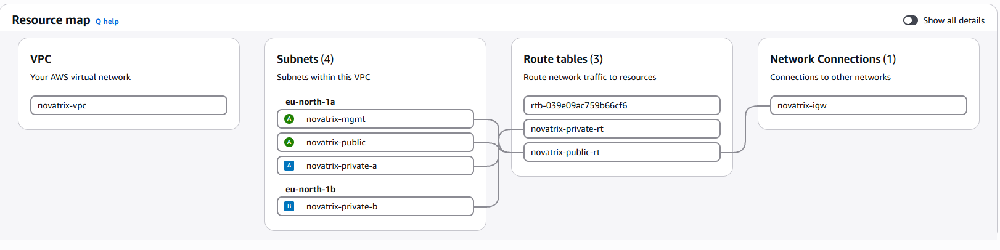

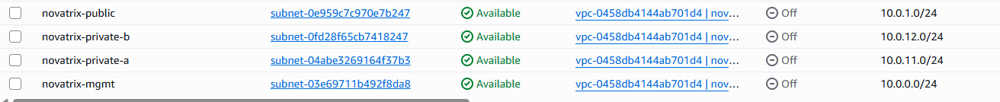

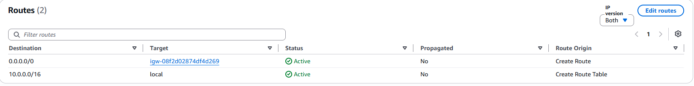

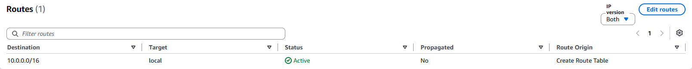

## Delmoment 3 – Säkra trafiken

Trafiken filtreras i två lager som arbetar på olika nivåer:

| | NACL | Security group |
|---|------|----------------|
| Nivå | Subnät | Enskild server |
| Tillstånd | Stateless – svarstrafik måste tillåtas uttryckligen | Stateful – svar tillåts automatiskt |
| Regler | Allow och deny, läses i nummerordning | Bara allow |
| Kan referera till | IP-adresser och CIDR-block | IP-adresser och andra security groups |

### NACL:er

Eftersom NACL:er är stateless måste svaren tillbaka till klienten, som går till en
slumpmässig port mellan 1024 och 65535 (*ephemeral ports*), tillåtas uttryckligen. Allt som
inte matchar en regel nekas av standardregeln `*`.

| NACL | In | Ut |
|------|----|----|
| `novatrix-public-nacl` | 80 och 443 från alla, 22 från `novatrix-mgmt`, 1024–65535 från alla | 1024–65535 till alla, 443 till alla, 3306 till de privata subnäten |
| `novatrix-mgmt-nacl` | 22 från min IP, 1024–65535 från `novatrix-public` | 1024–65535 till min IP, 22 till `novatrix-public` |
| `novatrix-private-nacl` | 3306 från `novatrix-public` | 1024–65535 till `novatrix-public` |

```bash
# novatrix-public-nacl (webbserver): HTTP/HTTPS från alla, SSH endast från novatrix-mgmt
nacl_rule "$WEB_NACL_ID" in  100 0.0.0.0/0    80   80        # HTTP
nacl_rule "$WEB_NACL_ID" in  110 0.0.0.0/0    443  443       # HTTPS
nacl_rule "$WEB_NACL_ID" in  120 "$MGMT_CIDR" 22   22        # SSH endast från bastion-subnätet
nacl_rule "$WEB_NACL_ID" in  130 0.0.0.0/0    1024 65535     # svar på serverns egna anrop
nacl_rule "$WEB_NACL_ID" out 100 0.0.0.0/0    1024 65535     # svar till besökare och bastion
nacl_rule "$WEB_NACL_ID" out 110 0.0.0.0/0    443  443       # HTTPS ut (S3, paketförråd)
nacl_rule "$WEB_NACL_ID" out 120 "$DB_CIDR_A" 3306 3306      # MySQL till databasen (v45)
nacl_rule "$WEB_NACL_ID" out 130 "$DB_CIDR_B" 3306 3306
```

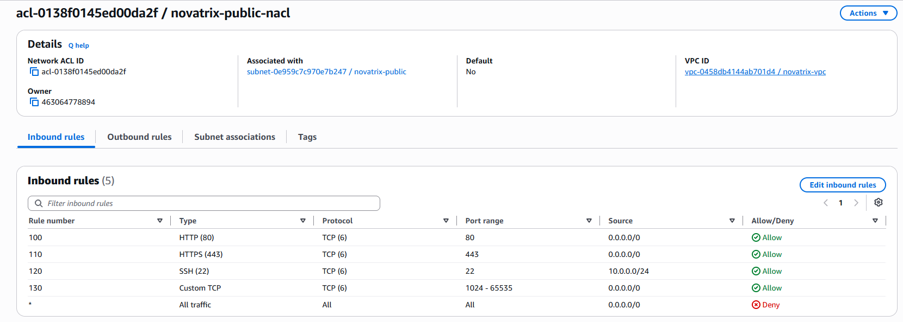

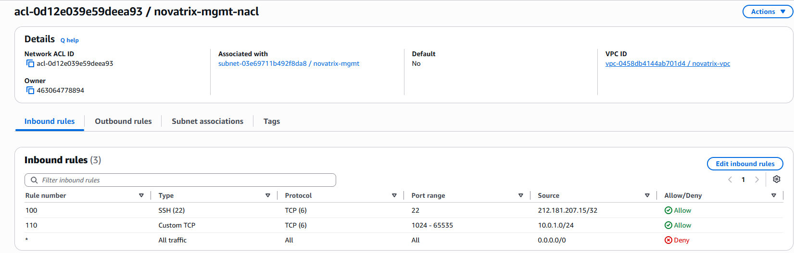

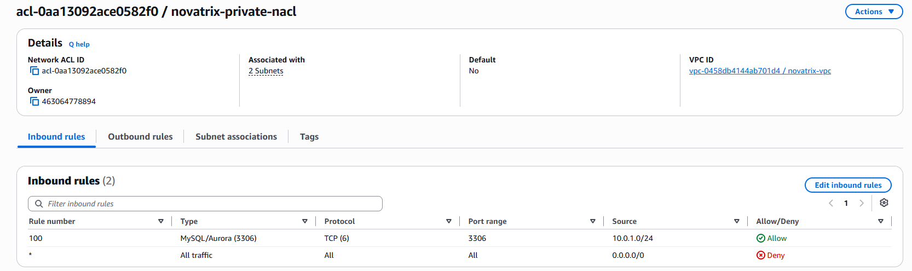

### Security groups

Security groups refererar till **varandra** i stället för till IP-adresser. Webbservern tar
till exempel emot SSH från "allt som har `novatrix-bastion-sg`", så regeln fortsätter att
fungera även om bastion får en ny adress.

Nya security groups tillåter normalt all utgående trafik. Den regeln togs bort från alla tre
grupperna, så att även trafiken **ut** är begränsad.

| Security group | In | Ut |
|----------------|----|----|
| `novatrix-bastion-sg` | SSH 22 från min IP | SSH 22 till `novatrix-web-sg` |
| `novatrix-web-sg` | HTTP 80 och HTTPS 443 från alla, SSH 22 från `novatrix-bastion-sg` | HTTPS 443 till alla, MySQL 3306 till `novatrix-db-sg` |
| `novatrix-db-sg` | MySQL 3306 från `novatrix-web-sg` | Ingenting |

```bash
sg_rule ingress "$WEB_SG_ID"     80   0.0.0.0/0        "HTTP fran alla"
sg_rule ingress "$WEB_SG_ID"     443  0.0.0.0/0        "HTTPS fran alla"
sg_rule ingress "$WEB_SG_ID"     22   "$BASTION_SG_ID" "SSH endast fran bastion"
sg_rule egress  "$WEB_SG_ID"     443  0.0.0.0/0        "HTTPS till S3 och paketforrad"
sg_rule egress  "$WEB_SG_ID"     3306 "$DB_SG_ID"      "MySQL till databasen"
```

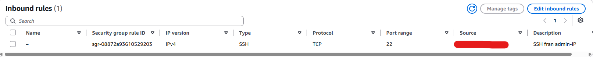

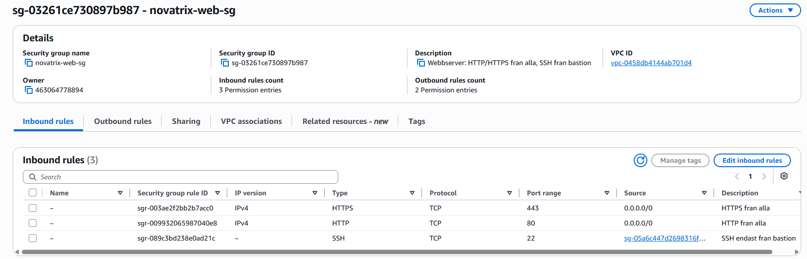

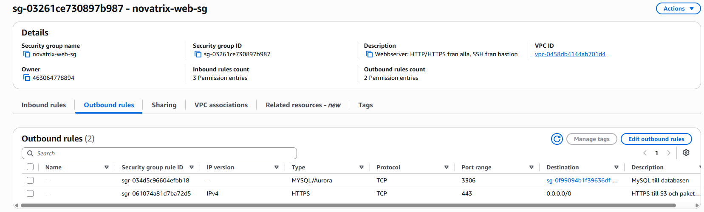

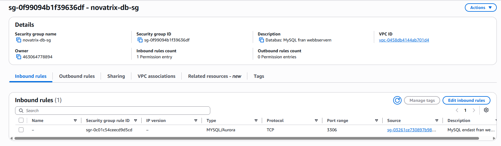

## Delmoment 4 – Placera lösningen

```bash
./provision.sh
```

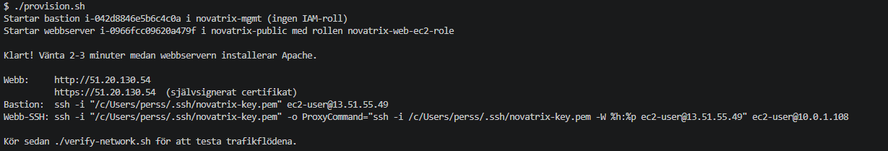

**Webbservern** `novatrix-web` startas i `novatrix-public` med `novatrix-web-sg` och
IAM-rollen från v43. User data-skriptet installerar Apache med både HTTP och HTTPS (med ett
självsignerat certifikat), hämtar webbsidan från S3 med rollen och laddar upp
installationsloggen till `logs/`.

**Bastion** `novatrix-bastion` startas i `novatrix-mgmt` med `novatrix-bastion-sg`. Den får
**ingen IAM-roll** och **ingen user data**. Den ska bara fungera som en sluss för SSH, så om
någon skulle ta sig in på den finns varken behörigheter i AWS eller extra program att använda.

**De privata subnäten** `novatrix-private-a` och `-b` är tomma och väntar på databasen.
Security groupen `novatrix-db-sg` och NACL:en `novatrix-private-nacl` är redan på plats,
och webbserverns regler släpper redan ut MySQL dit.

Båda servrarna startas med **IMDSv2 som krav** (`HttpTokens=required`):

```bash
--metadata-options HttpTokens=required,HttpEndpoint=enabled
```

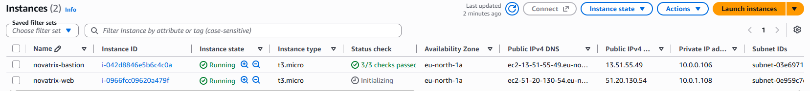

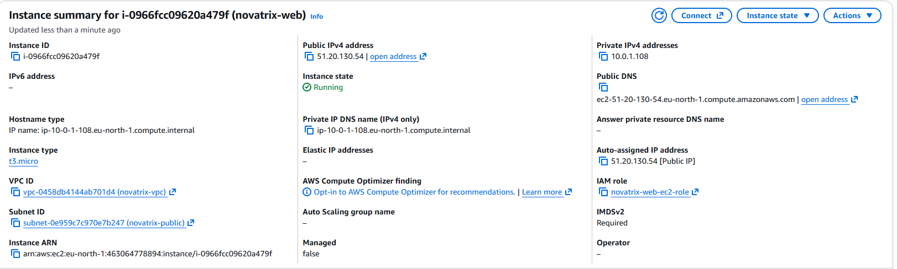

## Delmoment 5 – Verifiera

### Webbsidan

Sidan nås över både HTTP och HTTPS på webbserverns publika IP. Webbläsaren varnar för
HTTPS-certifikatet eftersom det är självsignerat, men trafiken är krypterad.

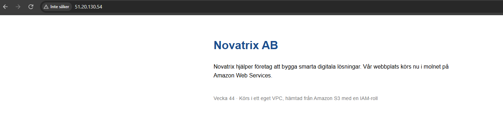

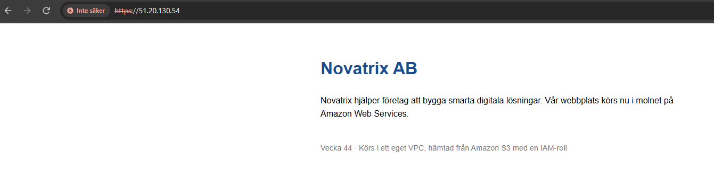

### Automatiska trafiktester

`verify-network.sh` testar 17 trafikflöden och jämför med förväntat resultat. Skriptet
skiljer på tre utfall:

- **öppen** – anslutningen lyckades
- **blockerad** – trafiken stoppades av en brandvägg (paketen släpps tyst, timeout)
- **stängd** – trafiken släpptes igenom, men ingen tjänst svarar

```bash
./verify-network.sh
```

| Från | Till | Släpps igenom | Blockeras |
|------|------|---------------|-----------|
| Internet | Webbservern | HTTP 80, HTTPS 443, Novatrix-sidan | SSH 22, MySQL 3306 |
| Internet | Bastion | SSH 22 från min IP | HTTP 80, HTTPS 443 |
| Bastion | Webbservern | SSH till den privata IP:n | – |
| Bastion | Internet | – | HTTPS ut |
| Webbservern | Internet och S3 | HTTPS 443 ut, läsa sidan från S3 | HTTP 80 ut |
| Webbservern | Bastion | – | SSH 22 |
| Privata subnät | Internet | – | Ingen väg, inga publika IP-adresser |

Alla 17 tester gav förväntat resultat.

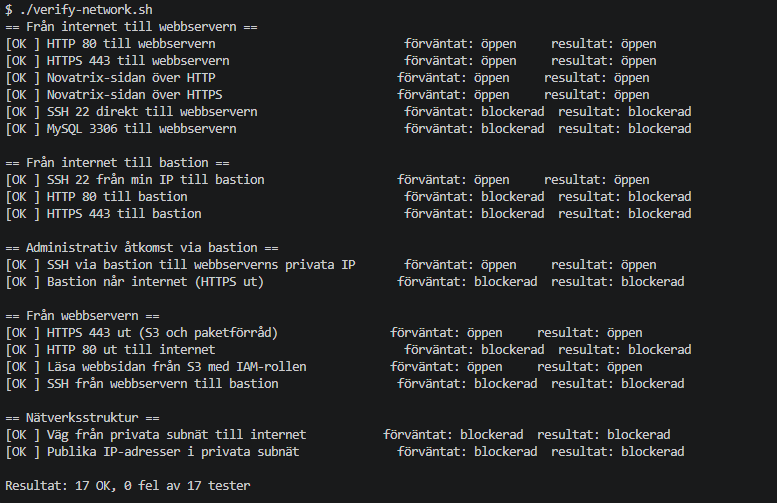

### Bastion-designen

**Direkt SSH till webbservern blockeras**, trots rätt nyckel. Anslutningen tar slut efter
10 sekunder, eftersom både `novatrix-web-sg` och `novatrix-public-nacl` bara tillåter SSH
från bastion.

```bash
ssh -i ~/.ssh/novatrix-key.pem -o ConnectTimeout=10 ec2-user@<webbserverns-publika-IP>
```

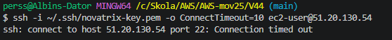

**Bastion saknar nyckel och internet.** På bastion finns bara `authorized_keys`, ingen
privat nyckel. Ett SSH-försök vidare till webbservern når fram (servern visar sitt
fingeravtryck), men inloggningen nekas eftersom bastion inte har nyckeln. Bastion når inte
heller internet.

```bash
ls -la ~/.ssh
ssh -o ConnectTimeout=5 ec2-user@<webbserverns-privata-IP>
curl -s -m 5 https://aws.amazon.com > /dev/null && echo "når internet" || echo "blockerad"
```

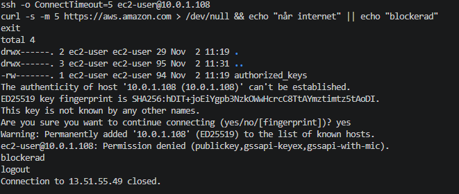

**SSH via bastion fungerar.** Med `ProxyCommand` öppnar den egna datorn en tunnel genom
bastion och loggar in på webbserverns privata adress. Inloggningen görs från den egna
datorn, så bastion ser bara krypterad trafik och behöver aldrig nyckeln.

```bash
ssh -i ~/.ssh/novatrix-key.pem \
  -o ProxyCommand="ssh -i ~/.ssh/novatrix-key.pem -W %h:%p ec2-user@<bastion-IP>" \
  ec2-user@<webbserverns-privata-IP>
```

På webbservern visades också att IMDSv2 krävs. En förfrågan utan token nekas med **401**,
medan en förfrågan med token godkänns med **200**.

```bash
curl -s -o /dev/null -w "IMDSv1 utan token: %{http_code}\n" http://169.254.169.254/latest/meta-data/
TOKEN=$(curl -s -X PUT http://169.254.169.254/latest/api/token -H "X-aws-ec2-metadata-token-ttl-seconds: 60")
curl -s -o /dev/null -w "IMDSv2 med token: %{http_code}\n" -H "X-aws-ec2-metadata-token: $TOKEN" http://169.254.169.254/latest/meta-data/
```

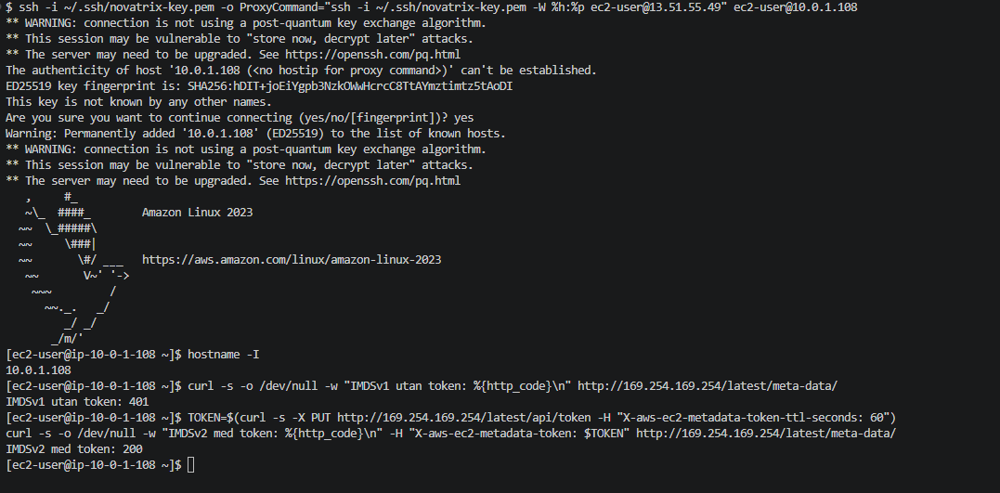

## Städning

Resurserna revs i tre steg, i den ordning beroendena kräver. Servrarna först, eftersom de
sitter fast i subnäten. Sedan nätverket inifrån och ut, där reglerna i security groups tas
bort först eftersom grupperna refererar till varandra. Sist IAM och bucketen.

```bash
./teardown.sh
./teardown-network.sh
./teardown-iam.sh
```

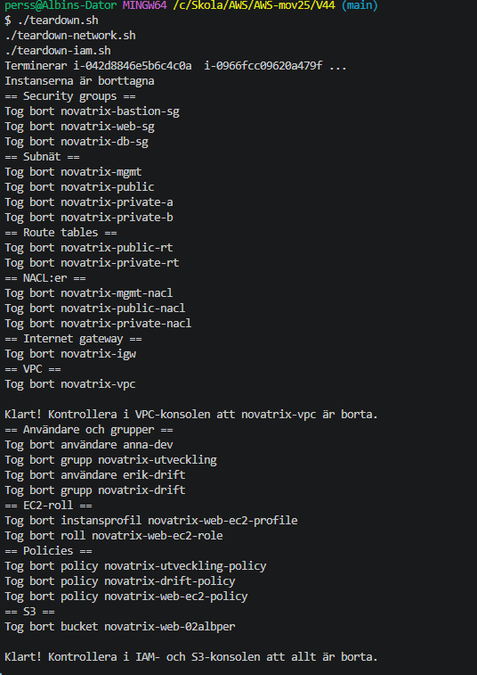

**Verifiering:** Bara standard-VPC:t finns kvar, inga instanser körs, bara `albin-admin`
finns i IAM och inga buckets finns kvar.

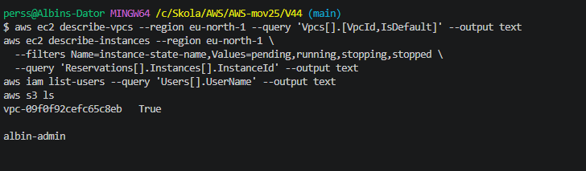

---

## Defense in depth (VG)

Lösningen har flera lager, där varje lager skyddar mot ett annat hot. Ett misstag i ett
lager räcker inte för att öppna systemet.

| Lager | Hur | Skyddar mot |
|-------|-----|-------------|
| **Segmentering** | Ett subnät per funktion: bastion, webb och databas | Att en angripare som tagit sig in i en del rör sig fritt i nätverket (lateral movement) |
| **Routing** | De privata subnäten saknar väg till internet | Att databasen exponeras, även om en security group skulle öppnas av misstag |
| **NACL:er** | Filter på subnätsnivå, en NACL per typ av subnät | Felkonfigurerade security groups; om någon öppnar SSH för alla i `novatrix-web-sg` stoppar `novatrix-public-nacl` det ändå |
| **Security groups** | Filter per server, refererar till varandra | Portskanning och obehöriga anslutningar till enskilda servrar |
| **Bastion** | Enda vägen in för SSH, bara från min IP, utan IAM-roll och utan nyckel | Att SSH exponeras mot internet; brute force mot webbservern |
| **Begränsad utgående trafik** | Standardregeln för all utgående trafik borttagen; bara de portar som behövs | Dataläckage och skadlig kod som ringer hem eller laddar ner fler verktyg |
| **IMDSv2** | Token krävs för metadatatjänsten | SSRF-attacker som försöker stjäla rollens tillfälliga nycklar |
| **IAM (v43)** | Rollen får bara läsa `web/` och skriva `logs/` | Att en hackad webbserver kan ändra sidan eller radera loggar |
| **S3** | All publik åtkomst blockerad | Att innehållet i bucketen läcker ut på internet |

Ett exempel på hur lagren samverkar: om en angripare tar över webbservern kan hen inte
- logga in på bastion, eftersom `novatrix-web-sg` inte tillåter SSH ut,
- ladda ner verktyg över HTTP, eftersom bara HTTPS ut är tillåtet,
- byta ut webbsidan eller radera loggarna, eftersom IAM-rollen inte tillåter det,
- stjäla rollens nycklar via en enkel förfrågan, eftersom IMDSv2 kräver token.

## Återskapa lösningen (VG)

Hela miljön, IAM, nätverk och servrar, kan återskapas från repot.

**Förutsättningar:**

- AWS CLI v2 inloggat med `aws login` som en användare med administratörsbehörighet
- Nyckelparet `novatrix-key` i eu-north-1, med den privata nyckeln i `~/.ssh/novatrix-key.pem`
- Ett eget, globalt unikt bucketnamn i `config.sh`
- Git Bash (Windows) eller terminal (Mac/Linux)

**Steg:**

```bash
git clone https://github.com/02albper-frog/AWS-mov25.git
cd AWS-mov25/V44
./setup-iam.sh          # IAM och bucket
./verify-iam.sh         # 26 IAM-tester
./network.sh            # VPC, subnät, routing, NACL:er och security groups
./provision.sh          # bastion och webbserver
./verify-network.sh     # 17 trafiktester (vänta 2-3 min efter provision)

./teardown.sh           # servrarna
./teardown-network.sh   # nätverket
./teardown-iam.sh       # IAM och bucket
```

## Reflektion

- **Begränsningar:** `novatrix-public-nacl` tillåter ephemeral ports in från hela internet,
  eftersom svaren på webbserverns egna anrop kan komma från vilken adress som helst. Det är
  security groupen, som är stateful, som stoppar oönskade anslutningar på de portarna. Det är
  ett bra exempel på varför lagren behöver varandra.
- **Min IP i reglerna:** Bastion är låst till min IP-adress. Om den ändras måste nätverket
  byggas om. En förbättring vore ett separat skript som bara uppdaterar de två reglerna.
- **Nästa steg:** En **S3 gateway endpoint** (kostnadsfri) skulle låta webbservern nå S3
  utan att gå via internet. **VPC Flow Logs** skulle logga vilken trafik som faktiskt
  släpps igenom och blockeras. Webbservern bör också få ett riktigt certifikat i stället
  för det självsignerade.
- **SSH:** Klienten varnar för att servrarna inte stöder post-kvant-nyckelutbyte.
  Anslutningarna är krypterade med dagens standardalgoritmer, men på sikt bör servrarna
  uppgraderas till en OpenSSH-version som stöder det. Alternativt kan bastion ersättas helt
  av **AWS Systems Manager Session Manager**, som ger åtkomst utan öppna SSH-portar.
- **Lärdom:** Det svåraste var att förstå skillnaden mellan stateless och stateful. En
  NACL-regel som släpper in HTTP räcker inte; svaret ut måste också tillåtas. Testet som
  skiljer på *blockerad* och *stängd* gjorde det tydligt vilket lager som faktiskt stoppar
  trafiken.