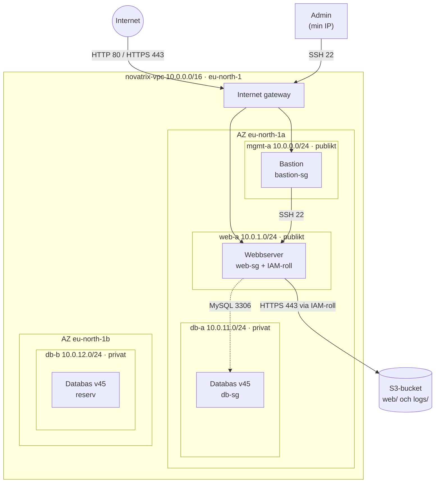

# V44 – Nätverk och säkerhet

**Kurs:** Amazon Web Services · **Vecka:** 44 · **Uppgift:** 3 av 8 · **Företag:** Novatrix AB

> Arbetsversion. Den fullständiga dokumentationen med skärmdumpar läggs till när lösningen är testad.

## Syfte

Novatrix webbserver flyttas från standard-VPC:t till ett eget VPC som byggs helt som kod.
Nätverket är segmenterat i flera subnät och skyddas av flera lager (defense in depth):
route tables, NACL:er, security groups och en bastion för administrativ åtkomst.
Privata subnät förbereds för databasen som kommer i v45. IAM-modellen från v43 ingår i samma mapp.

## Nätverksskiss



## Subnät och routing

| Subnät | CIDR | AZ | Typ | Route table | Innehåll |
|--------|------|----|-----|-------------|----------|
| `novatrix-mgmt-a` | 10.0.0.0/24 | eu-north-1a | Publikt | `novatrix-public-rt` | Bastion |
| `novatrix-web-a` | 10.0.1.0/24 | eu-north-1a | Publikt | `novatrix-public-rt` | Webbserver |
| `novatrix-db-a` | 10.0.11.0/24 | eu-north-1a | Privat | `novatrix-private-rt` | Databas (v45) |
| `novatrix-db-b` | 10.0.12.0/24 | eu-north-1b | Privat | `novatrix-private-rt` | Databas (v45) |

`novatrix-public-rt` har en väg `0.0.0.0/0 → internet gateway`. `novatrix-private-rt` har bara
den lokala vägen inom VPC:t, så databassubnäten kan varken nås från eller nå internet.
Databassubnäten ligger i två tillgänglighetszoner, eftersom RDS kräver det.

## Security groups (instansnivå, stateful)

| Grupp | In | Ut |
|-------|----|----|
| `novatrix-bastion-sg` | SSH 22 från min IP | SSH 22 till `web-sg` |
| `novatrix-web-sg` | HTTP 80 och HTTPS 443 från alla, SSH 22 från `bastion-sg` | HTTPS 443 till alla, MySQL 3306 till `db-sg` |
| `novatrix-db-sg` | MySQL 3306 från `web-sg` | Ingenting |

Standardregeln som tillåter all utgående trafik är borttagen från alla tre grupper.

## NACL:er (subnätsnivå, stateless)

| NACL | In | Ut |
|------|----|----|
| `novatrix-mgmt-nacl` | 22 från min IP, 1024–65535 från web-a | 1024–65535 till min IP, 22 till web-a |
| `novatrix-web-nacl` | 80 och 443 från alla, 22 från mgmt-a, 1024–65535 från alla | 1024–65535 till alla, 443 till alla, 3306 till db-a/db-b |
| `novatrix-db-nacl` | 3306 från web-a | 1024–65535 till web-a |

NACL:er är stateless, så svarstrafiken (ephemeral ports 1024–65535) måste tillåtas uttryckligen.
Allt som inte matchar en regel nekas av standardregeln `*`.

## Lager och hot

| Lager | Skyddar mot |
|-------|-------------|
| Segmentering i subnät | Att ett intrång i en del sprider sig fritt; varje roll har sitt eget subnät |
| Privat route table | Att databasen exponeras mot internet, även om en security group skulle bli felkonfigurerad |
| NACL:er | Felkonfigurerade security groups; ett andra filter på subnätsnivå |
| Security groups | Portskanning och obehöriga anslutningar till enskilda servrar |
| Bastion | Att SSH exponeras mot internet; en enda kontrollerad väg in för administration |
| Begränsad utgående trafik | Dataläckage och skadlig kod som ringer hem på godtyckliga portar |
| IMDSv2 | SSRF-attacker som försöker stjäla rollens tillfälliga nycklar |
| IAM-roll (v43) | Att servern får mer behörighet i AWS än den behöver |

## Filer

| Fil | Beskrivning |
|-----|-------------|
| `config.sh` | Gemensamma namn, CIDR-block och hjälpfunktioner |
| `policies/` | IAM-policydokumenten från v43 (driftpolicyn uppdaterad) |
| `setup-iam.sh` / `verify-iam.sh` / `teardown-iam.sh` | IAM och S3 från v43 |
| `network.sh` | Bygger VPC, subnät, routing, NACL:er och security groups |
| `provision.sh` | Startar bastion och webbserver i VPC:t |
| `user-data-web.sh` | Installerar Apache med HTTP/HTTPS och hämtar sidan från S3 |
| `verify-network.sh` | Testar vilken trafik som släpps igenom och vilken som blockeras |
| `teardown.sh` | Tar bort instanserna |
| `teardown-network.sh` | Tar bort nätverket |
| `index.html` | Novatrix webbsida |

## Köra lösningen

Kör i Git Bash som administratör:

```bash
cd V44
./setup-iam.sh          # IAM och bucket (v43)
./verify-iam.sh         # testar IAM
./network.sh            # bygger nätverket
./provision.sh          # startar bastion och webbserver
./verify-network.sh     # testar trafikflödena (vänta 2-3 min efter provision)

./teardown.sh           # tar bort instanserna
./teardown-network.sh   # tar bort nätverket
./teardown-iam.sh       # tar bort IAM och bucket
```

SSH till webbservern går alltid via bastion. Den privata nyckeln stannar på den egna datorn
och kopieras aldrig till bastion:

```bash
ssh -i ~/.ssh/novatrix-key.pem \
  -o ProxyCommand="ssh -i ~/.ssh/novatrix-key.pem -W %h:%p ec2-user@<bastion-IP>" \
  ec2-user@<webbserverns-privata-IP>
```