# V45 – Storage och databas

**Kurs:** Amazon Web Services · **Vecka:** 45 · **Uppgift:** 4 av 8 · **Företag:** Novatrix AB

## Syfte

Nu tar WordPress-stacken form. WordPress behöver en databas för innehållet och delad lagring
för sina filer. I den här uppgiften sätts en hanterad databas (RDS), delad lagring (EFS) och
objektlagring för backuper (S3) upp och kopplas ihop med webbservern till en fungerande
WordPress-lösning. Databasen är aldrig publikt åtkomlig, och åtkomsten mellan komponenterna
är säkrad i flera lager.

Allt byggs **som kod** och bygger vidare på nätverket från v44 och IAM-modellen från v43.
Lösningen är byggd som den hade sett ut i drift, med bland annat **Multi-AZ** för databasen.

## Arkitektur

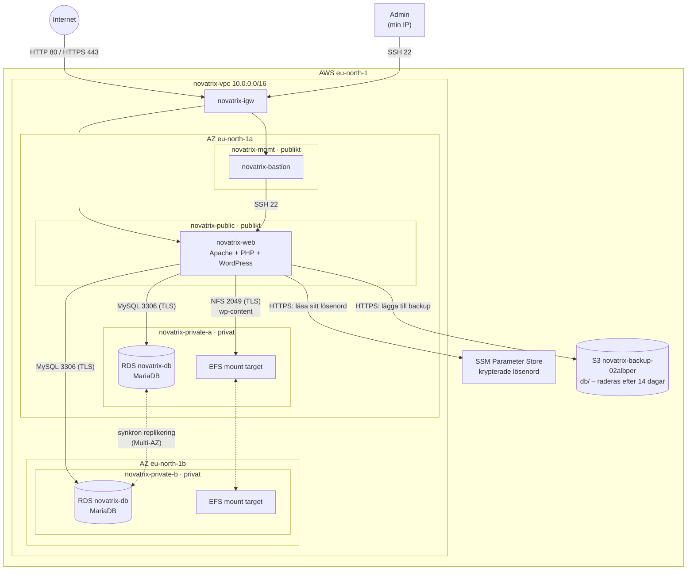

| Komponent | Namn | Placering |
|-----------|------|-----------|
| Webbserver | `novatrix-web` | `novatrix-public` (eu-north-1a) |
| Bastion | `novatrix-bastion` | `novatrix-mgmt` (eu-north-1a) |
| Databas | `novatrix-db` (RDS MariaDB, Multi-AZ) | `novatrix-private-a` och `novatrix-private-b` |
| DB subnet group | `novatrix-db-subnet-group` | `novatrix-private-a` och `novatrix-private-b` |
| Delad lagring | `novatrix-efs` | Mount targets i `novatrix-private-a` och `novatrix-private-b` |
| Backup | `novatrix-backup-02albper` | S3, privat bucket |
| Lösenord | `/novatrix/db/*`, `/novatrix/wp/*` | SSM Parameter Store, krypterade |

## Filer

| Fil | Beskrivning |
|-----|-------------|
| [`config.sh`](config.sh) | Alla namn, nivåval och hjälpfunktioner på ett ställe |
| [`network.sh`](network.sh) | Nätverket från v44, nu med `novatrix-efs-sg` och NFS-regler |
| [`storage.sh`](storage.sh) | **Ny:** lösenord, backup-bucket, EFS och RDS |
| [`provision.sh`](provision.sh) | Startar bastion och webbserver |
| [`user-data-web.sh`](user-data-web.sh) | Installerar WordPress, monterar EFS, schemalägger backup |
| [`install-wordpress.sh`](install-wordpress.sh) | **Ny:** databasanvändare, WordPress och första backupen |
| [`verify-wordpress.sh`](verify-wordpress.sh) | **Ny:** 25 tester av databas, lagring, backup och säkerhet |
| [`verify-network.sh`](verify-network.sh) / [`verify-iam.sh`](verify-iam.sh) | Tester från v43 och v44 |
| [`teardown-storage.sh`](teardown-storage.sh) | **Ny:** tar bort RDS, EFS, backup-bucket och lösenord |
| [`teardown.sh`](teardown.sh) / [`teardown-network.sh`](teardown-network.sh) / [`teardown-iam.sh`](teardown-iam.sh) | Nedrivning |
| [`setup-iam.sh`](setup-iam.sh) | IAM från v43, med utökad roll |
| [`policies/`](policies/) | IAM-policyer och den nya EFS-policyn |

---

## Delmoment 1 – Repo

Mappen `V45` skapades med alla filer från v44 som grund, och README:n i roten uppdaterades.
Nya inställningar för databas, EFS, backup och lösenord lades till i `config.sh`.

### IAM

Webbserverns roll utökades med två behörigheter: den får **lägga till** backuper och läsa
**sitt eget** databaslösenord.

```json
{
  "Sid": "SkrivDatabasbackuper",
  "Effect": "Allow",
  "Action": "s3:PutObject",
  "Resource": "arn:aws:s3:::__BACKUP_BUCKET__/db/*"
},
{
  "Sid": "LasEndastWordPressLosenordet",
  "Effect": "Allow",
  "Action": "ssm:GetParameter",
  "Resource": "arn:aws:ssm:__REGION__:__ACCOUNT_ID__:parameter/novatrix/db/wp-password"
}
```

Rollen kan alltså varken läsa eller radera backuper, och den kan inte läsa databasens
huvudlösenord. Alla 31 IAM-tester gav förväntat resultat.

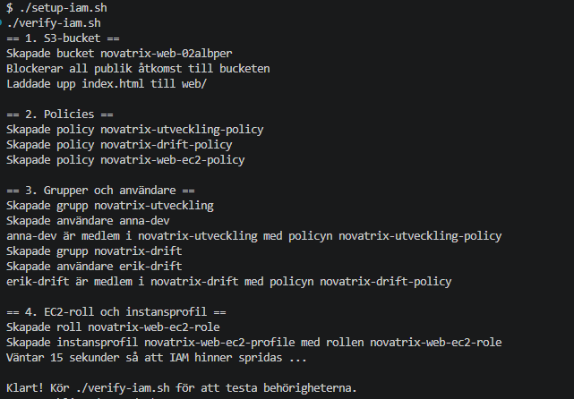

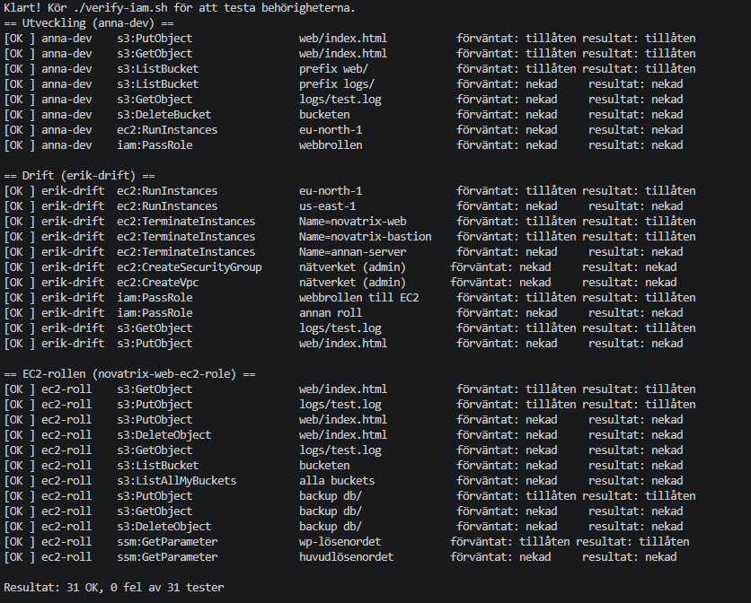

### Nätverket

Nätverket från v44 byggdes upp igen, med en ny security group för EFS och regler för NFS
(port 2049). Databasreglerna (port 3306) fanns redan sedan v44.

```bash
./network.sh
```
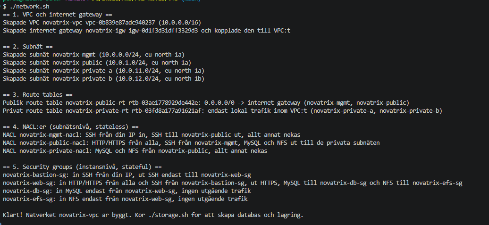

## Delmoment 2 – Databas

Databasen skapas av `storage.sh`. Först skapas en **DB subnet group**, som talar om för RDS
att databasen bara får placeras i de privata subnäten:

```bash
aws rds create-db-subnet-group --db-subnet-group-name novatrix-db-subnet-group \
  --subnet-ids <novatrix-private-a> <novatrix-private-b>
```

Därefter skapas databasen:

```bash
aws rds create-db-instance \
  --db-instance-identifier novatrix-db \
  --engine mariadb \
  --db-instance-class db.t4g.micro \
  --allocated-storage 20 --storage-type gp3 --storage-encrypted \
  --db-subnet-group-name novatrix-db-subnet-group \
  --vpc-security-group-ids <novatrix-db-sg> \
  --no-publicly-accessible \
  --multi-az \
  --backup-retention-period 1 \
  --preferred-backup-window 01:00-01:30
```

```bash
./storage.sh
```

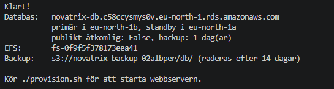

### Val av databasnivå

| Val | Motivering |
|-----|------------|
| **MariaDB** | Öppen källkod och fullt kompatibel med WordPress, utan licenskostnad |
| **`db.t4g.micro`** | Ingår i free tier. Graviton-processorn (ARM) ger mer prestanda per krona än motsvarande Intel-instans. Burstable-klassen passar en webbplats med ojämn belastning |
| **20 GB gp3** | gp3 är billigare per GB än gp2 och har en fast baslinje på 3 000 IOPS oavsett storlek. Med gp2 hade 20 GB bara gett 100 IOPS i baslinje |
| **Multi-AZ** | En synkroniserad standby i den andra zonen tar över automatiskt inom ett par minuter om den primära går ner. Kostar ungefär dubbelt så mycket, men är standard för produktionsdatabaser |
| **Krypterad lagring** | Skyddar data och backuper om disken skulle hamna i fel händer. Ingen extra kostnad |
| **Inte publikt åtkomlig** | Databasen får ingen publik IP och kan bara nås inifrån VPC:t |

Med Multi-AZ hamnade den primära databasen i eu-north-1b och standby i eu-north-1a.
Webbservern i eu-north-1a når båda, eftersom nätverket släpper igenom MySQL till båda de
privata subnäten. Om databasen byter zon vid en failover behöver alltså ingenting ändras.

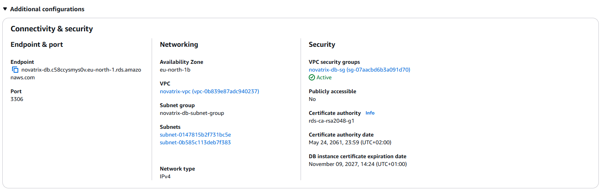

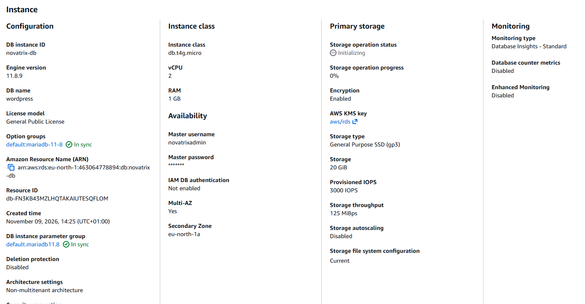

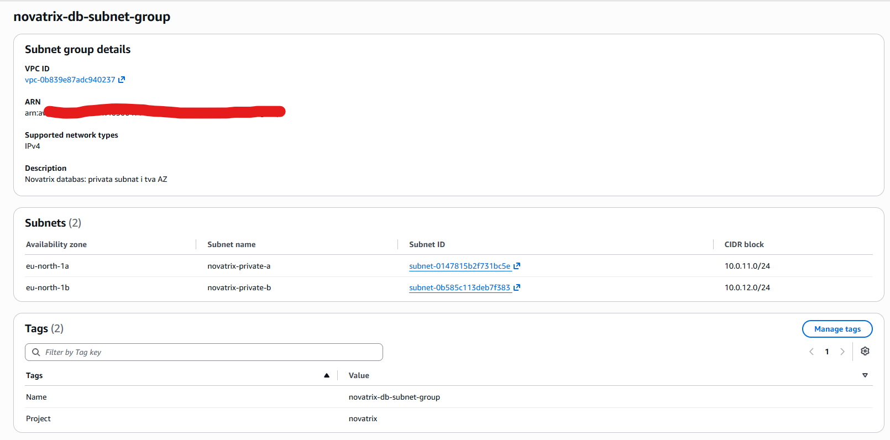

## Delmoment 3 – Delad lagring

EFS-filsystemet `novatrix-efs` monteras på `/var/www/html/wp-content`, där WordPress sparar
uppladdade filer, teman och tillägg.

```bash
aws efs create-file-system --creation-token novatrix-efs \
  --performance-mode generalPurpose --throughput-mode bursting --encrypted
```

### Val av lagringsnivå

| Val | Motivering |
|-----|------------|
| **Bara `wp-content` på EFS** | Resten av WordPress (PHP-koden) körs från den lokala disken, som är snabbare. Bara det som ändras och ska delas mellan servrar ligger på EFS |
| **General Purpose** | Lägst fördröjning, vilket passar många små filer som i WordPress |
| **Bursting** | Ingen fast kostnad för genomströmning. En liten webbplats har låg genomsnittlig belastning med enstaka toppar |
| **Livscykel till Infrequent Access** | Filer som inte använts på 30 dagar flyttas till en klass som är betydligt billigare per GB, och tillbaka vid nästa användning |
| **Krypterad** | Både i vila och under överföring |

Två **mount targets** skapas, en i varje privat subnät, med `novatrix-efs-sg`. När fler
webbservrar läggs till senare i kursen kan de i båda zonerna montera samma filsystem.

En **filsystemspolicy** tillåter bara montering via mount targets inne i VPC:t och nekar
all okrypterad trafik:

```json
{
  "Sid": "KravKrypteradTrafik",
  "Effect": "Deny",
  "Principal": { "AWS": "*" },
  "Action": "*",
  "Resource": "__EFS_ARN__",
  "Condition": { "Bool": { "aws:SecureTransport": "false" } }
}
```

Webbservern monterar därför EFS med TLS:

```bash
echo "$EFS_ID:/ /var/www/html/wp-content efs _netdev,tls 0 0" >> /etc/fstab
```

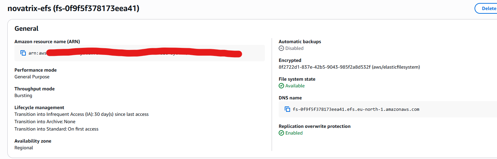

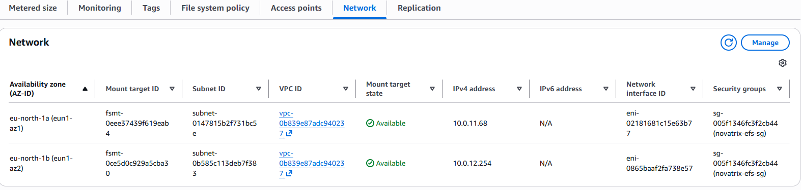

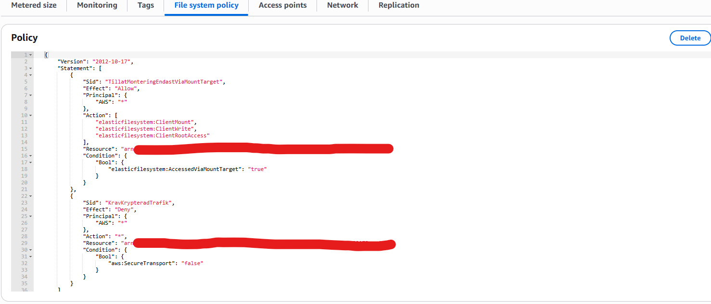

## Delmoment 4 – Objektlagring och backup

### Backup-bucket med livscykelregel

En egen bucket, `novatrix-backup-02albper`, används bara för databasbackuper. Den är skild
från bucketen med webbinnehåll, så att den kan ha egna regler och behörigheter. All publik
åtkomst är blockerad, och en livscykelregel raderar backuper äldre än 14 dagar:

```json
{
  "ID": "radera-databasbackuper-efter-14-dagar",
  "Status": "Enabled",
  "Filter": { "Prefix": "db/" },
  "Expiration": { "Days": 14 },
  "AbortIncompleteMultipartUpload": { "DaysAfterInitiation": 1 }
}
```

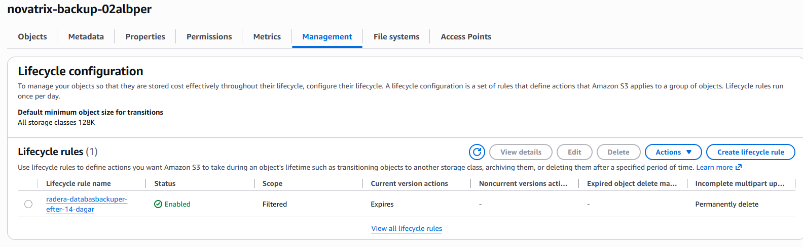

### Backup av databasen till S3

Webbservern har ett backupskript som dumpar databasen med en krypterad anslutning, packar
den och laddar upp den direkt till S3 utan att spara den på disken:

```bash
"$DUMP" --ssl-ca="$RDS_CA" --ssl-verify-server-cert \
  -h "$DB_HOST" -u "$DB_USER" --single-transaction --no-tablespaces "$DB_NAME" \
  | gzip | aws s3 cp - "s3://$BACKUP_BUCKET/db/$DB_NAME-$STAMP.sql.gz"
```

`--single-transaction` ger en konsekvent ögonblicksbild utan att låsa tabellerna, så
webbplatsen fungerar som vanligt under backupen. Skriptet körs varje natt kl. 03:00 UTC:

```
0 3 * * * root /usr/local/bin/novatrix-backup.sh >> /var/log/novatrix-backup.log 2>&1
```

Den första backupen togs direkt av `install-wordpress.sh`.

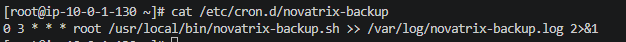

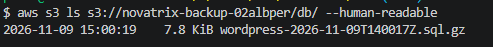

### Automatisk backup i RDS

RDS tar också egna automatiska backuper, med lagringstid **1 dag**. Det är det högsta som
Free plan tillåter.

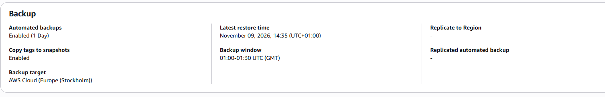

**Lagringstid i drift: 14 dagar.** RDS automatiska backuper gör det möjligt att återställa
databasen till valfri sekund inom lagringstiden (*point-in-time recovery*). Med 1 dag måste
ett fel upptäckas inom ett dygn. Ofta upptäcks fel långt senare, till exempel ett tillägg som
förstört data, en felaktig massändring eller ett intrång som pågått en tid. 14 dagar ger två
veckors marginal och matchar livscykeln för S3-dumparna, så att båda backuptyperna täcker
samma period. Kostnaden är låg: backuplagring upp till databasens storlek ingår utan extra
kostnad, och därutöver kostar den bara några ören per GB och månad.

De två backuptyperna kompletterar varandra:

| | RDS automatisk backup | S3-dump |
|---|---|---|
| Återställning | Till valfri sekund | Till en viss natt |
| Ligger | Inne i RDS | I en separat bucket |
| Överlever att databasen tas bort | Nej, om man väljer att radera dem | Ja |
| Kan läsas i andra system | Nej | Ja, vanlig SQL-fil |

## Delmoment 5 – Koppla ihop WordPress

```bash
./provision.sh
./install-wordpress.sh
```

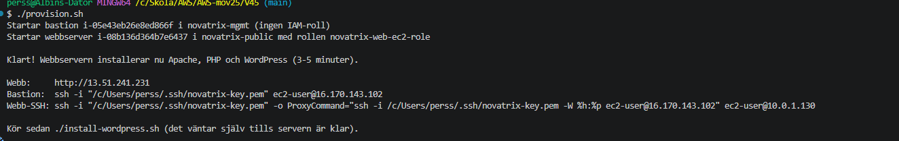

`user-data-web.sh` installerar hela stacken när webbservern startar:

1. Apache, PHP, MariaDB-klienten, EFS-verktygen och cron
2. RDS certifikatkedja, så att anslutningen till databasen kan krypteras och verifieras
3. WP-CLI och WordPress på svenska
4. EFS monteras på `wp-content` och fylls med WordPress standardinnehåll
5. `wp-config.php` skrivs med databasens adress och WordPress-lösenordet, som servern hämtar
   från SSM med sin roll
6. Backupskriptet och cron-jobbet

`install-wordpress.sh` körs från administratörens dator och skickar kommandona till
webbservern via bastion. Det skapar en **egen databasanvändare** för WordPress, installerar
WordPress och tar den första backupen:

```sql
CREATE USER IF NOT EXISTS 'wordpress'@'10.0.1.%' IDENTIFIED BY '...';
GRANT ALL PRIVILEGES ON wordpress.* TO 'wordpress'@'10.0.1.%';
```

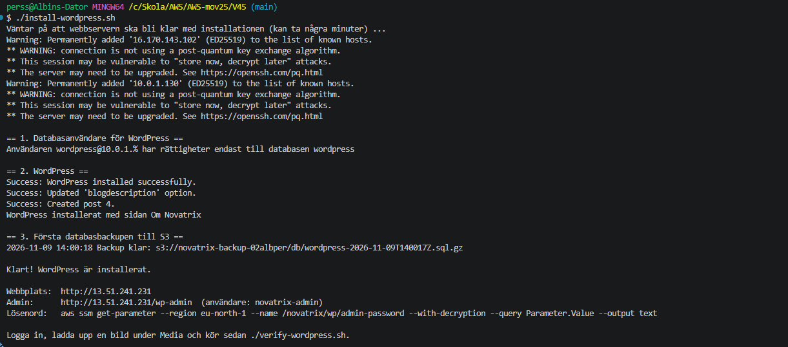

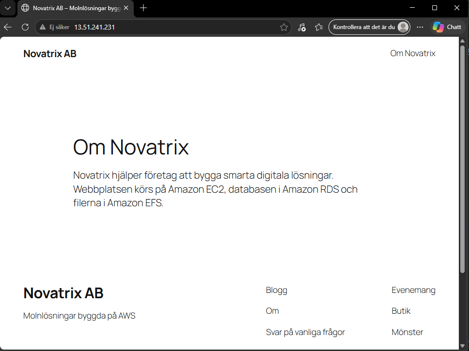

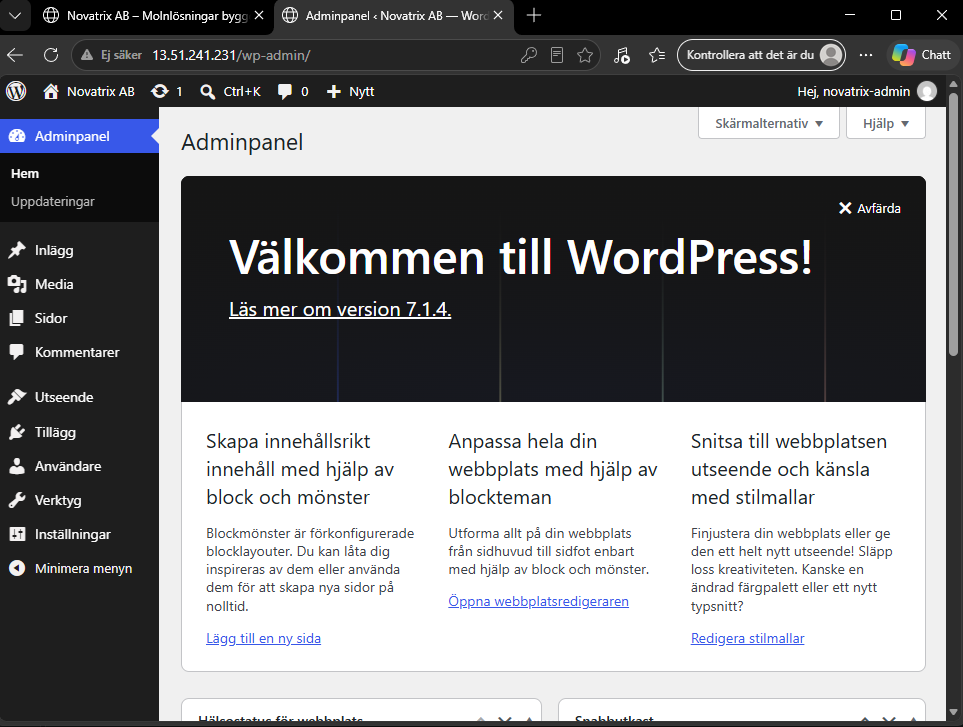

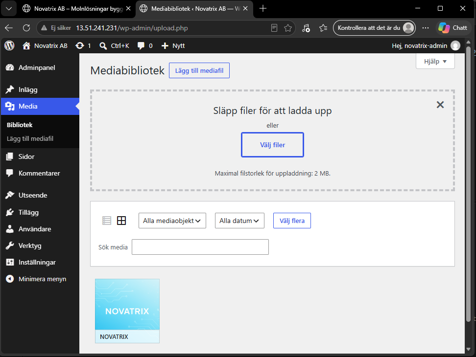

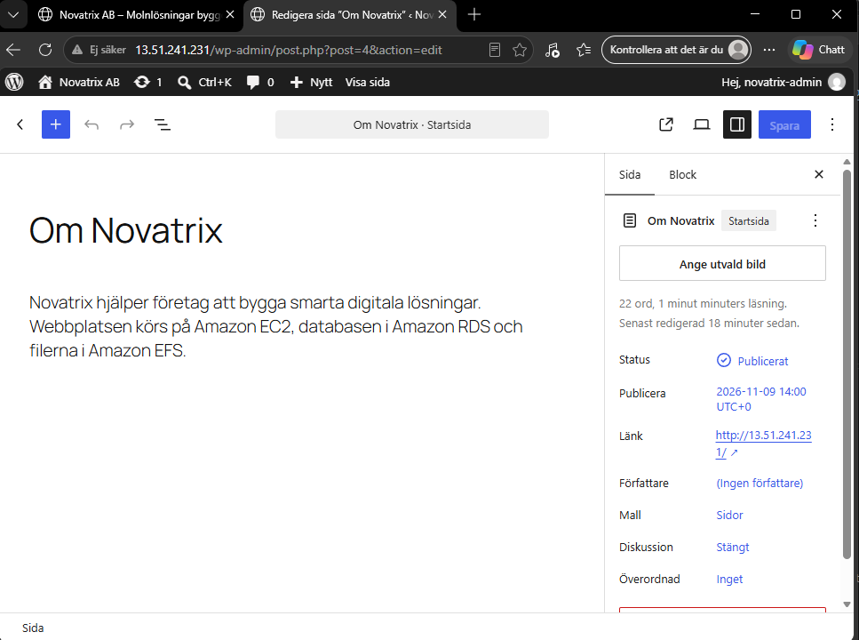

## Delmoment 6 – Säkra åtkomsten

Åtkomsten är säkrad i flera lager, där varje lager skyddar mot ett annat hot.

| Lager | Hur | Skyddar mot |
|-------|-----|-------------|
| **Privata subnät** | RDS och EFS ligger i subnät utan väg till internet | Att databasen eller filerna exponeras, även om en brandväggsregel öppnas av misstag |
| **Ingen publik åtkomst** | RDS: *Publicly accessible: No*. S3: all publik åtkomst blockerad | Att databasen eller backuperna nås från internet |
| **Security groups grupp mot grupp** | `novatrix-db-sg` tar bara emot 3306 från `novatrix-web-sg`, `novatrix-efs-sg` bara 2049 från `novatrix-web-sg` | Att andra servrar, till exempel bastion, når databasen eller filerna |
| **NACL:er** | `novatrix-private-nacl` släpper bara in 3306 och 2049 från `novatrix-public` | Felkonfigurerade security groups |
| **Egen databasanvändare** | `wordpress` når bara databasen `wordpress` och bara från `10.0.1.%` | Att ett intrång i WordPress ger åtkomst till hela databasservern |
| **Lösenord i SSM** | Slumpade, krypterade, aldrig i repot. Webbservern kan bara läsa sitt eget | Läckta lösenord via Git; att en hackad server får administratörens lösenord |
| **Huvudlösenordet stannar hos admin** | Används en gång via SSH av `install-wordpress.sh`, sparas aldrig på servern | Att en angripare på webbservern blir databasadministratör |
| **Backuper kan bara läggas till** | Rollen har `s3:PutObject` men inte `GetObject` eller `DeleteObject` | Att en angripare läser ut eller raderar backuperna |
| **Kryptering i vila** | RDS, EFS och S3 | Att data läses från stulna diskar eller snapshots |
| **Kryptering under överföring** | TLS till RDS (verifierat certifikat), TLS till EFS (krävs av policyn), HTTPS till S3 och SSM | Avlyssning av trafiken inne i nätverket |
| **Skyddade filer på servern** | `wp-config.php` och backupkonfigurationen kan bara läsas av root eller Apache | Att andra användare på servern läser lösenord och adresser |

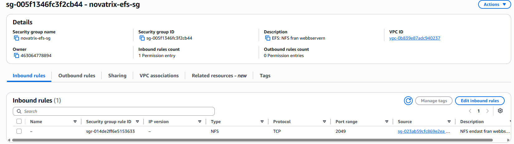
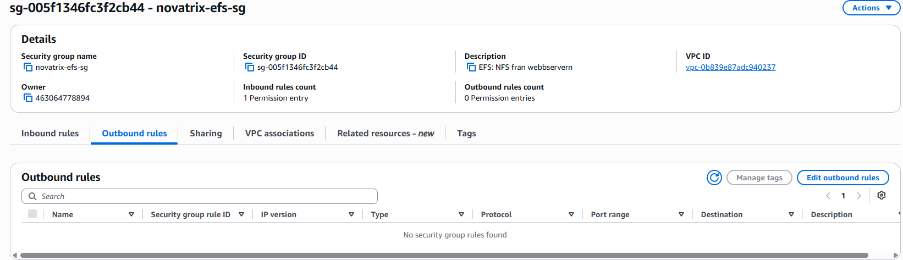

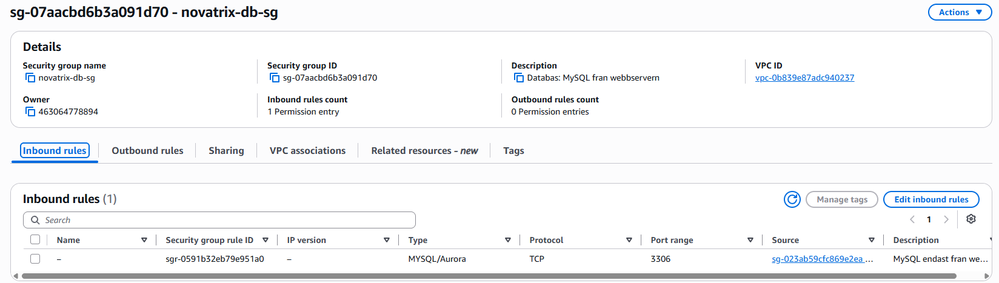

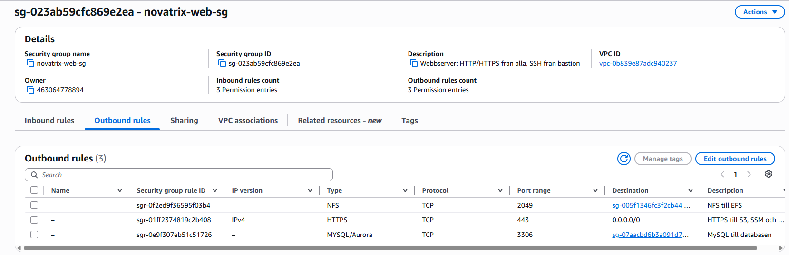

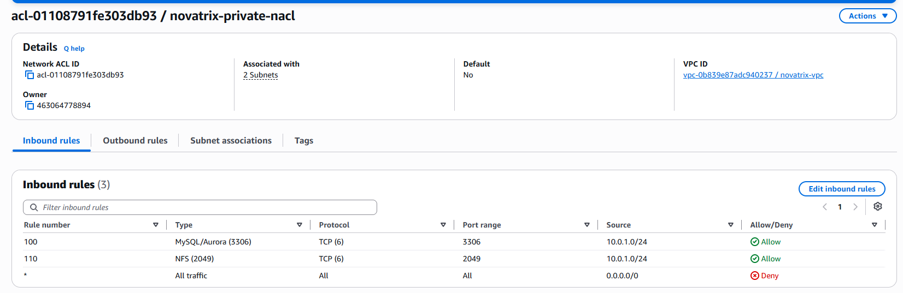

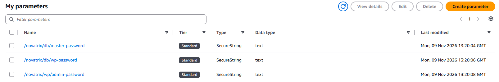

## Delmoment 7 – Verifiera

### Automatiska tester

```bash
./verify-wordpress.sh
./verify-network.sh
```

`verify-wordpress.sh` kör 25 tester i fem grupper:

| Grupp | Vad som testas |
|-------|----------------|
| Databas | Inte publik, Multi-AZ, krypterad, automatisk backup, bara i privata subnät, privat adress |
| EFS | Krypterad, bara i privata subnät, kräver TLS, monterad på `wp-content`, uppladdade filer ligger där |
| Backup | Publik åtkomst blockerad, livscykelregel på 14 dagar, minst en backup finns |
| WordPress | Startsidan och inloggningen fungerar, WordPress når databasen över TLS, sidan *Om Novatrix* finns |
| Säkerhet | Bastion når varken databasen eller EFS; webbservern kan läsa sitt lösenord men inte administratörens, och kan varken läsa eller radera backuper |

Alla 25 tester i `verify-wordpress.sh` och alla 17 i `verify-network.sh` gav förväntat resultat.

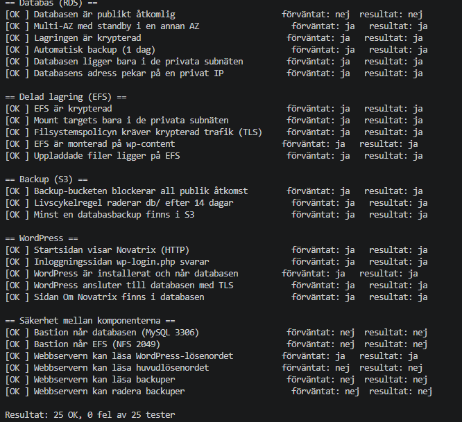

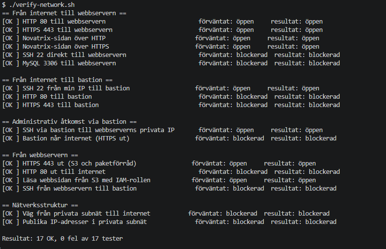

### På servern

EFS är monterad på `wp-content` med NFS, och den uppladdade bilden ligger där:

```bash
df -hT /var/www/html/wp-content
sudo find /var/www/html/wp-content/uploads -type f
```

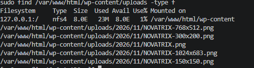

WordPress-användaren ansluter med TLS och ser bara sin egen databas:

```bash
mysql --ssl-ca="$RDS_CA" --ssl-verify-server-cert -h "$DB_HOST" -u wordpress \
  -e "SHOW DATABASES; SHOW STATUS LIKE 'Ssl_cipher'; SELECT ID, post_title FROM wordpress.wp_posts WHERE post_type='page';"
```

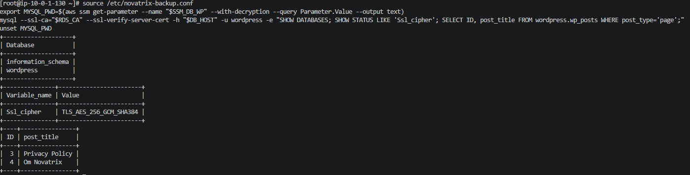

## Städning

Resurserna revs i den ordning beroendena kräver: servrarna, sedan databas och lagring,
sedan nätverket och sist IAM. Databasen togs bort utan slutlig snapshot, eftersom det är en
labbmiljö. I drift tas alltid en sista snapshot innan en databas tas bort.

```bash
./teardown.sh
./teardown-storage.sh
./teardown-network.sh
./teardown-iam.sh
```

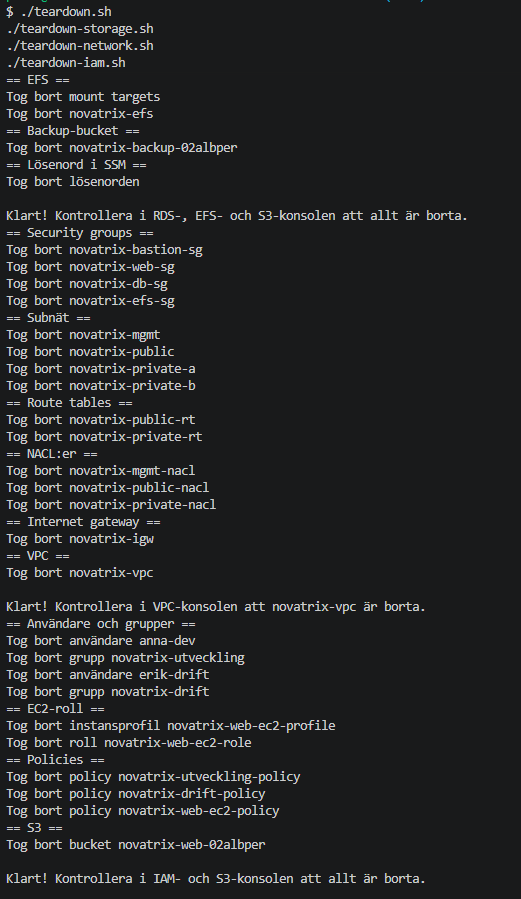

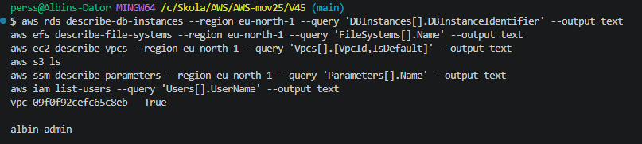

---

## Återskapa lösningen (VG)

Hela miljön kan återskapas från repot.

**Förutsättningar:**

- AWS CLI v2 inloggat med `aws login` som en användare med administratörsbehörighet
- Nyckelparet `novatrix-key` i eu-north-1, med den privata nyckeln i `~/.ssh/novatrix-key.pem`
- Egna, globalt unika bucketnamn i `config.sh` (`BUCKET` och `BACKUP_BUCKET`)
- Git Bash (Windows) eller terminal (Mac/Linux)

**Steg:**

```bash
git clone https://github.com/02albper-frog/AWS-mov25.git
cd AWS-mov25/V45
./setup-iam.sh          # IAM och webb-bucket
./verify-iam.sh         # 31 IAM-tester
./network.sh            # nätverket
./storage.sh            # lösenord, backup-bucket, EFS och RDS (15-25 minuter)
./provision.sh          # bastion och webbserver
./install-wordpress.sh  # databasanvändare, WordPress och första backupen
./verify-wordpress.sh   # 25 tester
./verify-network.sh     # 17 tester

./teardown.sh           # servrarna
./teardown-storage.sh   # RDS, EFS, backup-bucket och lösenord
./teardown-network.sh   # nätverket
./teardown-iam.sh       # IAM och webb-bucket
```

## Reflektion

- **Problem under arbetet:** Tre fel upptäcktes och rättades i koden. PHP:s standardgräns
  på 128 MB minne räckte inte för att packa upp WordPress, så WP-CLI körs nu med 512 MB.
  EFS fick bara en tom `uploads`-mapp när den första installationen misslyckades, och nästa
  server trodde då att EFS redan var ifylld. Skriptet kopierar nu alltid in det som saknas
  (`cp -an`). Testet av startsidan i `verify-network.sh` gav falskt fel när sidan blev större,
  på grund av hur `grep -q` och `pipefail` samverkar. Att allt är kod gjorde det enkelt att
  rätta felen och starta om bara den del som behövdes.
- **Git Bash och AWS CLI:** Git Bash gör om argument som börjar med `/` till Windows-sökvägar,
  så `/novatrix/wp/admin-password` blev fel. Skripten slår av det med `MSYS_NO_PATHCONV=1`.
- **Multi-AZ:** Failover testades inte i den här labben. Nästa steg är att tvinga en failover
  med `aws rds reboot-db-instance --force-failover` och visa att WordPress fortsätter fungera.
- **Begränsningar:** RDS kräver inte TLS från serversidan; det är klienterna som är
  konfigurerade att använda det. En egen parametergrupp med `require_secure_transport=ON`
  skulle göra det obligatoriskt. Lösenorden i SSM roteras inte automatiskt; i drift skulle
  AWS Secrets Manager med automatisk rotation vara ett alternativ.
- **Nästa steg:** Med WordPress-filerna på EFS och databasen i RDS är webbservern i princip
  utbytbar. Det förbereder för skalbarhet med flera webbservrar bakom en lastbalanserare,
  där `novatrix-web-b` och mount target i den andra zonen kommer till användning.