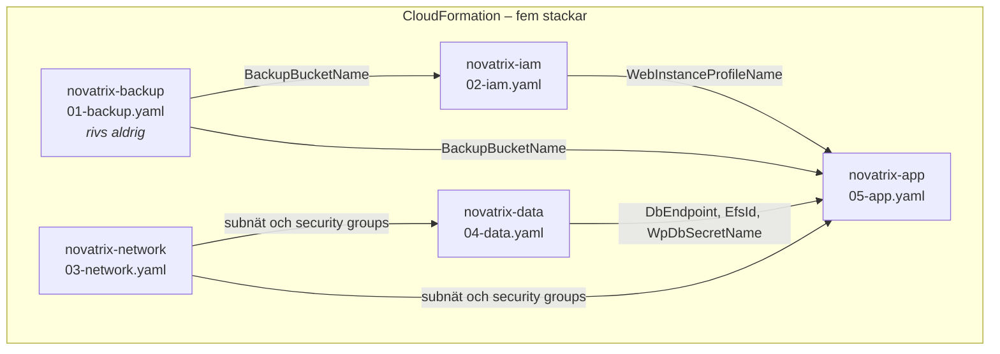

# V46 – IaC med CloudFormation

**Kurs:** Amazon Web Services · **Vecka:** 46 · **Uppgift:** 5 av 8 · **Företag:** Novatrix AB

## Syfte

Hittills har Novatrix WordPress-stack byggts bit för bit med AWS CLI-skript. I den här
uppgiften samlas hela stacken, alltså nätverk, IAM, databas, lagring, servrar och backup, i
**CloudFormation-templates** som är versionshanterade i det här repot. Hela miljön byggs med
ett kommando, utan några steg i konsolen, och kan rivas och återskapas på samma sätt.

Templates beskriver *hur miljön ska se ut*, och CloudFormation räknar själv ut i vilken ordning
resurserna ska skapas, ändras eller tas bort. Det ersätter de många skripten från v42–v45,
som anropade AWS kommando för kommando och behövde egna skript för nedrivning.

## Arkitektur



| Stack | Template | Innehåll | Livslängd |
|-------|----------|----------|-----------|
| `novatrix-backup` | [`01-backup.yaml`](templates/01-backup.yaml) | Backup-bucket med kryptering, versionshantering och livscykelregler | Rivs aldrig; `DeletionPolicy: Retain` |
| `novatrix-iam` | [`02-iam.yaml`](templates/02-iam.yaml) | Webbserverns roll, grupper och användare (v43) | Byggs och rivs med miljön |
| `novatrix-network` | [`03-network.yaml`](templates/03-network.yaml) | VPC, fyra subnät, routing, NACL:er och security groups (v44) | Byggs och rivs med miljön |
| `novatrix-data` | [`04-data.yaml`](templates/04-data.yaml) | Lösenord i Secrets Manager, RDS Multi-AZ och EFS (v45) | Byggs och rivs med miljön |
| `novatrix-app` | [`05-app.yaml`](templates/05-app.yaml) | Bastion och webbserver med WordPress (v44/v45) | Byggs och rivs oftast |

Stackarna delar värden med varandra genom **exports**. Nätverksstacken exporterar till exempel
subnätens ID:n, som datastacken importerar med `Fn::ImportValue` när databasen placeras i de
privata subnäten. Uppdelningen gör att en del kan byggas om utan att resten påverkas; servrarna
kan till exempel bytas ut utan att databasen rörs.

## Filer

| Fil | Beskrivning |
|-----|-------------|
| [`templates/`](templates/) | De fem CloudFormation-templaten |
| [`parameters/prod.env`](parameters/prod.env) | Värden för produktionsmiljön `novatrix` |
| [`parameters/test.env`](parameters/test.env) | Värden för en billigare testmiljö från samma templates |
| [`lib.sh`](lib.sh) | Gemensamma funktioner för skripten |
| [`deploy.sh`](deploy.sh) | Validerar templates och bygger eller uppdaterar alla stackar i ordning |
| [`destroy.sh`](destroy.sh) | Tar en sista backup och river allt utom backup-stacken |
| [`install-wordpress.sh`](install-wordpress.sh) | Skapar databasanvändaren och installerar WordPress |
| [`restore-wordpress.sh`](restore-wordpress.sh) | Återställer databas och bilder från backup-bucketen |
| [`backup-now.sh`](backup-now.sh) | Tar en backup direkt |
| [`preview-change.sh`](preview-change.sh) | Förhandsgranskar en ändring i en template med ett change set |
| [`show-password.sh`](show-password.sh) | Visar inloggningen till WordPress |
| [`verify.sh`](verify.sh) | 32 tester av hela stacken |

---

## Delmoment 1 – Repo

Mappen `V46` skapades i kursrepot, och README:n i roten uppdaterades. Templates ligger i
`templates/`, parametervärden i `parameters/` och skripten i mappens rot. Inga hemligheter
finns i repot: lösenorden skapas av Secrets Manager när stacken byggs, och SSH-regeln till
bastion får den aktuella IP-adressen när `deploy.sh` körs.

## Delmoment 2 – Templates

Templaten täcker hela stacken från v42–v45. Några delar som är värda att lyfta fram:

### Backup som överlever miljön

Backup-bucketen har `DeletionPolicy: Retain`, så den finns kvar även om stacken tas bort av
misstag. Versionshantering skyddar mot att en backup skrivs över, och en bucket policy nekar
all okrypterad trafik. Livscykelregler raderar backuper efter 14 dagar.

```yaml
  BackupBucket:
    Type: AWS::S3::Bucket
    DeletionPolicy: Retain          # bucketen och backuperna överlever att stacken tas bort
    UpdateReplacePolicy: Retain
    Properties:
      BucketName: !Ref BackupBucketName
      VersioningConfiguration:
        Status: Enabled
      LifecycleConfiguration:
        Rules:
          - Id: radera-databasbackuper
            Status: Enabled
            Prefix: db/
            ExpirationInDays: !Ref BackupRetentionDays
          - Id: radera-filbackuper
            Status: Enabled
            Prefix: uploads/
            ExpirationInDays: !Ref BackupRetentionDays
```

### Lösenord utan att någon ser dem

Lösenorden slumpas av Secrets Manager direkt i templaten. Databasen läser sitt lösenord med en
*dynamisk referens*, så det syns aldrig i templaten, parametrarna eller CloudFormation-konsolen.

```yaml
  DbMasterSecret:
    Type: AWS::SecretsManager::Secret
    Properties:
      Name: !Sub "${EnvName}/db/master"
      GenerateSecretString:
        SecretStringTemplate: '{"username": "novatrixadmin"}'
        GenerateStringKey: password
        PasswordLength: 32
        ExcludePunctuation: true

  Database:
    Type: AWS::RDS::DBInstance
    Properties:
      MasterUserPassword: !Sub "{{resolve:secretsmanager:${DbMasterSecret}:SecretString:password}}"
      MultiAZ: !Ref DbMultiAZ
      PubliclyAccessible: false
      StorageEncrypted: true
```

### Security groups som refererar till varandra

Reglerna mellan komponenterna pekar på security groups i stället för IP-adresser. Standardregeln
för all utgående trafik är ersatt överallt, så även trafiken ut är begränsad.

```yaml
  DbFromWeb:
    Type: AWS::EC2::SecurityGroupIngress
    Properties:
      GroupId: !Ref DbSg
      IpProtocol: tcp
      FromPort: 3306
      ToPort: 3306
      SourceSecurityGroupId: !Ref WebSg
      Description: "MySQL endast fran webbservern"
```

### Webbservern meddelar när den är klar

Webbservern har en `CreationPolicy`. Stacken blir inte klar förrän user data har installerat
WordPress och skickat en signal med `cfn-signal`. Om installationen misslyckas rullar
CloudFormation tillbaka stacken i stället för att den ser klar ut med en trasig server.

```yaml
  WebServer:
    Type: AWS::EC2::Instance
    CreationPolicy:
      ResourceSignal:
        Count: 1
        Timeout: PT20M
```

### Parametrar för återanvändbarhet

Allt som kan variera mellan miljöer är parametrar: miljönamn, adressrymder, instansklasser,
Multi-AZ, lagringstider och nyckelpar. Värdena ligger i en fil per miljö. Med `test.env`
byggs en billigare testmiljö, med single-AZ, kortare lagringstid och en egen adressrymd,
från **samma templates**:

```bash
./deploy.sh test
```

| Parameter | `prod.env` | `test.env` |
|-----------|------------|------------|
| `EnvName` | `novatrix` | `novatrix-test` |
| `VpcCidr` | `10.0.0.0/16` | `10.1.0.0/16` |
| `DbMultiAZ` | `true` | `false` |
| `BackupRetentionDays` | `14` | `3` |

Alla resursnamn byggs från `EnvName`, så två miljöer kan finnas i samma konto utan att krocka.
Den senaste Amazon Linux-avbildningen slås upp via en SSM-parameter vid varje deploy.

## Delmoment 3 – Deploya från kod

```bash
./deploy.sh
```

`deploy.sh` validerar först alla templates med `aws cloudformation validate-template`, så att
ett syntaxfel stoppar allt innan något skapas. Sedan byggs stackarna i ordning med
`aws cloudformation deploy`, som skapar och genomför ett change set för varje stack. Körs
skriptet igen utan ändringar händer ingenting.


### WordPress

```bash
./install-wordpress.sh
```

Skriptet skapar WordPress egen databasanvändare och installerar WordPress, med *Om Novatrix*
som startsida. Lösenorden hämtas från Secrets Manager.


### Verifiering

```bash
./backup-now.sh
./verify.sh
```

`backup-now.sh` kör samma backup som körs varje natt: databasen till `db/` och uppladdade
filer till `uploads/`. `verify.sh` kör 32 tester:

| Grupp | Vad som testas |
|-------|----------------|
| CloudFormation | Alla fem stackar är klara, och nätverket är oförändrat sedan deploy (driftkontroll) |
| Backup | `DeletionPolicy: Retain`, publik åtkomst blockerad, versionshantering, krav på kryptering, livscykel på 14 dagar, backuper av både databas och filer finns |
| Nätverk | HTTP och HTTPS till webbservern öppna, SSH direkt till webbservern blockerad, SSH till bastion från min IP, ingen väg från de privata subnäten till internet |
| Databas och lagring | Inte publik, Multi-AZ, krypterad, automatisk backup, EFS krypterad och monterad med TLS |
| WordPress | Startsidan fungerar, WordPress når databasen, IMDSv2 krävs |
| Säkerhet | Bastion når inte databasen; webbservern kan läsa sitt eget lösenord men inte huvudlösenordet eller backuperna |

**Driftkontrollen** (*drift detection*) frågar CloudFormation om någon har ändrat resurserna
utanför templaten, till exempel genom att klicka i konsolen. Det är ett viktigt skydd när
templates är den enda sanningen om hur miljön ska se ut.

Alla 32 tester gav förväntat resultat.


## Delmoment 4 – Versionshantering

### En planerad ändring: förhandsgranska, committa, deploya

Livscykeln för EFS ändrades så att filer som inte använts flyttas till den billigare
lagringsklassen *Infrequent Access* efter 14 dagar i stället för 30. Bilder i WordPress används
mest när de är nya, så de kan flyttas tidigare.

```yaml
      LifecyclePolicies:
-       - TransitionToIA: AFTER_30_DAYS
+       - TransitionToIA: AFTER_14_DAYS
```

Innan ändringen genomfördes förhandsgranskades den med ett **change set**:

```bash
./preview-change.sh data
```

CloudFormation visade att bara `FileSystem` ändras, och `Replacement: False` betyder att
filsystemet ändras på plats utan att bytas ut. Inga filer går alltså förlorade. Om det hade
stått `Replacement: True` på databasen hade man vetat i förväg att ändringen skulle radera den.


Ändringen committades och genomfördes med samma kommando som skapade stacken. Bara
`novatrix-data` uppdaterades; de andra stackarna rapporterade att inget behövde ändras.

```bash
git diff templates/04-data.yaml
git commit -m "V46: flytta EFS-filer till Infrequent Access efter 14 dagar i stället för 30"
git push
./deploy.sh
```


### Historiken

```bash
git log --oneline -- .
```

```
df24965 V46: radera lösenorden efter data-stacken, inte före
24638ba V46: flytta EFS-filer till Infrequent Access efter 14 dagar i stället för 30
28f8800 V46: ge apache ägarskap av wp-content efter installation och återställning
a5ebf91 V46: hela stacken som CloudFormation-templates
```

Historiken visar två sorters ändringar. `24638ba` är en planerad förbättring. `28f8800` och
`df24965` är fel som upptäcktes när lösningen testades: WordPress kunde inte spara uppladdade
bilder eftersom mappen ägdes av root, och nedrivningen misslyckades eftersom lösenorden raderades
innan databasen (se *Städning* nedan). Varje fel rättades i koden och dokumenterades i en commit.


### Hur versionshantering hjälper drift och samarbete

- **Spårbarhet.** Varje ändring i infrastrukturen har en commit som visar vad som ändrades,
  när och av vem, och meddelandet förklarar varför. Om något slutar fungera efter en ändring
  går det att se exakt vilken commit som orsakade det.
- **Återställning.** Om en ändring orsakar problem kan man gå tillbaka till föregående version
  av templaten och köra `./deploy.sh`. Infrastrukturen återgår då till hur den var.
- **Granskning före genomförande.** Ett change set visar konsekvensen av en ändring innan den
  sker. I ett team kan ändringen dessutom granskas i en pull request innan den slås ihop.
  IAM-modellen speglar det: gruppen `novatrix-utveckling` får skapa change sets men inte
  genomföra dem, medan `novatrix-drift` får genomföra dem.
- **Samarbete utan krockar.** Flera personer kan arbeta på olika delar i egna grenar, och Git
  visar exakt var ändringarna skiljer sig.
- **En enda sanning.** Repot beskriver hur miljön ska se ut. Driftkontrollen i `verify.sh`
  upptäcker om någon har ändrat något i konsolen som inte finns i koden.
- **Samma miljö varje gång.** Test- och produktionsmiljön byggs från samma templates, så det
  som fungerar i test fungerar i produktion.

## Delmoment 5 – Återskapa stacken från repot

Hela stacken återskapas från repot utan några steg i konsolen.

### Förutsättningar

- AWS CLI v2 inloggat med `aws login` som en användare med administratörsbehörighet
- Nyckelparet `novatrix-key` i eu-north-1, med den privata nyckeln i `~/.ssh/novatrix-key.pem`
- Ett eget, globalt unikt `BackupBucketName` i `parameters/prod.env`
- Git Bash (Windows) eller terminal (Mac/Linux)

### Steg

```bash
git clone https://github.com/02albper-frog/AWS-mov25.git
cd AWS-mov25/V46
./deploy.sh               # validerar templates och bygger alla fem stackar (20-30 minuter)
./install-wordpress.sh    # skapar databasanvändaren och installerar WordPress
./verify.sh               # 32 tester av hela stacken
```

Om det finns backuper i bucketen från en tidigare miljö återställs webbplatsen, med innehåll
och uppladdade bilder, med:

```bash
./restore-wordpress.sh                     # den senaste backupen
./restore-wordpress.sh prod 2026-11-16T... # en viss backup
```

Återställningen hämtar den senaste databasdumpen och de senaste filerna, byter webbplatsens
adress till den nya serverns IP och sätter administratörens lösenord till den nya miljöns.
Webbservern har aldrig behörighet att läsa backuperna; skriptet skapar i stället tillfälliga
nedladdningslänkar som gäller i 10 minuter.

En annan miljö byggs från samma templates genom att ange en annan parameterfil:

```bash
./deploy.sh test
```

## Städning

```bash
./destroy.sh
```

`destroy.sh` tar först en sista backup av databasen och filerna. Om backupen misslyckas avbryts
nedrivningen, så att inget går förlorat. Sedan rivs stackarna i omvänd ordning: `app`, `data`,
`network` och `iam`. `novatrix-backup` lämnas alltid kvar.

### Ett fel vid nedrivningen

Första gången misslyckades nedrivningen av `novatrix-data` med `DELETE_FAILED`. Händelseloggen
visade orsaken:

```bash
aws cloudformation describe-stack-events --region eu-north-1 --stack-name novatrix-data \
  --query "StackEvents[?ResourceStatus=='DELETE_FAILED'].[LogicalResourceId,ResourceStatusReason]" \
  --output table
```


`destroy.sh` raderade lösenorden i Secrets Manager *innan* datastacken togs bort. Databasen
läser sitt lösenord via en dynamisk referens, och CloudFormation slår upp den även när
databasen ska tas bort. Eftersom hemligheten redan var raderad misslyckades det.

Databasen togs bort direkt i RDS, och stacken togs sedan bort med `--retain-resources`, som
säger åt CloudFormation att hoppa över en resurs i en stack som har fastnat i `DELETE_FAILED`:

```bash
aws rds delete-db-instance --region eu-north-1 --db-instance-identifier novatrix-db \
  --skip-final-snapshot --delete-automated-backups
aws cloudformation delete-stack --region eu-north-1 --stack-name novatrix-data \
  --retain-resources Database
```


Felet rättades i `destroy.sh` (commit `df24965`): lösenorden raderas nu efter datastacken.


Efter nedrivningen finns bara `novatrix-backup` kvar, med backuperna av databasen och bilderna.


---

## Reflektion

- **Från skript till templates:** Med skripten i v42–v45 behövde varje steg och varje
  nedrivning skrivas för hand, i rätt ordning. Med CloudFormation beskrivs bara slutresultatet,
  och nedrivningen blir ett kommando per stack. Change sets gör dessutom att en ändring kan
  granskas innan den genomförs, något som inte gick med skripten.
- **Backup och data:** Infrastruktur kan alltid byggas om från kod, men data kan inte det. Därför
  ligger backuperna i en egen stack med `DeletionPolicy: Retain`, och `destroy.sh` tar alltid en
  sista backup innan något rivs. Backupen omfattar nu både databasen och uppladdade filer, vilket
  saknades i v45.
- **Felen under arbetet** visade värdet av både IaC och versionshantering. Båda felen upptäcktes
  vid test, rättades i koden och syns i historiken. Felet vid nedrivningen lärde mig också hur
  man felsöker med CloudFormation-händelser och hur dynamiska referenser fungerar.
- **Begränsningar:** Att skapa databasanvändaren och installera WordPress görs fortfarande med
  skript, eftersom det sker inne i databasen och på servern och inte är AWS-resurser. Databasen
  har `DeletionPolicy: Delete` i labbmiljön; i drift skulle den ha `Snapshot`, så att en slutlig
  ögonblicksbild alltid tas. Återställningen testades inte i den här uppgiften.
- **Nästa steg:** Testa återställningen från backup-bucketen, låta GitHub Actions validera
  templates med `cfn-lint` vid varje push, och lägga till en lastbalanserare och fler webbservrar
  inför skalbarhet, vilket blir enkelt nu när stacken är uppdelad och parametriserad.