# V47 – Skalbarhet och tillgänglighet

**Kurs:** Amazon Web Services · **Vecka:** 47 · **Uppgift:** 6 av 8 · **Företag:** Novatrix AB

## Syfte

Novatrix WordPress-sajt ska tåla både belastningstoppar och driftstörningar. I den här uppgiften
ersätts den enskilda webbservern från v46 av en **Application Load Balancer** och en
**Auto Scaling-grupp** som sprider webbservrarna över två tillgänglighetszoner, skalar efter
belastningen och byter ut trasiga servrar automatiskt.

Allt är byggt som **CloudFormation** ovanpå IaC-uppsättningen från v46: launch template,
Auto Scaling-grupp, skalningsregel, lastbalanserare och hälsokontroller. Nya versioner av
webbservrarna rullas ut automatiskt, en server i taget och utan avbrott.

## Arkitektur

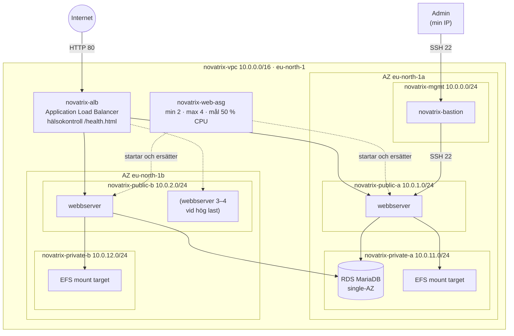

| Stack | Template | Innehåll |
|-------|----------|----------|
| `novatrix-backup` | [`01-backup.yaml`](templates/01-backup.yaml) | Backup-bucket (`DeletionPolicy: Retain`) |
| `novatrix-iam` | [`02-iam.yaml`](templates/02-iam.yaml) | Webbservrarnas roll, grupper och användare |
| `novatrix-network` | [`03-network.yaml`](templates/03-network.yaml) | VPC, publika subnät i två zoner, privata subnät, NACL:er, security groups |
| `novatrix-data` | [`04-data.yaml`](templates/04-data.yaml) | Lösenord och WordPress-nycklar, RDS, EFS |
| `novatrix-app` | [`05-app.yaml`](templates/05-app.yaml) | Bastion, launch template, Auto Scaling-grupp, skalningsregel, lastbalanserare |

## Filer

| Fil | Beskrivning |
|-----|-------------|
| [`templates/`](templates/) | De fem CloudFormation-templaten |
| [`parameters/prod.env`](parameters/prod.env) | Värden för miljön, bland annat gruppens storlek och CPU-målet |
| [`deploy.sh`](deploy.sh) | Bygger eller uppdaterar alla stackar; startar en rolling update vid ändringar |
| [`install-wordpress.sh`](install-wordpress.sh) | Installerar WordPress en gång; gäller alla servrar |
| [`verify.sh`](verify.sh) | 33 tester av hela stacken |
| [`test-availability.sh`](test-availability.sh) | **Ny:** följer webbplatsen medan en server kraschar eller tas bort |
| [`load-test.sh`](load-test.sh) | **Ny:** belastar CPU och följer hur gruppen skalar |
| [`preview-change.sh`](preview-change.sh) | Förhandsgranskar en ändring med ett change set |
| [`destroy.sh`](destroy.sh) | Tar en sista backup och river allt utom backup-stacken |
| [`restore-wordpress.sh`](restore-wordpress.sh) / [`backup-now.sh`](backup-now.sh) / [`show-password.sh`](show-password.sh) | Från v46 |

---

## Delmoment 1 – Repo

Mappen `V47` skapades som en vidareutveckling av V46, och README:n i roten uppdaterades.
Ändringarna jämfört med v46 ligger i nätverks-, data- och app-templaten samt i skripten.
Skärmdumparna ligger i mappen `bilder`.

### Ändringar i nätverket

En lastbalanserare kräver subnät i minst två zoner, så ett andra publikt subnät lades till.

| Subnät | CIDR | Zon | Innehåll |
|--------|------|-----|----------|
| `novatrix-mgmt` | 10.0.0.0/24 | eu-north-1a | Bastion |
| `novatrix-public-a` | 10.0.1.0/24 | eu-north-1a | Lastbalanserare och webbservrar |
| `novatrix-public-b` | 10.0.2.0/24 | eu-north-1b | Lastbalanserare och webbservrar (**nytt**) |
| `novatrix-private-a` | 10.0.11.0/24 | eu-north-1a | RDS och EFS |
| `novatrix-private-b` | 10.0.12.0/24 | eu-north-1b | EFS (och RDS standby vid Multi-AZ) |

En ny security group, `novatrix-alb-sg`, tar emot HTTP från internet. Webbservrarna tar nu bara
emot HTTP från lastbalanseraren, grupp mot grupp, och inte längre direkt från internet:

| Security group | In | Ut |
|----------------|----|----|
| `novatrix-alb-sg` | HTTP 80 från alla | HTTP 80 till `novatrix-web-sg` |
| `novatrix-web-sg` | HTTP 80 från `novatrix-alb-sg`, SSH 22 från `novatrix-bastion-sg` | HTTPS 443, MySQL 3306 och NFS 2049 |

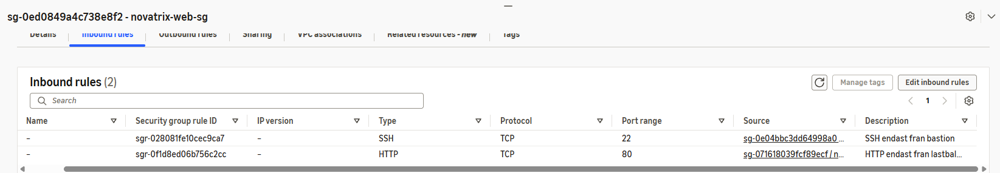

## Delmoment 2 – Förbered utrullning: launch template

Launch templaten `novatrix-web-lt` är mallen för varje webbserver. Alla servrar som Auto Scaling
startar blir identiska:

| Inställning | Värde |
|-------------|-------|
| AMI | Senaste Amazon Linux 2023, slås upp via SSM vid varje deploy |
| Instanstyp | `t3.micro` |
| IAM-roll | `novatrix-web-ec2-profile` |
| Security group | `novatrix-web-sg` |
| Metadata | IMDSv2 krävs |
| Övervakning | Detailed monitoring (CPU varje minut) |
| User data | Installerar Apache, PHP och WordPress, monterar EFS, skriver `wp-config.php` |

Zonen anges inte i mallen. Det är Auto Scaling-gruppen som bestämmer var varje server startas,
så samma mall används i båda zonerna.

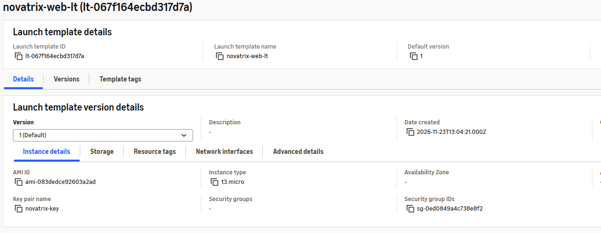

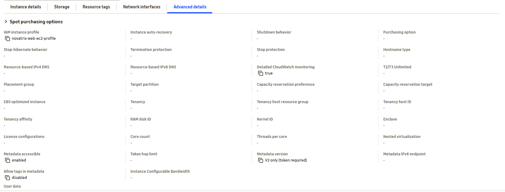

### Vad som krävs när det finns flera servrar

Fyra ändringar i installationen gör att servrarna kan bytas ut fritt:

1. **Gemensamma WordPress-nycklar.** WordPress signerar inloggningar med nycklar i
   `wp-config.php`. Om varje server slumpade egna nycklar skulle användaren loggas ut så fort
   lastbalanseraren skickade nästa förfrågan till en annan server. Nycklarna ligger därför i
   Secrets Manager, och alla servrar använder samma. Ingen *sticky session* behövs, eftersom
   inloggningen och innehållet ligger i databasen och filerna på EFS.
2. **Hälsokontrollsidan skapas sist.** `/health.html` skapas först när WordPress-filerna, EFS och
   `wp-config.php` är på plats. En server vars installation misslyckas svarar alltså inte på
   hälsokontrollen och byts ut automatiskt.
3. **Bara en server tar backup.** Alla servrar har backupjobbet, men bara den med lägst instans-ID
   i gruppen kör det. Försvinner den servern tar nästa över utan någon ändring.
4. **Installationssidan är stängd.** `/wp-admin/install.php` är blockerad i Apache, så att ingen
   utomstående kan installera WordPress via lastbalanseraren. Installationen görs bara med
   WP-CLI via `install-wordpress.sh`.

Varje server skickar också med sitt instans-ID i HTTP-huvudet `X-Novatrix-Instance`, så att det
går att se vilken server som svarar.

## Delmoment 3 – Auto Scaling

```bash
./deploy.sh
```

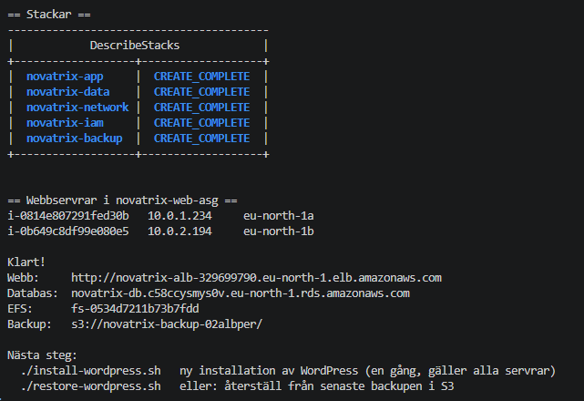

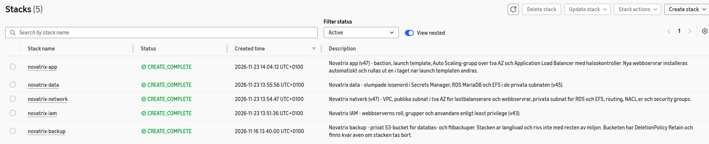

Auto Scaling-gruppen `novatrix-web-asg`:

| Inställning | Värde | Motivering |
|-------------|-------|------------|
| Subnät | `novatrix-public-a` och `novatrix-public-b` | En server per zon; om en zon försvinner finns den andra kvar |
| Min / max | 2 / 4 | Två servrar ger tillgänglighet; fyra räcker för toppar och sätter ett kostnadstak |
| Hälsokontroll | ELB, 10 minuters startperiod | En server som lastbalanseraren anser trasig byts ut, inte bara en som har kraschat |
| Skalning | Target tracking, 50 % snitt-CPU | AWS lägger själv till och tar bort servrar för att hålla snittet nära 50 % |
| Utrullning | Rolling update, minst 1 server i drift, en i taget | En ny launch template rullas ut utan avbrott |
| Uppstart | `CreationPolicy` med signal från varje server | Stacken blir klar först när servrarna faktiskt fungerar |

```yaml
  WebAsg:
    Type: AWS::AutoScaling::AutoScalingGroup
    CreationPolicy:
      ResourceSignal:
        Count: !Ref AsgMinSize
        Timeout: PT20M
    UpdatePolicy:
      AutoScalingRollingUpdate:
        MinInstancesInService: 1
        MaxBatchSize: 1
        WaitOnResourceSignals: true
    Properties:
      VPCZoneIdentifier:
        - { "Fn::ImportValue": !Sub "${EnvName}-PublicSubnetAId" }
        - { "Fn::ImportValue": !Sub "${EnvName}-PublicSubnetBId" }
      MinSize: !Ref AsgMinSize
      MaxSize: !Ref AsgMaxSize
      HealthCheckType: ELB
      HealthCheckGracePeriod: 600

  CpuScalingPolicy:
    Type: AWS::AutoScaling::ScalingPolicy
    Properties:
      AutoScalingGroupName: !Ref WebAsg
      PolicyType: TargetTrackingScaling
      TargetTrackingConfiguration:
        PredefinedMetricSpecification:
          PredefinedMetricType: ASGAverageCPUUtilization
        TargetValue: !Ref CpuTargetPercent
```

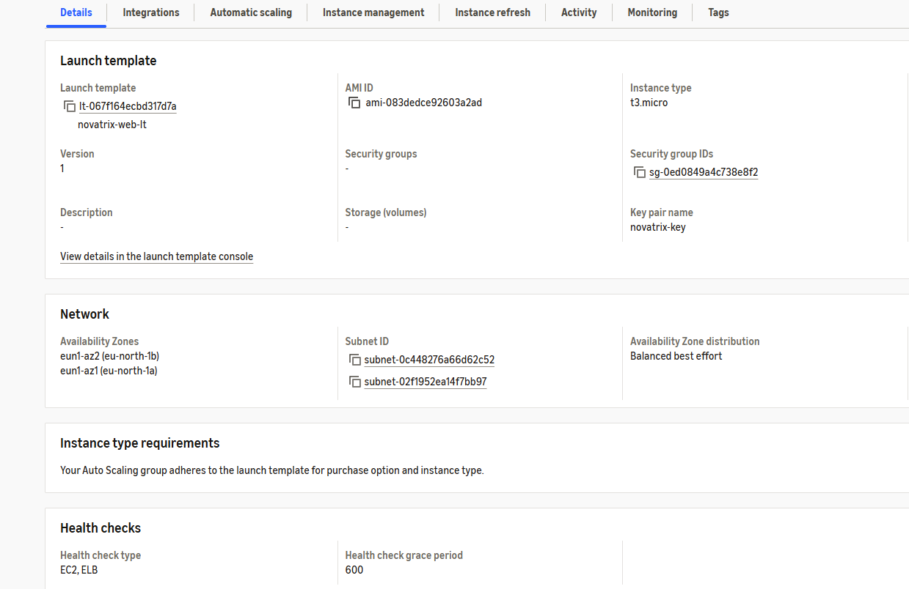

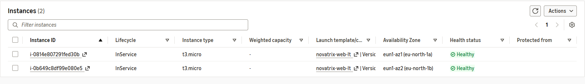

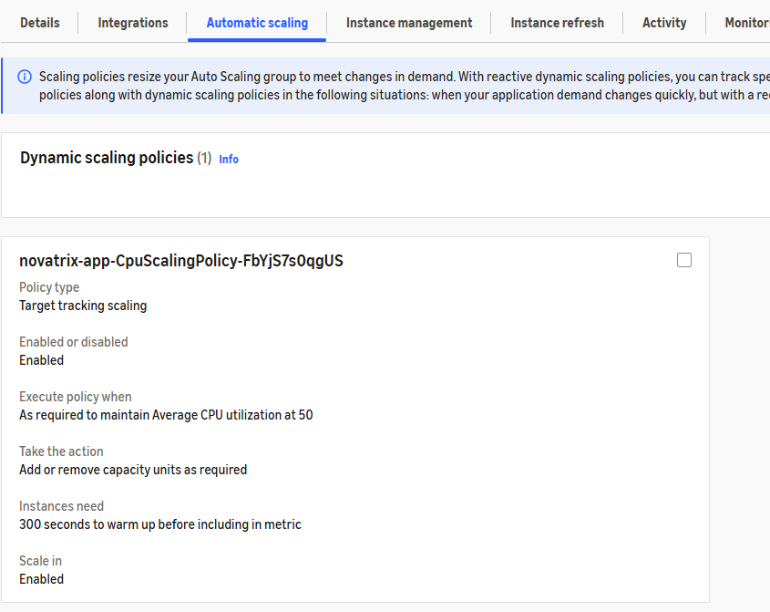

## Delmoment 4 – Load balancing

Lastbalanseraren `novatrix-alb` är internetvänd och ligger i båda publika subnäten. Den lyssnar
på HTTP port 80 och skickar trafiken till target groupen `novatrix-web-tg`, som Auto Scaling-gruppen
automatiskt lägger till och tar bort servrar i.

| Hälsokontroll | Värde | Motivering |
|---------------|-------|------------|
| Sökväg | `/health.html` | En statisk sida. Om databasen får problem ska inte alla servrar markeras som trasiga och bytas ut, eftersom det inte skulle hjälpa |
| Intervall | 15 sekunder | |
| Frisk efter | 2 lyckade kontroller | En ny server får trafik efter ungefär 30 sekunder |
| Trasig efter | 2 misslyckade kontroller | En trasig server tas ur trafiken efter högst ungefär 30 sekunder |
| Deregistration delay | 30 sekunder | Pågående förfrågningar hinner avslutas innan en server tas bort |

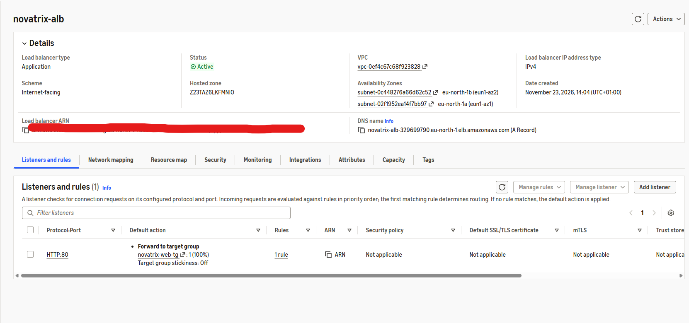

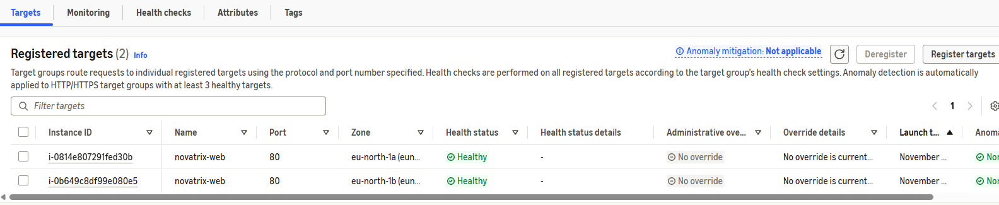

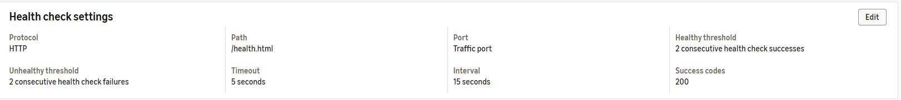

**HTTPS:** Lastbalanseraren lyssnar bara på HTTP, eftersom ett certifikat från AWS Certificate
Manager kräver ett eget domännamn. I drift skulle Novatrix domän få ett certifikat, en lyssnare på
port 443 och en regel som omdirigerar HTTP till HTTPS. Krypteringen avslutas då i
lastbalanseraren, och webbservrarna behöver inget eget certifikat.

## Delmoment 5 – Kostnad

Kostnaden beräknades med AWS Pricing Calculator i två scenarier, som två grupper i samma kalkyl.

**Kalkylen:** https://calculator.aws/#/estimate?id=f840dd5148388bfeb83751e109d261e4d4ac137d

### Antaganden

- Region Europe (Stockholm), eu-north-1
- Drift dygnet runt, 730 timmar per månad, On-Demand-priser utan reservationer eller Savings Plans
- Free tier är inte medräknat, eftersom det bara gäller nya konton under en begränsad tid
- Cirka 30 GB trafik genom lastbalanseraren per månad, motsvarande en mindre företagssajt
- Databasen kör single-AZ, som i den här uppgiften, utan RDS Proxy och Database Insights
- **Normal last:** 2 webbservrar och bastion, 5 publika IPv4-adresser
- **Hög last:** 4 webbservrar och bastion hela månaden, 7 publika IPv4-adresser. Det är taket,
  alltså det högsta lösningen kan kosta med `AsgMaxSize=4`
- Inte medräknat: trafik mellan zonerna och dataöverföring ut under 100 GB per månad, som är gratis

### Resultat

| Del | Normal last (USD/mån) | Hög last (USD/mån) |
|-----|----------------------:|-------------------:|
| Webbservrar, `t3.micro` med EBS och detailed monitoring | 21,31 (2 st) | 42,62 (4 st) |
| Bastion, `t3.micro` | 8,55 | 8,55 |
| Publika IPv4-adresser | 18,25 (5 st) | 25,55 (7 st) |
| Application Load Balancer | 18,05 | 18,05 |
| RDS MariaDB `db.t4g.micro`, single-AZ, 20 GB gp3 | 14,08 | 14,08 |
| Secrets Manager (4 hemligheter) | 1,65 | 1,65 |
| EFS (1 GB) och S3 (1 GB) | 0,32 | 0,32 |
| **Totalt per månad** | **82,21** | **110,82** |
| **Totalt per år** | **986,52** | **1 329,84** |

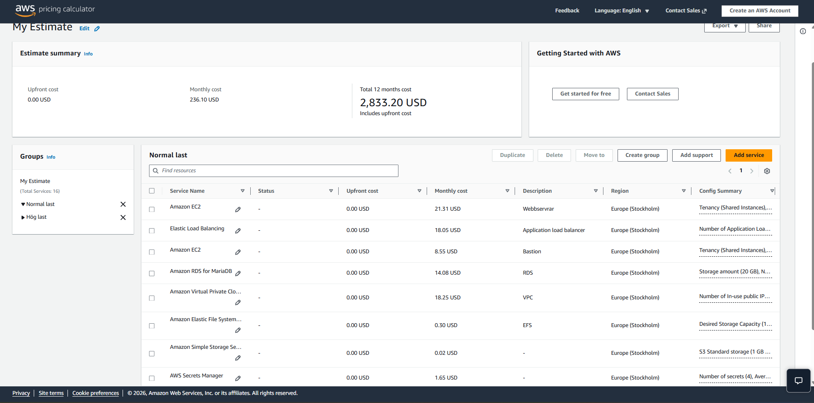


### Vad som kostar mest

| Del | Andel vid normal last | Andel vid hög last |
|-----|----------------------:|-------------------:|
| EC2 (webbservrar och bastion) | 36 % | 46 % |
| Publika IPv4-adresser | 22 % | 23 % |
| Lastbalanserare | 22 % | 16 % |
| Databas | 17 % | 13 % |
| Övrigt | 3 % | 2 % |

1. **EC2-instanserna** är den största posten och den enda som växer med lasten. Med `AsgMaxSize=4`
   finns ett tak: lösningen kan aldrig kosta mer än cirka 111 USD per månad, hur hög belastningen
   än blir. I verkligheten skalar gruppen bara ut under toppar, så den verkliga kostnaden hamnar
   nära normal last.
2. **De publika IPv4-adresserna** kostar lika mycket som lastbalanseraren, eftersom AWS tar betalt
   för varje publik IPv4-adress, även lastbalanserarens två. Alternativet, webbservrar i privata
   subnät bakom en NAT gateway, kostar ännu mer, drygt 30 USD per månad och zon. Publika adresser
   med security groups som bara släpper in trafik från lastbalanseraren är därför det billigare
   valet för Novatrix.
3. **Lastbalanseraren** är en fast kostnad, oberoende av antalet servrar.
4. **Databasen** är billig med single-AZ men ungefär fördubblas med Multi-AZ.

Kalkylatorn hade som förval tillvalen RDS Proxy och Database Insights påslagna, vilket först gav
databasen en kostnad på 57 USD. Det visar att antagandena måste kontrolleras rad för rad.

**Möjliga besparingar:** Savings Plans eller reserverade instanser för de två servrar som alltid
körs (30–60 % billigare), Basic monitoring i testmiljön, och att stänga av bastion när den inte
används, vilket sparar både instansen och en publik IP-adress.

## Delmoment 6 – Verifiera

### WordPress via lastbalanseraren

```bash
./install-wordpress.sh
```

WordPress installeras en gång. Installationen ligger i databasen och på EFS, så den gäller för alla
servrar, även de som startas senare.

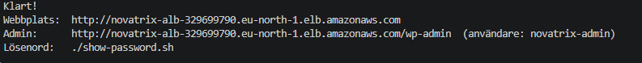

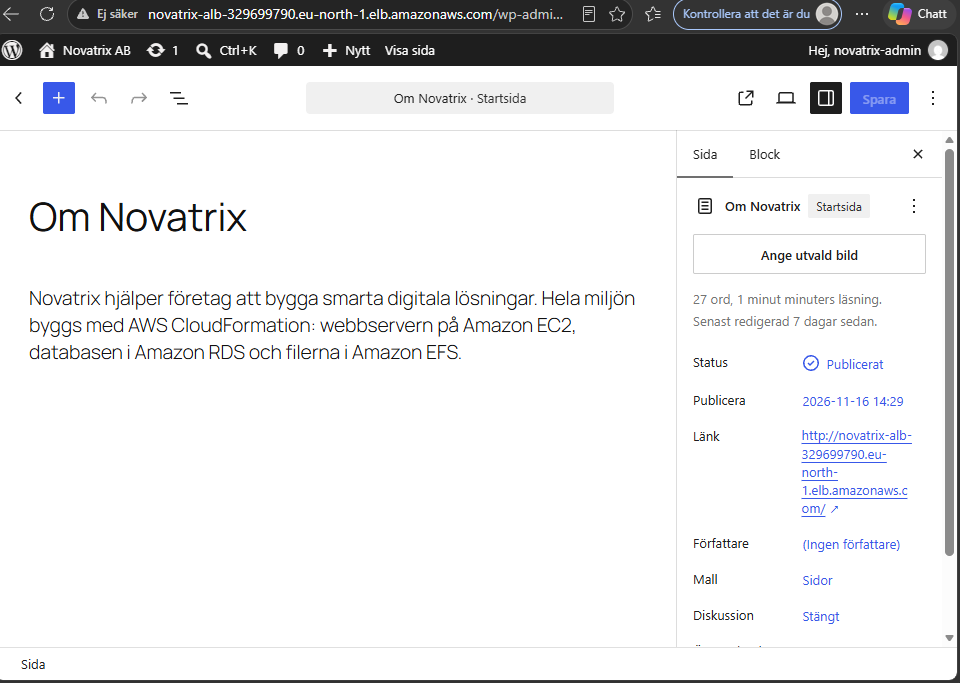

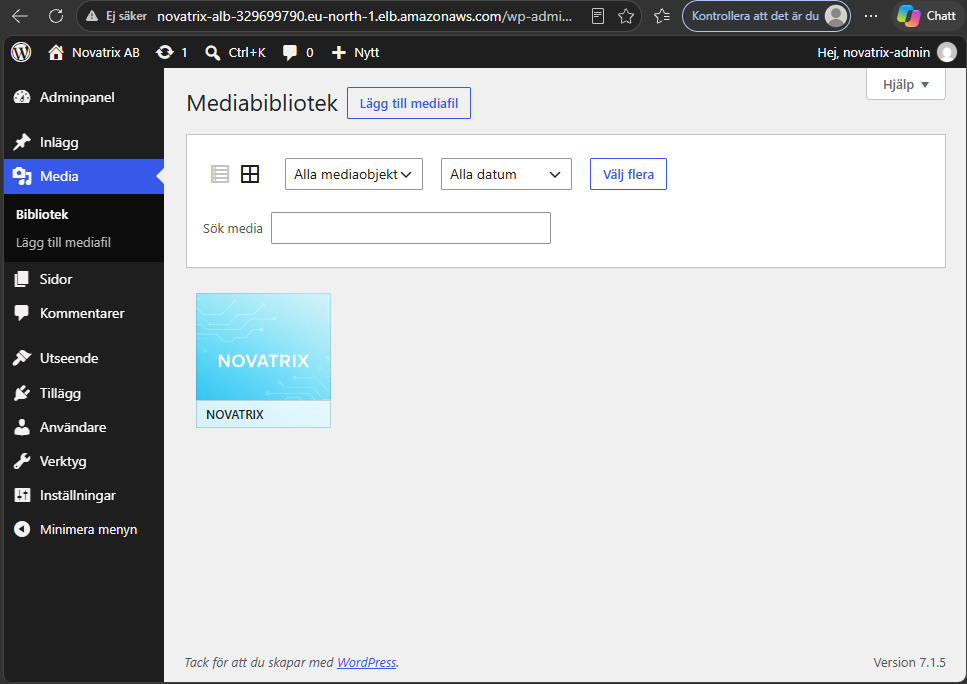

Trafiken fördelas mellan servrarna. Huvudet `X-Novatrix-Instance` visar att svaren omväxlande
kommer från båda:

```bash
for i in 1 2 3 4 5 6; do curl -sI "$(source ./lib.sh; stack_output app WebUrl)/" | grep -i x-novatrix-instance; done
```

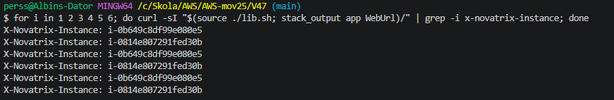

### Automatiska tester

`verify.sh` kör 33 tester:

| Grupp | Vad som testas |
|-------|----------------|
| CloudFormation | Alla stackar är klara, nätverket är oförändrat sedan deploy |
| Lastbalanserare | Webbplatsen svarar, två zoner, hälsokontroll på `/health.html`, minst 2 friska servrar, trafiken fördelas, `install.php` är stängd |
| Auto Scaling | Min 2 och max 4, servrar i två zoner, ELB-hälsokontroll, target tracking på 50 %, samma WordPress-nycklar på alla servrar |
| Nätverk | Webbservrarna nås inte direkt via HTTP eller SSH, bastion nås från min IP, privata subnät saknar väg ut |
| Databas, lagring och backup | Inte publik, krypterad, EFS monterad med TLS, backup-bucketen finns kvar |
| WordPress och säkerhet | WordPress når databasen, IMDSv2 på alla servrar, least privilege för bastion och webbservrar |

Alla 33 tester gav förväntat resultat, både före och efter de automatiska utrullningarna.

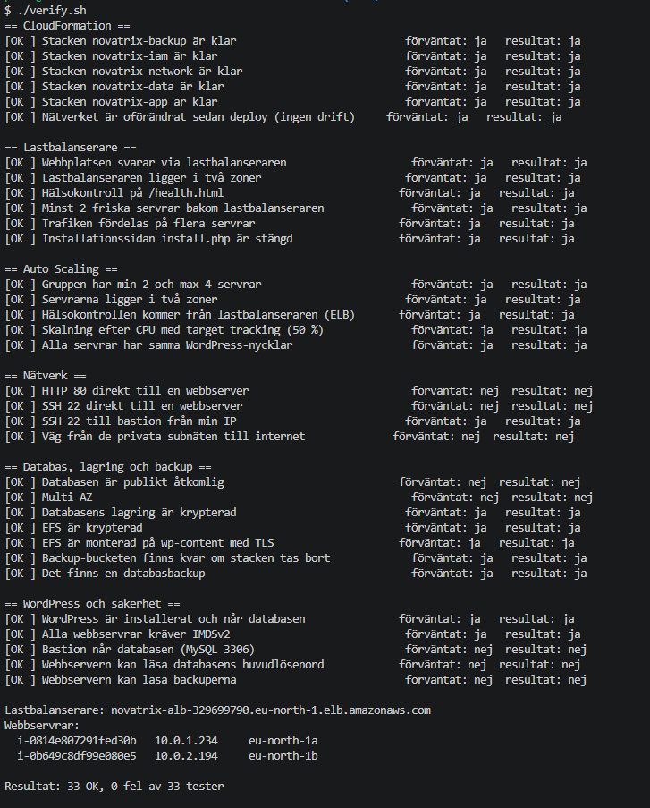

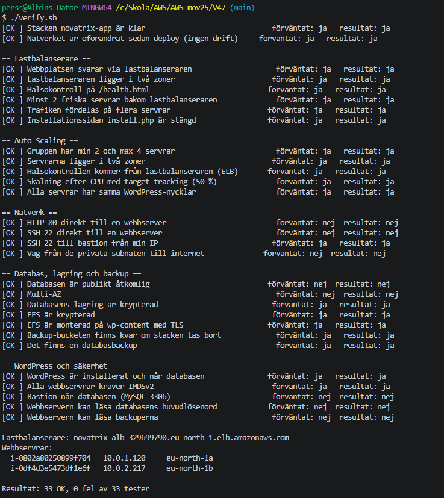

### En server kraschar

```bash
./test-availability.sh krasch
```

Skriptet frågar webbplatsen varannan sekund och visar vilken server som svarar. Efter 20 sekunder
stoppas Apache på en server, som ett oplanerat fel.

1. Under de första sekunderna fick några förfrågningar till den trasiga servern felet `502`. Det är
   tiden det tar för lastbalanseraren att upptäcka felet: två misslyckade hälsokontroller med
   15 sekunders mellanrum.
2. Därefter skickade lastbalanseraren all trafik till den friska servern, och webbplatsen fungerade.
3. Auto Scaling såg att servern var ohälsosam, avslutade den och startade en ersättare i samma zon.
4. När ersättaren var klar delades trafiken åter mellan två servrar.

Resultat: 232 av 238 förfrågningar fick svar 200, alltså 97 %. De 6 misslyckade förfrågningarna
kom alla under de första sekunderna efter kraschen, innan lastbalanseraren hade upptäckt felet.
Efter testet var gruppen återställd med två friska servrar, en i varje zon.

Felen under de första sekunderna kan minskas med tätare hälsokontroller, men det ger fler
kontroller och en större risk att en tillfälligt långsam server tas ur trafiken i onödan.

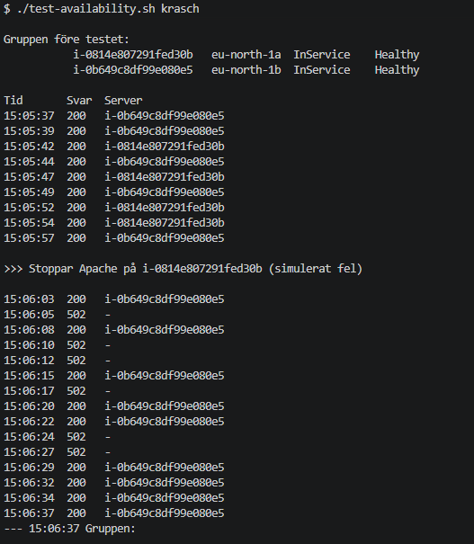

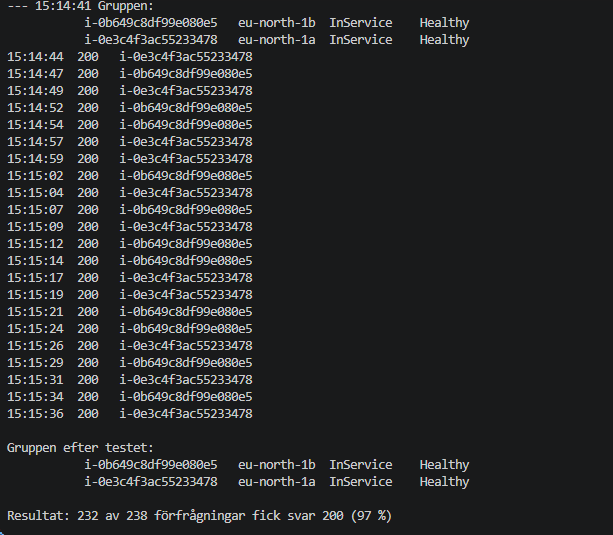

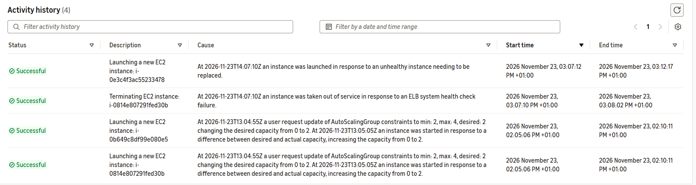

### Skalning efter last

```bash
./load-test.sh start
```

Alla servrar belastades till 100 % CPU. När snittet låg över 50 % i några minuter ökade Auto Scaling
antalet servrar, och den nya servern började ta emot trafik när hälsokontrollen lyckades. När
belastningen upphörde skalade gruppen in till 2 servrar igen.

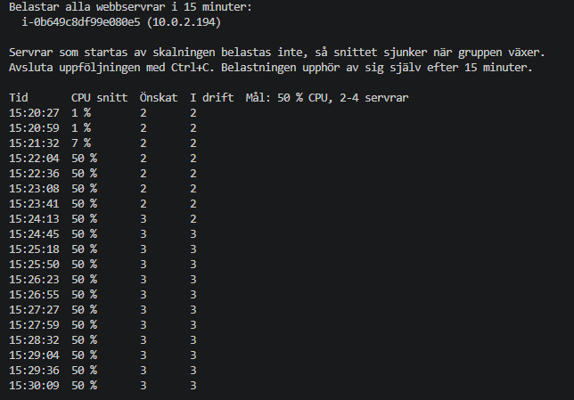

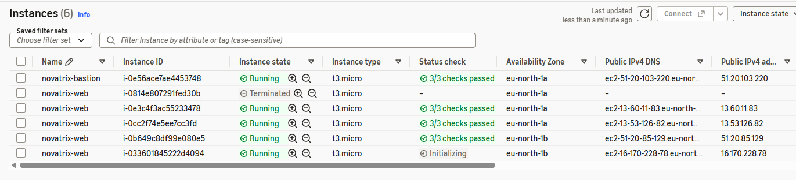

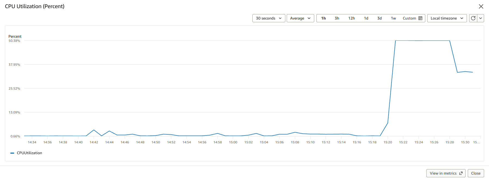

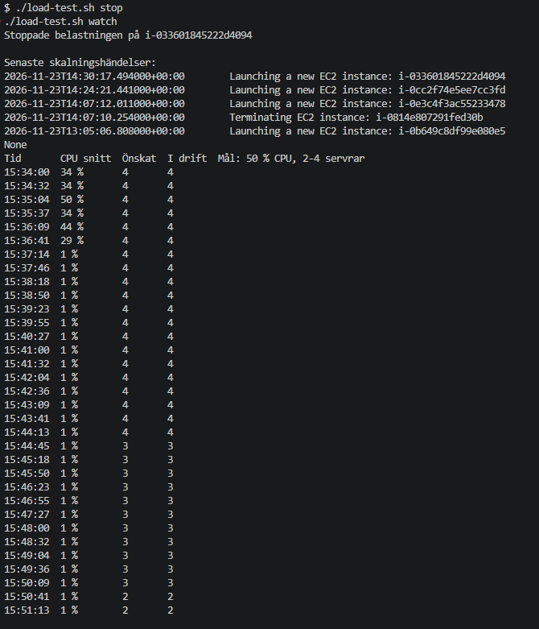

### Automatisk utrullning

En ändring i launch templaten, ett nytt HTTP-huvud `X-Novatrix-Version`, förhandsgranskades med ett
change set. Mallen ändras på plats (`Replacement: False`) genom att en ny version skapas, och
Auto Scaling-gruppen uppdateras.

```bash
./preview-change.sh app
```

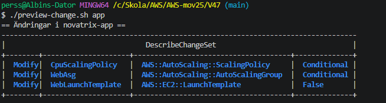

Ändringen rullades ut med `./deploy.sh` medan en loop frågade webbplatsen varannan sekund.
CloudFormation startade en ny server, väntade på dess signal, tog bort en gammal och upprepade.
Minst en server var i drift hela tiden, och **varje förfrågan fick svaret `200 OK`**.

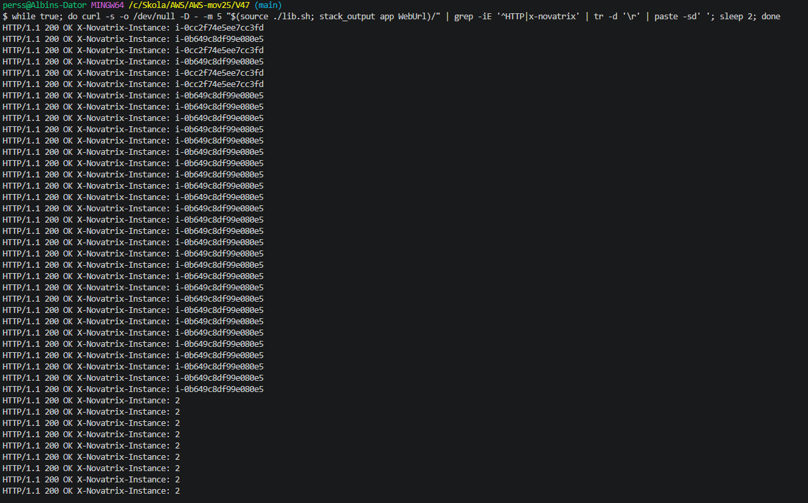

De två första försöken gav fel namn på huvudet. Felen rättades i koden och rullades ut på samma
sätt, så att launch templaten nu har fyra versioner. Även rättelserna rullades ut utan avbrott.

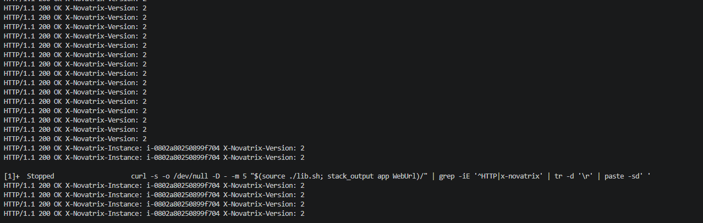

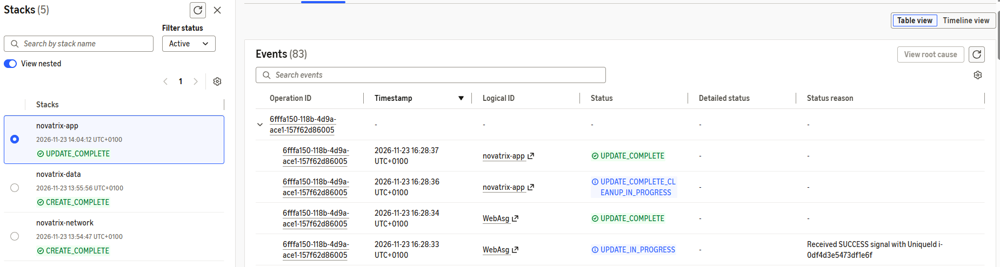

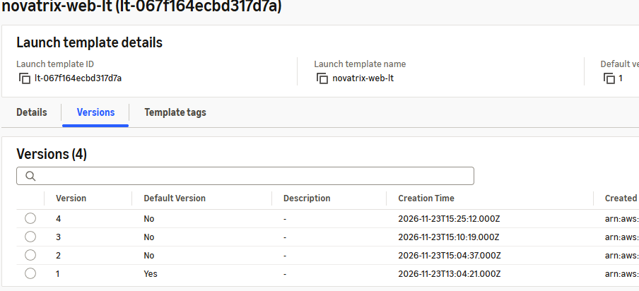

### Historiken

Varje ändring finns som en commit, och varje commit som ändrade launch templaten motsvarar en
version av mallen i AWS och en automatisk utrullning:

```
55fb183 V47: rätta namnet på versionshuvudet V2
4e47bb8 V47: rätta namnet på versionshuvudet
8c38353 V47: lägg till versionshuvud på webbservrarna
26bd574 V47: robustare test av IMDSv2 på alla webbservrar
e093900 V47: Created files V1
```

| Commit | Ändring | Launch template |
|--------|---------|-----------------|
| `e093900` | Första versionen av hela stacken | Version 1 |
| `26bd574` | Rättat test i `verify.sh` | Oförändrad |
| `8c38353` | Nytt HTTP-huvud, men med fel namn | Version 2 |
| `4e47bb8` | Första rättelsen, fortfarande fel | Version 3 |
| `55fb183` | Rätt: både instans-ID och version visas | Version 4 |

Historiken visar en viktig fördel med IaC: när ett fel upptäcks rättas det i koden och rullas
ut på samma sätt som allt annat, och det går alltid att se exakt vad som ändrades och när.

## Städning

```bash
./destroy.sh
```

En sista backup togs, stackarna revs i omvänd ordning och `novatrix-backup` lämnades kvar.

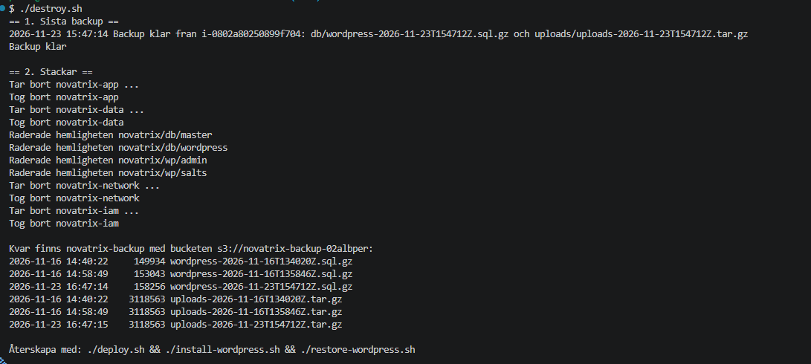

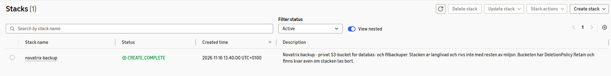

---

## Hur lösningen svarar på last och fel utan handpåläggning (VG)

| Händelse | Vad som händer automatiskt |
|----------|----------------------------|
| **Belastningen ökar** | Target tracking ser att snitt-CPU:n är över 50 % och startar fler servrar, upp till 4. Varje ny server installeras från launch templaten, monterar EFS, signalerar när den är klar och får trafik när hälsokontrollen lyckas |
| **Belastningen minskar** | Gruppen tar bort servrar, ner till 2, och lastbalanseraren slutar skicka trafik till dem innan de stängs |
| **En server kraschar** | Lastbalanseraren slutar skicka trafik till den inom ungefär 30 sekunder. Auto Scaling ser att den är ohälsosam och ersätter den |
| **En installation misslyckas** | Hälsokontrollsidan skapas aldrig, servern markeras som trasig och ersätts |
| **En zon försvinner** | Servern i den andra zonen tar all trafik, och Auto Scaling startar nya servrar i den zon som fungerar |
| **En ny version ska ut** | En ändring i templaten och `./deploy.sh` rullar ut den en server i taget, med automatisk återställning om en ny server inte signalerar |
| **Servern som tar backup försvinner** | Nästa server med lägst instans-ID tar över backupen |

## Återskapa lösningen

```bash
git clone https://github.com/02albper-frog/AWS-mov25.git
cd AWS-mov25/V47
./deploy.sh               # alla stackar, 25-35 minuter
./install-wordpress.sh    # en gång
./verify.sh               # 33 tester
```

Förutsättningar: AWS CLI inloggat som administratör, nyckelparet `novatrix-key` i eu-north-1 och
ett eget globalt unikt `BackupBucketName` i `parameters/prod.env`.

## Reflektion

- **Databasen är den svaga punkten.** Webbservrarna, lastbalanseraren och EFS finns i två zoner,
  men databasen kör single-AZ den här veckan för att hålla nere kostnaden. Om eu-north-1a försvinner
  slutar webbplatsen fungera trots att webbservern i eu-north-1b lever. I drift skulle
  `DbMultiAZ=true`, en ändring av en parameter, ge en standby-databas i den andra zonen, till en
  kostnad av ungefär 14 USD extra per månad.
- **Tidigare designval gjorde skalningen enkel.** Eftersom databasen ligger i RDS och filerna på EFS
  sedan v45 har webbservrarna inget eget innehåll. Det enda som behövde läggas till var gemensamma
  WordPress-nycklar och en backup som bara körs på en server.
- **Hälsokontrollen är en avvägning.** Tätare kontroller ger färre felsvar när en server kraschar men
  fler kontroller och risk för falsklarm. En statisk hälsosida gör att ett databasfel inte leder till
  att alla servrar byts ut i onödan.
- **Automatisk utrullning gör det ofarligt att göra fel.** Två felaktiga versioner av ett HTTP-huvud
  rullades ut och rättades utan att en enda förfrågan misslyckades, och varje version finns kvar i
  både Git och launch templaten.
- **Kostnaden överraskade.** De publika IPv4-adresserna kostar lika mycket som lastbalanseraren, och
  kalkylatorns förval kan lägga till tjänster man inte använder.
- **Nästa steg:** Multi-AZ för databasen, så att även databasen klarar ett avbrott i en zon, och
  central övervakning med larm i CloudWatch, som är nästa veckas uppgift.