# V48 – Monitorering och cloud native

**Kurs:** Amazon Web Services · **Vecka:** 48 · **Uppgift:** 7 av 8 · **Företag:** Novatrix AB

Den skalbara WordPress-lösningen från v47 har fått central övervakning i CloudWatch.
CloudWatch-agenten på varje webbserver skickar minne, disk och loggar. Larmen tittar på
hela gruppen och skickar e-post via SNS, och dashboarden `novatrix-drift` visar på en sida
om Novatrix mår bra. Lambda-funktionen `novatrix-sajtkoll` kontrollerar sajten utifrån,
som en besökare, var 5:e minut. Det är den serverless-del som körs på riktigt. Flytten av
webbservrarna till containers på Fargate beskrivs som nästa steg i en cloud native-strategi.

Allt är CloudFormation, även agenten, loggrupperna, larmen och dashboarden. Hela miljön
byggdes från grunden med ett enda `./deploy.sh`. Det enda som gjordes för hand var att
bekräfta prenumerationen på larmen i mejlet från AWS, vilket AWS kräver.

## Innehåll

1. [Arkitektur](#arkitektur)
2. [Stackar och filer](#stackar-och-filer)
3. [Bygga miljön](#bygga-miljön)
4. [CPU, minne och disk](#cpu-minne-och-disk)
5. [Larm](#larm)
6. [Central loggning](#central-loggning)
7. [Dashboard](#dashboard)
8. [Cloud native](#cloud-native)
9. [Varför central monitorering är väsentlig](#varför-central-monitorering-är-väsentlig)
10. [Verifiering och rivning](#verifiering-och-rivning)
11. [Kostnad](#kostnad)
12. [Lärdomar och förbättringar](#lärdomar-och-förbättringar)

## Arkitektur

```
                 ┌──────────────────────── CloudWatch ─────────────────────────┐
                 │  Metrics ──▶ 8 larm ──▶ SNS novatrix-larm ──▶ e-post         │
                 │  Logs ──▶ Logs Insights (4 sparade sökningar)                │
                 │  Dashboard novatrix-drift                                    │
                 └───────▲────────────────▲────────────────▲────────────────────┘
                         │ CPU, minne,    │ förfrågningar,  │ Available,
                         │ disk, loggar   │ fel, friska     │ ResponseTimeMs
Internet ──▶ novatrix-alb ──▶ novatrix-web-asg (2–4 servrar)   novatrix-sajtkoll (Lambda)
                              med CloudWatch-agenten              ▲
                                │            │                    │ var 5:e minut
                                ▼            ▼                 EventBridge
                          novatrix-db    novatrix-efs
                          (RDS, CPU och  (wp-content)
                           lagring)
```

Mätvärden och loggar samlas på ett ställe utanför servrarna. Larmen tittar på
Auto Scaling-gruppen och inte på enskilda servrar, eftersom servrarna byts ut hela tiden.

## Stackar och filer

| Stack | Template | Innehåll |
|-------|----------|----------|
| `novatrix-backup` | `templates/01-backup.yaml` | Backup-bucket som finns kvar när miljön rivs |
| `novatrix-iam` | `templates/02-iam.yaml` | Webbrollen, nu med `CloudWatchAgentServerPolicy`, grupper och användare |
| `novatrix-network` | `templates/03-network.yaml` | VPC, subnät i två zoner, NACL:er, security groups |
| `novatrix-data` | `templates/04-data.yaml` | Lösenord, RDS (single-AZ), EFS |
| `novatrix-app` | `templates/05-app.yaml` | Bastion, lastbalanserare, Auto Scaling-grupp, agentens konfiguration och loggrupper |
| `novatrix-monitoring` | `templates/06-monitoring.yaml` | **Ny:** SNS, 8 larm, dashboard, sparade sökningar och Lambda-funktionen `novatrix-sajtkoll` |

Övervakningen ligger i en egen stack som byggs sist och rivs först. Larmen behöver namnen
på gruppen, lastbalanseraren och target group, och de hämtas som exporter från
app-stacken. CloudFormation tillåter inte att app-stacken rivs så länge en annan stack
använder dess exporter.

**Nya och ändrade skript den här veckan:**

| Fil | Vad den gör |
|-----|-------------|
| `stress-test.sh` | **Ny.** Testar larmkedjan (`larmtest`), fyller minnet (`minne`) och disken (`disk`), gör en server sjuk (`unhealthy`) och återställer (`stopp`) |
| `reload-agent.sh` | **Ny.** Läser in agentens konfiguration på nytt på servrarna som redan körs |
| `verify.sh` | Utökad med 13 tester för övervakningen, 47 tester totalt |
| `deploy.sh`, `destroy.sh` | Hanterar den sjätte stacken och kontrollerar e-postadressen för larmen |
| `load-test.sh` | Rättad så att alla servrar belastas, se [Lärdomar](#lärdomar-och-förbättringar) |

**E-postadressen för larmen** ligger inte i koden. Den skickas in som parameter från
`parameters/prod.local.env`, som står i `.gitignore` och bara finns på min dator.
`prod.local.env.example` visar hur filen ska se ut.

## Bygga miljön

```bash
cd V48
cp parameters/prod.local.env.example parameters/prod.local.env   # fyll i e-postadressen
./deploy.sh                       # bygger alla sex stackar
./install-wordpress.sh            # eller ./restore-wordpress.sh
./verify.sh                       # 47 tester
./destroy.sh                      # sista backup, river allt utom backup-stacken
```

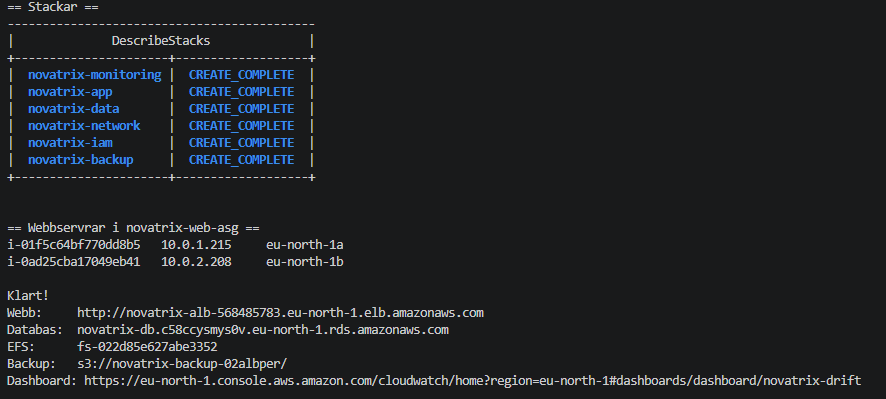

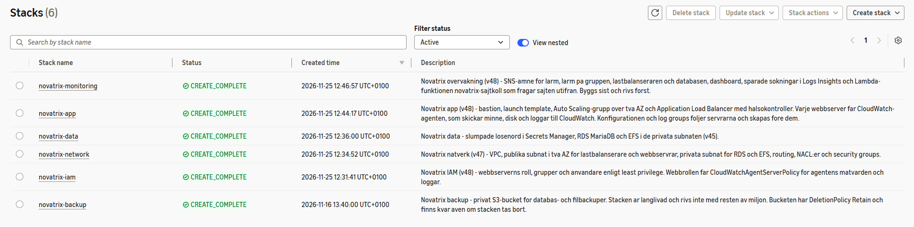

När `novatrix-monitoring` skapas skickar AWS ett mejl för att bekräfta prenumerationen.
Utan bekräftelse kommer inga larm fram. Det är det enda steget som inte går att
automatisera, eftersom AWS kräver att ägaren av adressen själv godkänner utskicken.

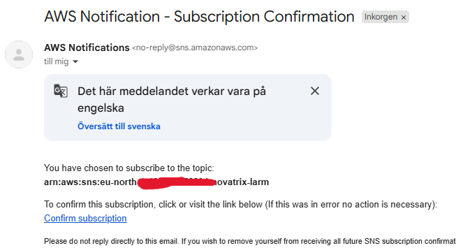

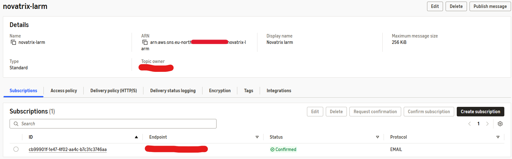

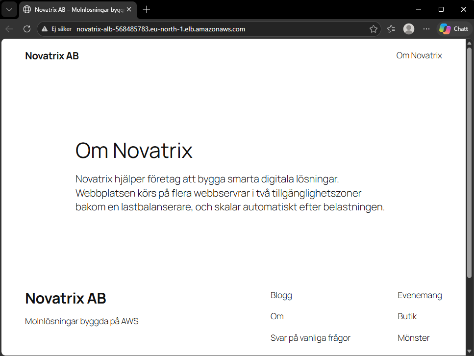

## CPU, minne och disk

### Vad AWS ser själv och vad som kräver agenten

AWS ser servrarna **utifrån**: CPU, nätverkstrafik och hur mycket som läses och skrivs
till disken. Hur mycket minne Linux använder och hur full disken är syns bara **inifrån**
operativsystemet. Därför har varje webbserver **CloudWatch-agenten**, som mäter inifrån
och skickar till namnrymden `CWAgent`. Samma agent skickar också loggfilerna.

| Mätvärde | Källa | Används för |
|----------|-------|-------------|
| `CPUUtilization` | AWS/EC2, varje minut (detailed monitoring) | Skalning och larmet `novatrix-cpu-hog` |
| `mem_available_percent` | CWAgent | Larmet `novatrix-minne` |
| `mem_used_percent` | CWAgent | Dashboarden |
| `disk_used_percent` för `/` | CWAgent | Larmet `novatrix-disk` |

### Så kommer agenten till varje server

Tre delar behövs, och alla är kod:

1. **Rättighet.** Webbrollen har fått den AWS-hanterade policyn
   `CloudWatchAgentServerPolicy`. Den får skicka mätvärden och loggar, läsa taggar (för
   gruppens namn) och läsa parametrar som börjar med `AmazonCloudWatch-`.

   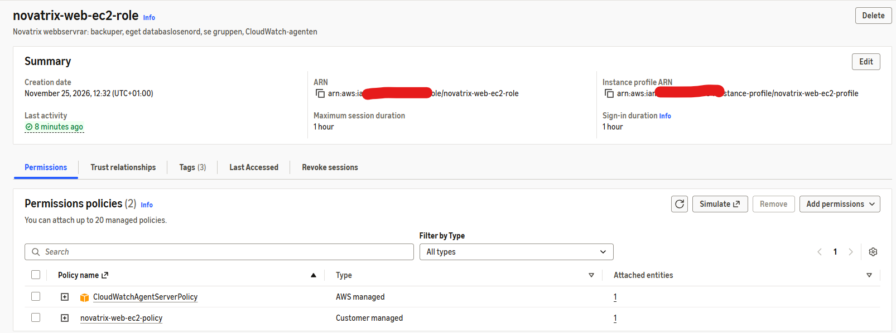

2. **Konfiguration.** Agentens inställningar ligger i Parameter Store som
   `AmazonCloudWatch-novatrix`. Alla servrar hämtar samma konfiguration när de startar,
   så den ändras på ett ställe. Servrar som redan körs läser in en ändring med
   `./reload-agent.sh`. Alternativet är en instance refresh som byter ut alla servrar.

   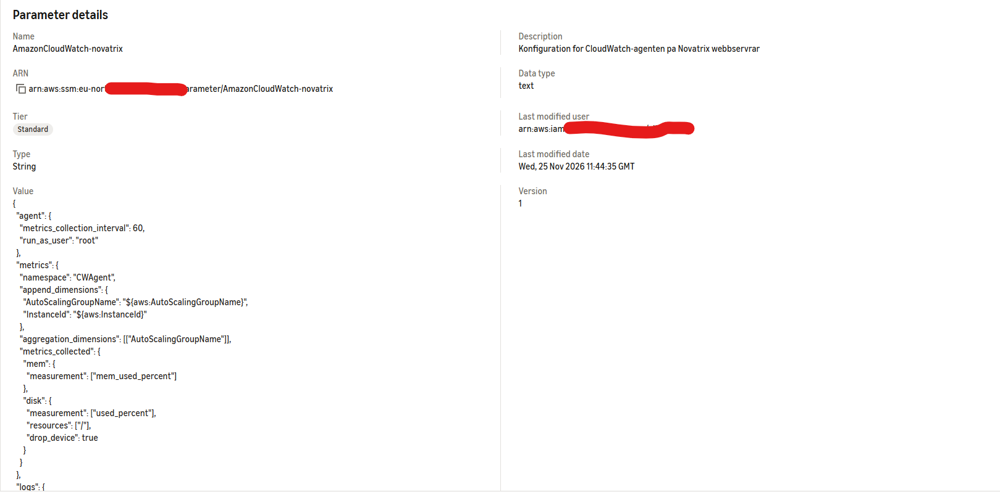

3. **Installation.** User data i launch templaten installerar agenten och startar den
   med konfigurationen. Servrar som startas av skalningen får den automatiskt.

Konfigurationen lägger till dimensionerna `AutoScalingGroupName` och `InstanceId`, och
`aggregation_dimensions` gör att agenten också skickar ett sammanräknat värde för hela
gruppen. Larmen tittar på gruppvärdet, och vid felsökning går det att se varje server
för sig.

I templaten skrivs agentens egna variabler som `${!aws:InstanceId}`. Utropstecknet hindrar
CloudFormations `!Sub` från att försöka ersätta dem, och de når agenten som
`${aws:InstanceId}`.

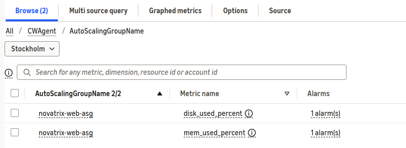

## Larm

Alla larm skickar till SNS-ämnet `novatrix-larm`, både när de går till ALARM och när de
går tillbaka till OK. Ett larm skickar bara meddelande när läget byts, inte hela tiden.

| Larm | Mätvärde | Villkor | Saknad data |
|------|----------|---------|-------------|
| `novatrix-cpu-hog` | CPU för gruppen | Average > 70 % i 5 min | missing |
| `novatrix-minne` | `mem_available_percent` för gruppen | Minimum < 10 % i 5 min | missing |
| `novatrix-disk` | `disk_used_percent` för gruppen | Maximum > 85 % i 5 min | missing |
| `novatrix-unhealthy` | UnHealthyHostCount | ≥ 1 i 3 av 3 minuter | notBreaching |
| `novatrix-5xx` | Serverfel från WordPress | Sum > 10 på 5 min | notBreaching |
| `novatrix-db-cpu` | Databasens CPU | Average > 80 % i 10 min | missing |
| `novatrix-db-lagring` | Databasens lediga lagring | < 2 GB | missing |
| `novatrix-sajtkoll` | Available från Lambda | < 1 två kontroller i rad | **breaching** |

**Motivering av trösklarna:**

- **CPU 70 %, medan skalningen börjar vid 50 %.** Vanlig last hanteras av skalningen
  utan att någon behöver göra något. Larmet går bara när skalningen inte räcker, till
  exempel när gruppen redan har nått max 4 servrar. Då behöver någon höja taket eller
  byta instanstyp.
- **Minne och disk med Minimum och Maximum, inte Average.** En enda server med fullt
  minne eller full disk är ett problem, även om de andra mår bra. Därför tittar larmen på
  den sämsta servern.
- **Saknad data hanteras olika.** För `unhealthy` och `5xx` betyder inga data inga fel,
  och då är allt bra. För `sajtkoll` betyder inga data att kontrollen har slutat
  rapportera, och en tyst vakt är ett fel.
- **Databasen** har larm på CPU och lagring, eftersom WordPress slutar fungera när
  databasen är full eller överbelastad.

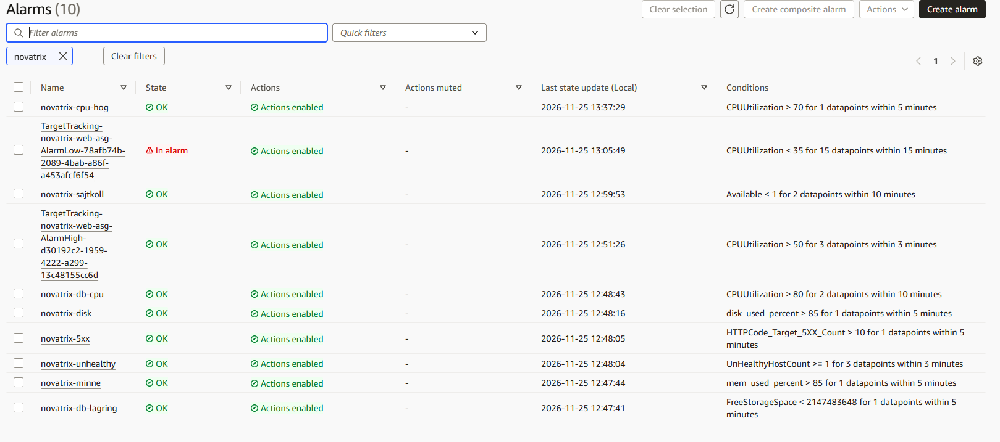

De två larm som börjar med `TargetTracking-novatrix-web-asg` skapas av Auto Scaling för
skalningsregeln från v47. De styr skalningen och skickar inga mejl. `AlarmLow` står
normalt i läget ALARM när CPU:n är låg, men gruppen har redan sitt minsta antal servrar.

### Test av larmkedjan

`./stress-test.sh larmtest` sätter `novatrix-cpu-hog` i läget ALARM med
`set-alarm-state`. Det visar att hela kedjan larm → SNS → e-post fungerar. Vid nästa
utvärdering går larmet tillbaka till OK, och ett nytt mejl kommer.

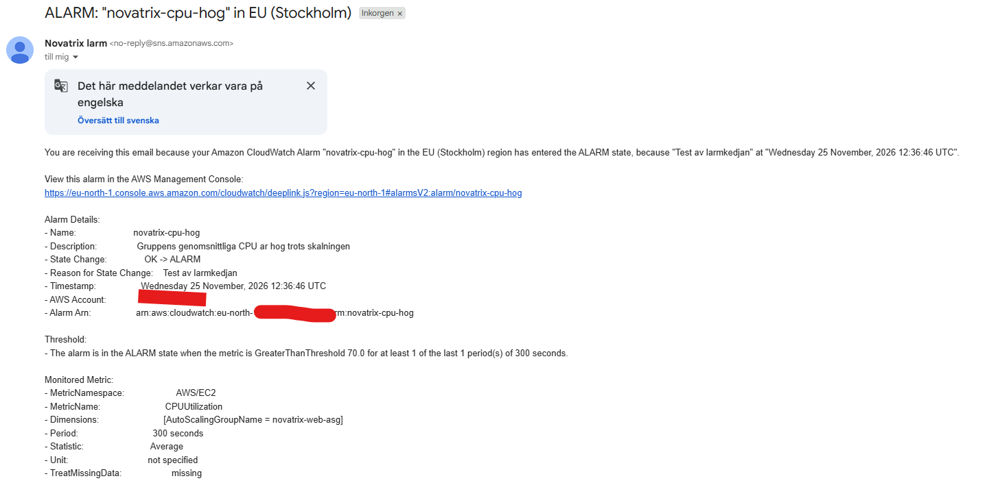

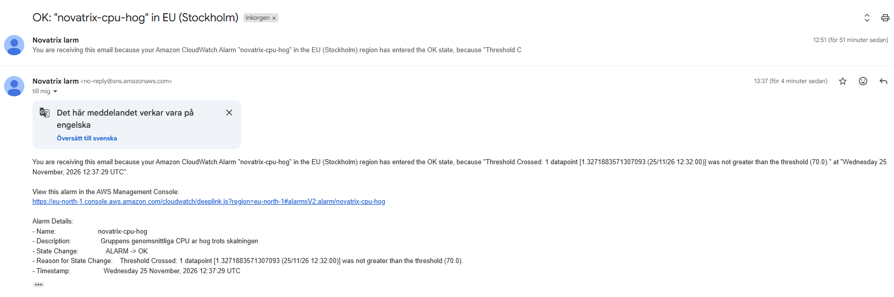

### CPU på riktigt

Med `./load-test.sh start` belastas alla servrar till 100 %. Gruppen skalade från 2 till
4 servrar. När alla fyra belastades och gruppen inte kunde växa mer gick CPU-snittet
över 70 %, och `novatrix-cpu-hog` larmade. Det är precis den situation larmet är till för.

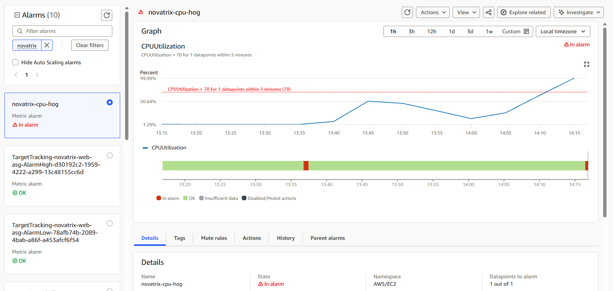

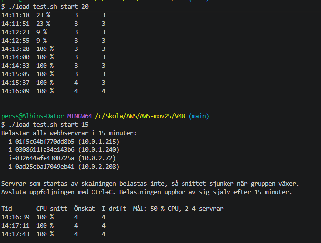

### Minne

Minneslarmet byggde först på `mem_used_percent` > 85 %, som i lärarens exempel. Testet
visade att det inte fungerar på en t3.micro med 1 GB minne. Linux stoppade testprocessen
med OOM killer när minnet tog slut, medan `mem_used_percent` stannade runt 75 % och
larmet stod kvar på OK.

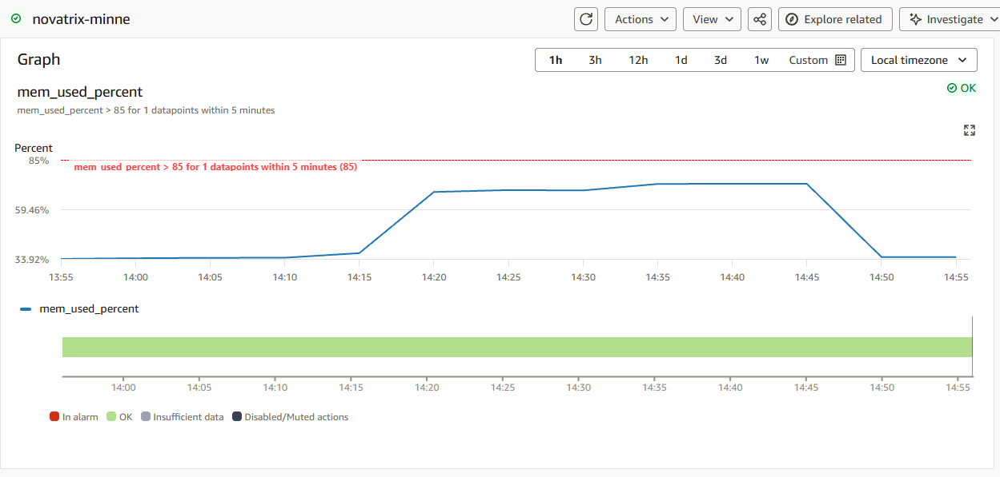

Förklaringen är hur måttet räknas. Agenten räknar all cache som ledigt minne, men på en
liten server är en stor del av cachen programkod som körs och delat minne, som inte går
att frigöra. Larmet bygger därför nu på `mem_available_percent`, det Linux själv bedömer
som tillgängligt, och går när det är under 10 %. Med det måttet larmade testet utan att
servern fick slut på minne.

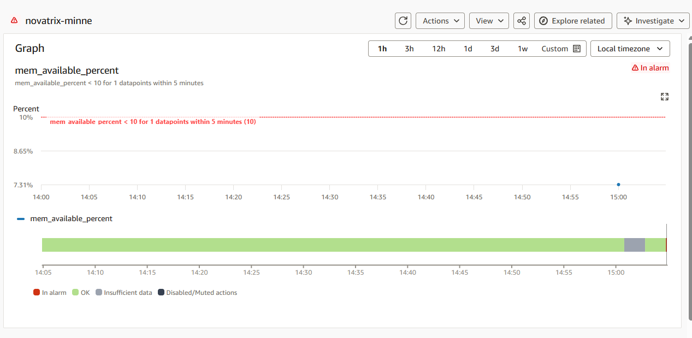

### Disk och sjuk server

`./stress-test.sh disk` fyller disken till cirka 90 % med en testfil, och `novatrix-disk`
larmar.

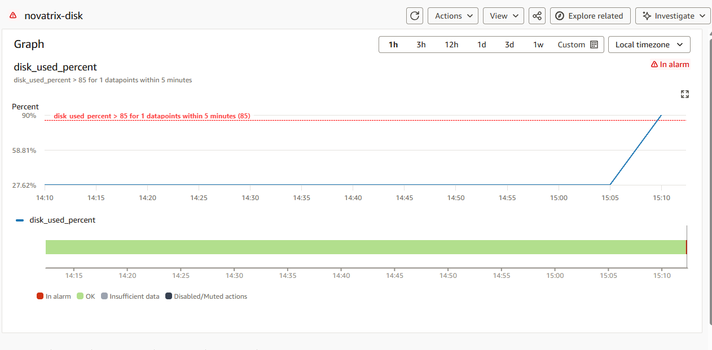

`./stress-test.sh unhealthy` tar bort hälsokontrollsidan på en server, så att den svarar
404. Gruppens egen hälsokontroll pausas under testet, annars byter Auto Scaling ut servern
innan larmet hinner se tre sjuka minuter i rad. Sajten fungerade hela tiden, eftersom
lastbalanseraren bara skickade trafik till de friska servrarna.

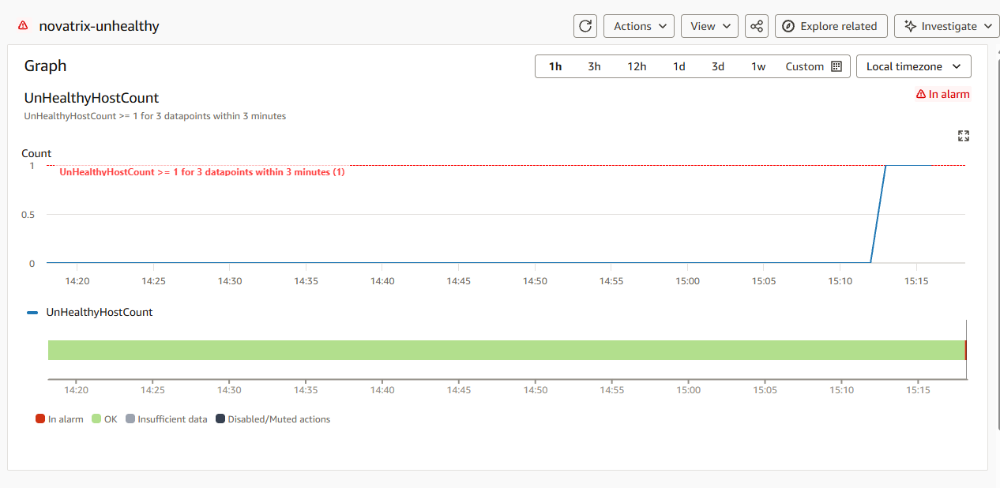

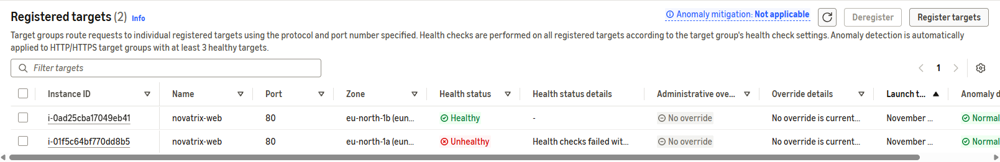

## Central loggning

Agenten skickar loggfilerna från alla servrar till CloudWatch Logs:

| Loggrupp | Innehåll |
|----------|----------|
| `/novatrix/httpd/access` | Alla förfrågningar till Apache |
| `/novatrix/httpd/error` | Fel från Apache och PHP |
| `/novatrix/backup` | Den nattliga backupens utskrift |
| `/aws/lambda/novatrix-sajtkoll` | Sajtkollens resultat |

- **Lagringstiden är 14 dagar**, satt med `RetentionInDays` i templaten. Utan den sparas
  loggarna för alltid och kostar för alltid.
- **Loggrupperna skapas före servrarna.** Launch templaten har `DependsOn` på
  loggrupperna. Annars hinner agenten skapa dem själv, utan lagringstid.
- **En loggström per server**, med serverns instans-ID som namn. Loggarna finns kvar när
  Auto Scaling har tagit bort servern.

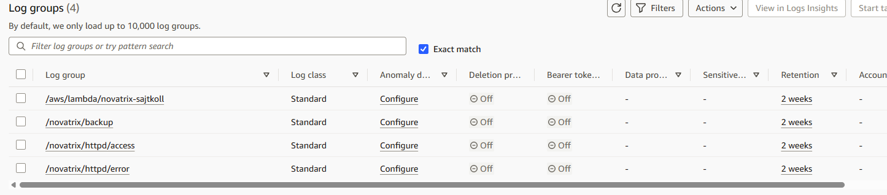

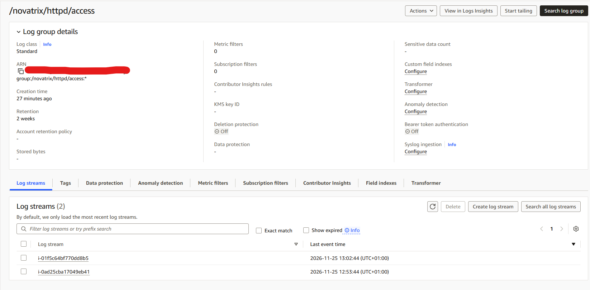

### Sökning med Logs Insights

Fyra sökningar är sparade som kod i mappen `novatrix`: statuskoder per server, felsidor
(4xx och 5xx), fel från Apache och backuphistorik. Sökningarna går över alla servrars
loggar på en gång.

Efter 20 anrop till sidor som inte finns visar `statuskoder-per-server` att 404-svaren
fördelades på båda servrarna. Lastbalanseraren skickade dem till olika servrar, och
sökningen hittar dem ändå på ett ställe.

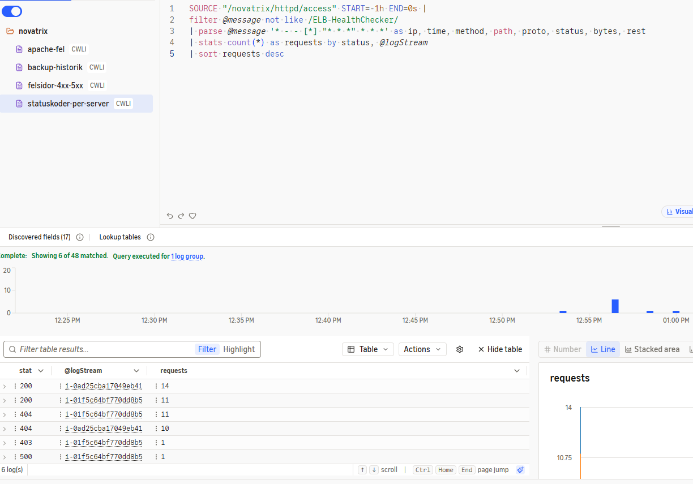

`felsidor-4xx-5xx` visar varje fel med tid, sida och server. Där syns också ett enstaka
serverfel (500) på startsidan, kvart i ett, innan WordPress var installerat. Felet gick att
spåra i efterhand utan att logga in på någon server.

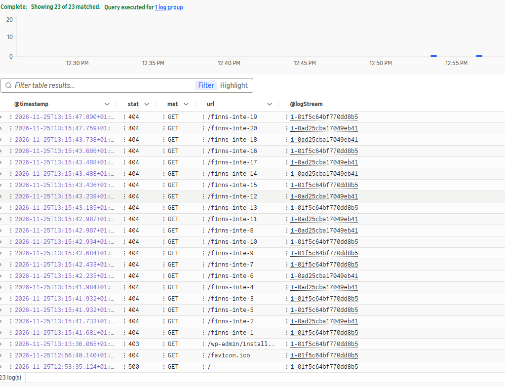

## Dashboard

`novatrix-drift` är en dashboard i CloudWatch som svarar på frågan "Mår Novatrix bra just
nu?". Larmens status står överst och detaljerna under: CPU, minne och disk, antal friska
och sjuka servrar, förfrågningar och fel, svarstider, databasen och en loggsökning med
statuskoder per server. Den skapas med `AWS::CloudWatch::Dashboard` i templaten och
kommer tillbaka likadan när miljön byggs igen.

Bilden visar de senaste tre timmarna, där alla tester syns: CPU-toppen och skalningen
till fyra servrar, minnes- och disktesterna och den sjuka servern. Alla larm är gröna
igen efter testerna.

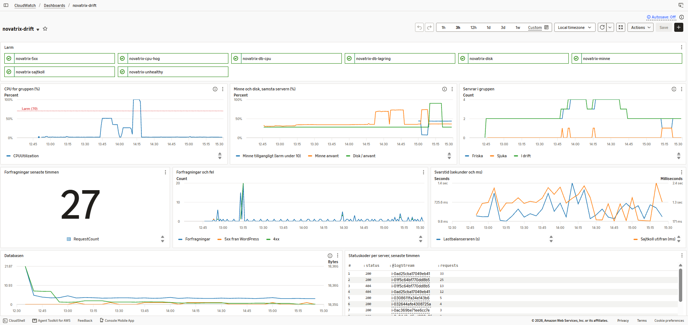

## Cloud native

### Vad cloud native betyder för Novatrix

Cloud native betyder att lösningen är byggd för molnet och inte bara flyttad dit. Den
består av små delar som kan bytas ut, skalas och startas om automatiskt, och AWS sköter
så mycket som möjligt av driften. Det finns tre nivåer:

| Nivå | Tjänst | Vad Novatrix sköter själv |
|------|--------|---------------------------|
| Virtuell server | EC2 | Operativsystem, uppdateringar, installation |
| Container | ECS på Fargate | Avbilden med applikationen |
| Serverless | Lambda | Bara koden |

Ju högre nivå, desto mindre att sköta, snabbare start och finare skalning, men också
mindre kontroll.

### Strategi i steg

**Steg 0, redan gjort.** Novatrix har redan lämnat mycket till AWS: RDS i stället för en
egen databasserver, EFS i stället för filer på servern, Secrets Manager för lösenorden,
en lastbalanserare och Auto Scaling för skalning och självläkning.

**Steg 1, gjort den här veckan: små jobb som Lambda.** Sajtkollen körs som Lambda.

**Steg 2, nästa steg: WordPress som container på Fargate.** Beskrivs nedan.

**Steg 3, senare: mer som händelser.** Till exempel bildbehandling när en bild laddas upp
till S3, och den nattliga backupen som en Lambda-funktion med schema i stället för cron
på servrarna.

### Steg 1: novatrix-sajtkoll (körs)

Alla andra mätvärden kommer inifrån lösningen. Servrarna kan rapportera låg CPU och
lastbalanseraren friska servrar, samtidigt som besökarna får en felsida, till exempel om
WordPress inte når databasen men hälsokontrollsidan fortfarande svarar. Sajtkollen mäter
det som faktiskt spelar roll: om en besökare kommer fram.

- EventBridge-regeln `novatrix-sajtkoll-schema` startar funktionen var 5:e minut.
- Funktionen, några rader Python, hämtar startsidan via lastbalanseraren och skickar två
  mätvärden till `Novatrix/SiteCheck`: **Available** (1 om svaret är 200, annars 0) och
  **ResponseTimeMs**.
- Rollen får bara skriva sin egen logg och skicka mätvärden till just den namnrymden.
- Larmet `novatrix-sajtkoll` går om sajten inte svarar två gånger i rad, eller om
  kontrollen slutar rapportera.

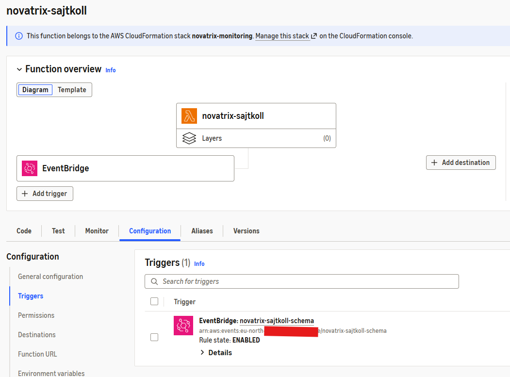

Ett test i konsolen visar svaret 200 och svarstiden. En körning tar under två sekunder
med 128 MB minne. Det blir cirka 8 600 körningar i månaden, vilket ryms gott i Lambdas
gratisnivå.

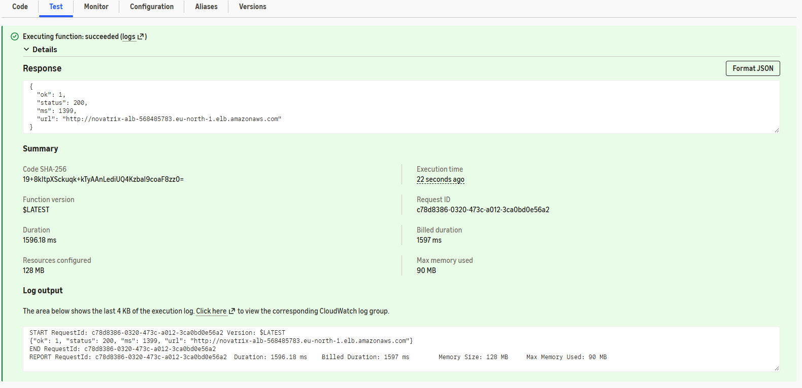

Grafen visar att sajten var tillgänglig hela tiden (Available = 1 på högeraxeln). Den
visar också att svarstiden steg till 1–2 sekunder under lasttesterna och sjönk till runt
200 ms efteråt. Sajten levde hela tiden, men den mådde inte alltid bra.

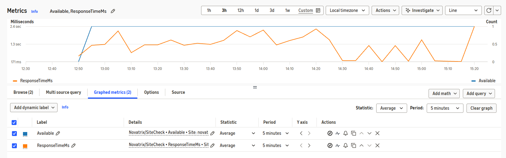

**Varför serverless passar här:** jobbet är kort och körs sällan. En egen server skulle
stå oanvänd nästan hela tiden. Funktionen har inget operativsystem att uppdatera och är
oberoende av webbservrarna, så den fortsätter larma även om alla servrar är borta.

### Steg 2: webbservrarna till ECS på Fargate (strategi)

**Vilken del och varför.** Det är webbservrarna som kräver mest drift i dag. Varje server
installeras från grunden med user data (paket, WordPress, agent och konfiguration), vilket
tar upp till 10 minuter. Den måste uppdateras, nås via bastion och SSH och övervakas
inifrån med en agent. Databasen och filerna ligger redan i hanterade tjänster.

**Varför container och inte serverless.** WordPress är en befintlig PHP-applikation som
körs hela tiden och tar emot trafik. Den passar inte i Lambda, som är byggt för korta
funktioner. En container kör applikationen som den är, och läraren beskriver WordPress
som en bra kandidat just för att filerna redan ligger på EFS och databasen i RDS.

**Hur flytten skulle gå till:**

1. **Avbild.** En `Dockerfile` som utgår från en officiell WordPress-avbild med Apache
   och PHP, plus Novatrix inställningar: säkerhetshuvuden, stängd `install.php` och
   `health.html`. Avbilden byggs en gång och lagras i **ECR**.
2. **Task definition.** Avbilden, 0,5 vCPU och 1 GB minne. EFS monteras som volym på
   `wp-content`, som i dag. Databasens lösenord och WordPress-nycklarna hämtas direkt
   från Secrets Manager med `secrets` i task definition, så inget behöver skrivas till
   disk. En egen task-roll med samma rättigheter som webbrollen har i dag.
3. **Service.** En ECS-service på Fargate med 2 tasks i de två zonerna, bakom samma
   lastbalanserare. Target group byter typ från `instance` till `ip`.
4. **Skalning.** Service Auto Scaling med target tracking på CPU, som i dag, men med
   tasks i stället för servrar.
5. **Övervakning.** Loggarna går direkt till CloudWatch Logs med loggdrivern `awslogs`,
   utan agent. CPU och minne per task och service kommer från **Container Insights**. Det
   ersätter agenten, och larmen flyttas till service-nivå. Sajtkollen, dashboarden och
   larmen på lastbalanseraren och databasen är oförändrade.
6. **Driftsättning.** Ny version = ny avbild. ECS byter tasks en i taget, på samma sätt
   som den rullande uppdateringen i v47.

**Vad som försvinner:** launch template, Auto Scaling-grupp för servrar, user data,
CloudWatch-agenten, bastion, SSH-nyckeln och SSH-reglerna i nätverket, samt patchning
av operativsystemet.

**Vad det ger:**

| | Fördelar | Nackdelar |
|---|---|---|
| **Skalbarhet** | En container startar på sekunder i stället för cirka 10 minuter. Skalningen hinner med snabba toppar | Begränsad av samma databas. RDS skalar inte med containrarna |
| **Kostnad** | Betalar per vCPU och GB minne per sekund. Mindre tid går åt till drift | Fargate är inte alltid billigare än EC2. Med en jämn last dygnet runt kostar 2 tasks ungefär som 2 små servrar, eller något mer |
| **Drift** | Inga servrar att patcha, ingen bastion. Samma avbild i test och produktion. Ny version = byt avbild, enkelt att rulla tillbaka | Nytt att lära sig: Docker, ECR, task definitions. Felsökning sker i loggarna i stället för på servern |

**Mitt val:** Novatrix bör ta steg 2 för webbservrarna. Den största vinsten är inte
kostnaden, utan att driften blir enklare och säkrare, och att skalningen blir snabb nog
för verkliga toppar. Riskerna är små eftersom data redan ligger i RDS och EFS, så
flytten berör bara webbnivån och kan göras med samma lastbalanserare. Det går att köra
de gamla servrarna och de nya containrarna parallellt bakom lastbalanseraren och flytta
trafiken stegvis.

## Varför central monitorering är väsentlig

I en skalbar miljö är servrarna tillfälliga. Auto Scaling startar och avslutar dem
själv, utan att någon gör något, när lasten ändras eller när en server kraschar. Då
fungerar det inte längre att logga in på en server och titta. Man vet inte vilken
server man ska titta på, och den man letar efter finns kanske inte längre. Loggarna
försvinner med servern om de bara ligger på dess disk.

Därför måste mätvärden och loggar samlas på ett ställe utanför servrarna:

- **CPU** visar om lasten är för hög. Det är också samma mätvärde som skalningen
  bygger på.
- **Minne** visar om servern är på väg att få slut, vilket gör att Linux börjar döda
  processer. Det märks inte på CPU:n, som testet visade.
- **Disk** visar om servern snart inte kan skriva loggar, uppdateringar eller filer.
- **Loggar** förklarar vad som hände, även på en server som redan har ersatts, och de
  går att söka i från alla servrar på en gång.

Mätvärdena berättar hur systemet mår, loggarna vad som hände, larmen när något är fel,
och dashboarden visar helheten. Larmen ersätter någon som tittar hela tiden, och de
tittar på gruppen eftersom servrarna byts ut. Ju mer som sker automatiskt, desto
viktigare är det att kunna se vad som händer.

## Verifiering och rivning

`./verify.sh` kör 47 tester: de 33 från v47, en för den nya stacken och 13 för
övervakningen. De kontrollerar bland annat att agenten körs på alla servrar, att minne
och disk kommer in för gruppen, att varje server har en loggström, att alla loggrupper
har 14 dagars lagring, att alla 8 larm skickar till `novatrix-larm`, att prenumerationen
är bekräftad, att dashboarden finns och att sajtkollen når sajten.

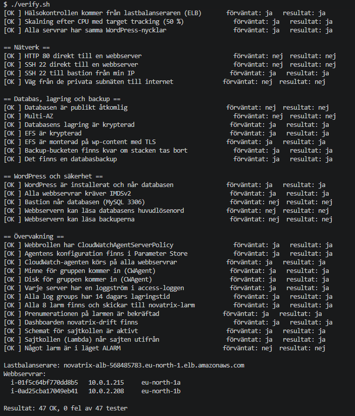

`./destroy.sh` tar en sista backup och river sedan stackarna i omvänd ordning,
`novatrix-monitoring` först. Kvar finns bara backup-stacken med bucketen. Larmen,
loggrupperna, SNS-ämnet, dashboarden och Lambda-funktionen försvann med stackarna,
eftersom allt var kod.

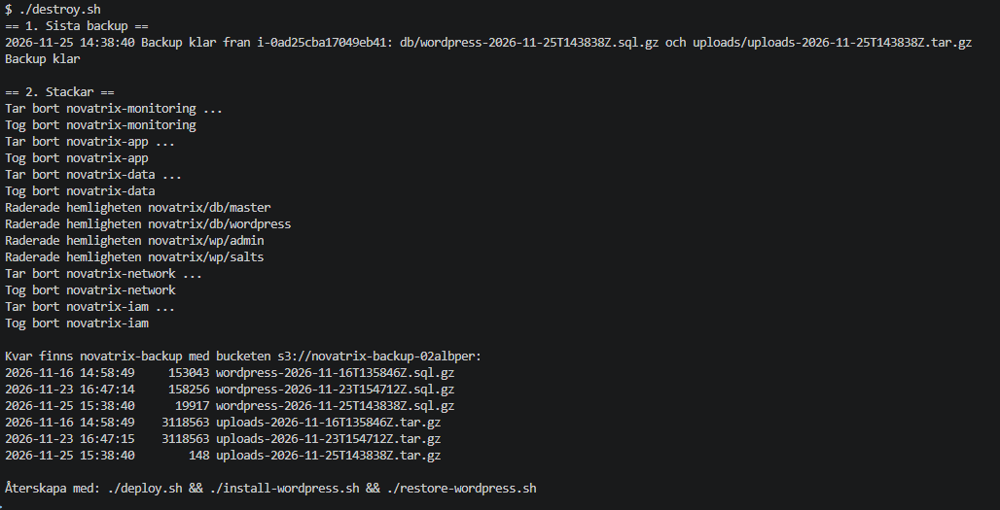

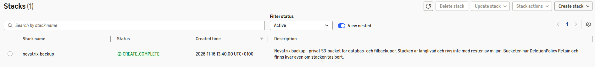

## Kostnad

Övervakningen kostar lite jämfört med servrarna och databasen:

- **Larm:** de första 10 larmen ingår i gratisnivån, och vi har 8 egna.
- **Egna mätvärden:** varje mätvärde från agenten och sajtkollen räknas per månad. Med 2
  servrar blir det cirka 11, med 4 servrar cirka 17, och de första 10 ingår. Varje
  mätvärde utöver det kostar några tiondels dollar i månaden. Därför skickar agenten
  bara de mätvärden som behövs.
- **Loggar:** kostar per GB som skickas in, lagras och söks. Med 14 dagars lagring och
  en liten sajt blir det mycket små mängder.
- **Dashboard:** de första tre ingår.
- **Lambda, EventBridge och SNS:** ryms i gratisnivån.

Kostnaden för resten av miljön är densamma som i v47.

## Lärdomar och förbättringar

**Under arbetet:**

- **Ett mätvärde är bara så bra som definitionen bakom det.** `mem_used_percent` larmade
  aldrig, trots att servern fick slut på minne. Testet på riktigt avslöjade det, och
  larmet bygger nu på `mem_available_percent`.
- **Larm och skalning måste passa ihop.** Ett vanligt lasttest gav inte CPU-larm, eftersom
  skalningen lade till servrar och sänkte snittet. Det var avsikten: larmet ska bara gå
  när skalningen inte räcker.
- **Övervakningen hittade ett fel i ett testverktyg.** `load-test.sh` från v47 belastade
  bara den första servern, eftersom SSH läste upp listan över de andra servrarna. CPU:n
  i grafen var 25 % med fyra servrar, vilket avslöjade felet. Det är rättat med
  `< /dev/null`.
- **Logs Insights tillåter inte att ett fält skapas två gånger.** En sparad sökning
  använde `fields` efter `parse`. Den är ändrad till `display`.

**Förbättringar:**

- **Engelska namn** på dashboard, larm och sökningar. De delas ofta med fler personer
  och verktyg, och då uppstår inga problem med å, ä och ö. Rubrikerna i dashboarden
  saknar nu de svenska tecknen.
- **Fler kanaler för larmen**, till exempel sms eller en chatt för den som har jour, som
  nya prenumerationer på samma SNS-ämne.
- **Container Insights och Fargate** enligt steg 2 i strategin.
- **Multi-AZ för databasen**, så att även databasen klarar ett avbrott i en zon.

## Git-historik

```
0872a17 Minneslarmet larmar på tillgängligt minne: mem_used_percent når inte 85 % före OOM
ec20a14 Rätta load-test: belasta alla servrar, inte bara den första
e7dd27a V48: CloudWatch-agent, loggar, larm, dashboard och Lambda-sajtkoll
```